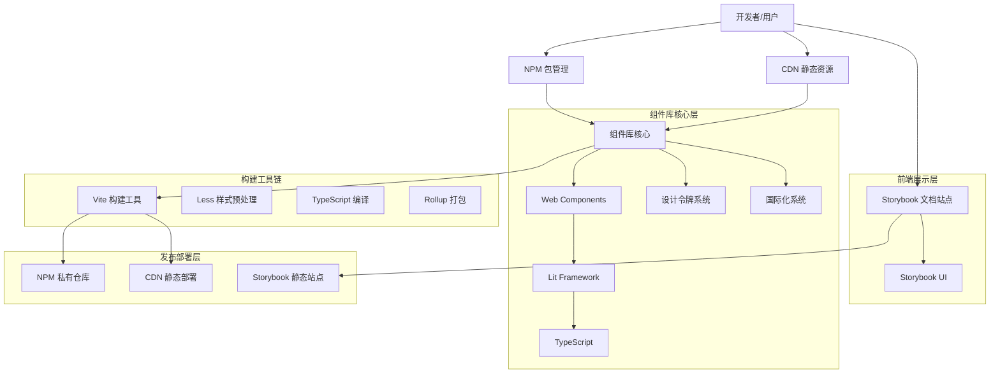
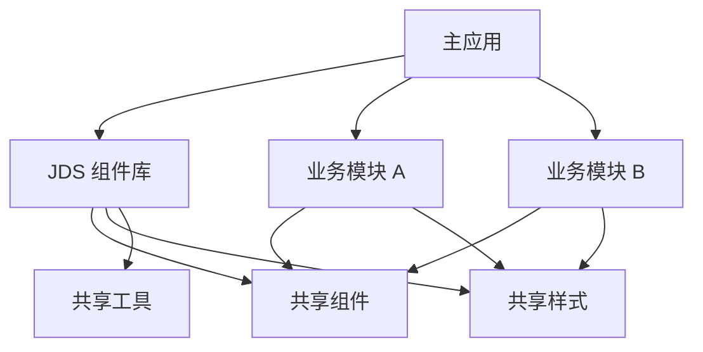
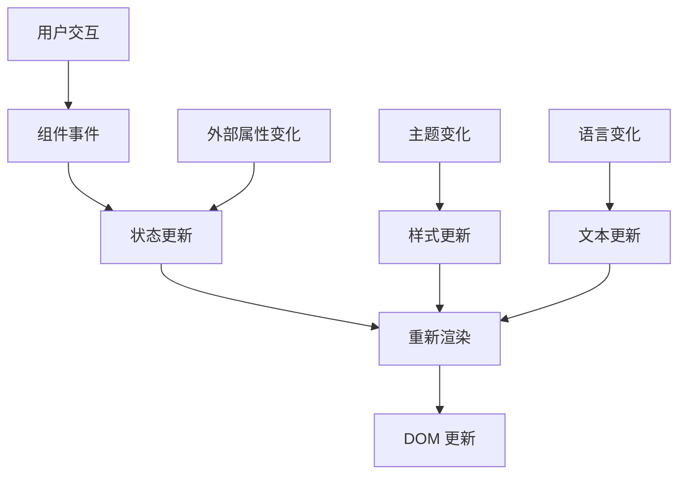
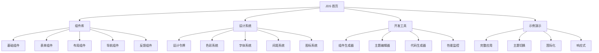
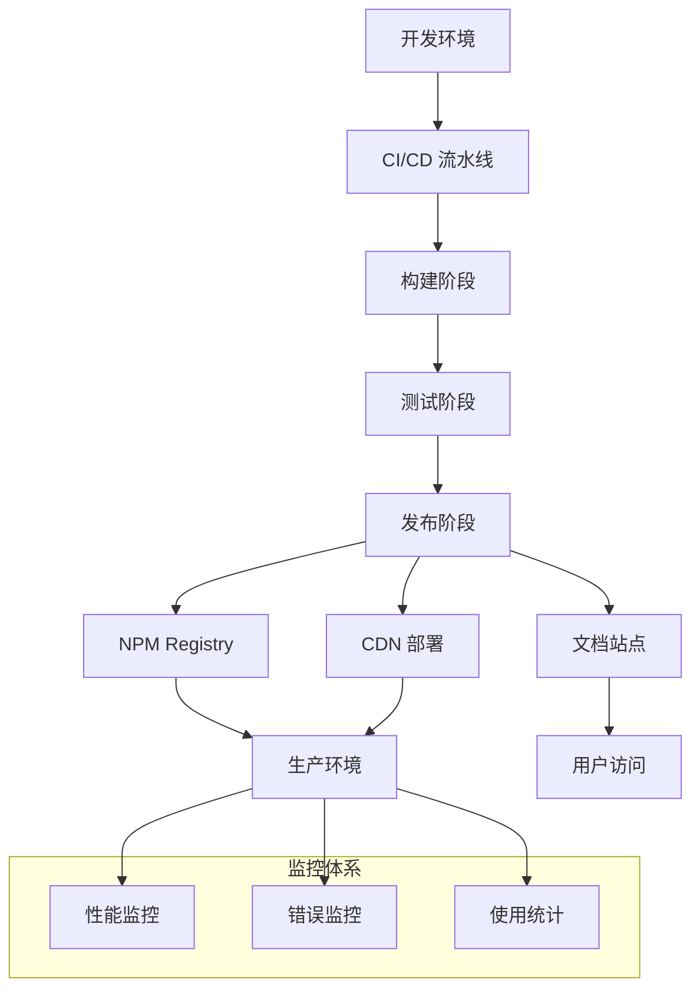

# Jackery Design System 技术架构文档
> 文档日期：2025-11-18\
> 适用范围：Jackery Design System（JDS）技术架构\
> 文档类型：技术架构

***

## 1. 架构设计

### 1.1 整体架构图



### 1.2 分层架构设计

#### 表现层 (Presentation Layer)

* **Storybook 文档站点**：组件展示、API 文档、交互演示

* **示例应用**：真实使用场景演示

* **开发调试工具**：组件开发和调试界面

#### 组件层 (Component Layer)

* **基础组件**：Button、Badge、Dialog 等原子级组件

* **复合组件**：表单、导航、数据展示等复合组件

* **布局组件**：Grid、Container、Layout 等布局组件

#### 服务层 (Service Layer)

* **主题服务**：主题切换、样式变量管理

* **国际化服务**：多语言支持、本地化处理

* **事件服务**：组件间通信、事件管理

#### 基础设施层 (Infrastructure Layer)

* **Web Components 标准**：跨框架兼容性

* **Lit 响应式系统**：状态管理、生命周期

* **TypeScript 类型系统**：类型安全、开发体验

### 1.4 架构更新要点（2025-11）

* 全局样式唯一来源 `src/styles/index.less`，移除 `@jackery/core` 入口的全局样式注入。

* 组件样式以内联方式注入（`index.less?inline`），仅使用 `var(--jds-...)` 引用全局 CSS 变量。

* 新增 Vite 别名 `@styles` 指向 `src/styles`，统一跨包引用路径。

* `packages/core/src/styles` 不再作为页面样式入口，仅保留组件开发所需的局部 Less 资源。

* 库构建模式：`pnpm run design:build:lib` 产出 `dist/index.esm.js`、`dist/index.cjs`、类型声明与聚合样式 `dist/index.css`。

* 类型声明打包：`pnpm run types:bundle`（Rollup DTS），统一生成顶层类型文件（`dist/jds.d.ts`）。

* Storybook 独立构建与部署，类型生成显式排除 `**/.storybook/**` 与 `apps/**`，避免混入库发布产物。

* 新增主题版本化构建：`pnpm run design:build:themes` 产出 `dist/index.css`（v1）与 `dist/index-v2.css`（v2）。目录结构分离为 `src/styles/themes/v1|v2`；公共 mixin 与基础变量在 `src/styles/jds/tokens.base.less`。

* 国际化自动初始化与 DOM 扫描：根包入口与 `@jackery/i18n` 入口自动执行 `initialize()` 与 `initI18nDom()`，引入后挂载 `window.i18n` 并开启 `MutationObserver` 扫描 `data-i18n-key` 与模板字符串 `${window.i18n.t(...)}`，语言切换触发重新扫描与更新。

* 字体与 tokens 归档至版本目录：`themes/v1|v2/font.css`、`themes/v1|v2/tokens.less`；默认入口 `src/styles/index.less` 指向 v1。

* 并存方案（文件驱动 + 属性驱动）：`src/styles/themes/switch.less` 产出 `dist/themes-switch.css`。文件驱动通过引入 `index.css/index-v2.css` 选择版本；属性驱动通过设置 `data-jds-theme-version="v2"` 运行时切换变量与字体。
* 站点静态目录：主题构建允许 `publicDir: true`，站点资源可随构建进入 `dist` 以便预览；发布阶段通过包 `files` 白名单限制发布内容，仅包含库 JS/CSS/类型与必要资产，不含 `public/**`、Storybook 或预览文件。

### 1.3 微前端架构考虑



## 2. 技术选型与对比分析

### 2.1 核心技术栈

| 技术             | 版本      | 选择理由           | 替代方案                      | 备注                                   |
| -------------- | ------- | -------------- | ------------------------- | ------------------------------------ |
| **Lit**        | 3.x     | 轻量级、标准化、性能优秀   | Stencil、原生 Web Components | 实际使用 3.0.0 - 3.2.1                   |
| **TypeScript** | 5.8.3   | 类型安全、开发体验、生态完善 | JavaScript、Flow           | 根目录 \~5.8.3，子包 ^5.0.0                |
| **Vite**       | 5.x/7.x | 快速构建、HMR、现代化   | Webpack、Rollup、Parcel     | 根目录 7.2.1，子包 5.x                     |
| **Less**       | 4.4.2   | 成熟稳定、功能丰富、团队熟悉 | Sass、Stylus、CSS-in-JS     | packages/core 组件内联样式；全局入口 src/styles |
| **Storybook**  | 8.4.5   | 组件文档、测试、生态完善   | Docusaurus、自建文档           | packages/icons 使用                    |

### 2.2 技术选型对比分析

#### Web Components 框架对比

| 框架          | 优势         | 劣势    | 适用场景   |
| ----------- | ---------- | ----- | ------ |
| **Lit**     | 轻量、标准、生态好  | 相对较新  | 企业级组件库 |
| **Stencil** | 编译优化、多框架输出 | 学习成本高 | 跨框架组件库 |
| **原生**      | 无依赖、标准化    | 开发效率低 | 简单组件   |

#### 构建工具对比

| 工具          | 构建速度 | 配置复杂度 | 生态支持 | 选择理由    |
| ----------- | ---- | ----- | ---- | ------- |
| **Vite**    | 极快   | 简单    | 优秀   | 开发体验最佳  |
| **Webpack** | 中等   | 复杂    | 最完善  | 配置复杂    |
| **Rollup**  | 快    | 中等    | 良好   | 主要用于库打包 |

### 2.3 架构决策记录 (ADR)

#### ADR-001: 选择 Web Components 作为组件标准

* **状态**: 已采用

* **决策**: 使用 Web Components 标准构建组件库

* **理由**: 跨框架兼容、标准化、未来趋势

* **后果**: 需要考虑兼容性，学习成本相对较高

#### ADR-002: 选择 Lit 作为开发框架

* **状态**: 已采用

* **决策**: 使用 Lit 框架开发 Web Components

* **理由**: 轻量级、性能优秀、Google 支持

* **后果**: 相对较新的技术，社区资源有限

#### ADR-003: 选择 TypeScript 作为开发语言

* **状态**: 已采用

* **决策**: 全面使用 TypeScript 开发

* **理由**: 类型安全、开发体验、维护性

* **后果**: 增加编译步骤，学习成本

#### ADR-004: 样式统一与别名策略

* **状态**: 已采用

* **决策**: 使用 `src/styles/index.less` 作为全局样式唯一入口，组件内样式通过 `index.less?inline` 注入；添加 Vite 别名 `@styles` 指向 `src/styles`。

* **理由**: 避免重复样式源导致冲突，提升样式管理一致性与可维护性。

* **后果**: 组件不得直接引入全局 Less 文件，需通过 CSS 变量消费；核心包不再自动注入任何页面级样式。

## 3. 详细系统设计

### 3.1 组件设计模式

#### 组件基类设计

```typescript
// 基础组件抽象类
abstract class JDSElement extends LitElement {
  // 通用属性
  @property({ type: String }) size: ComponentSize = 'medium';
  @property({ type: String }) variant: ComponentVariant = 'default';
  @property({ type: Boolean }) disabled = false;
  
  // 国际化控制器
  private i18n = new I18nController(this);
  
  // 主题控制器
  private theme = new ThemeController(this);
  
  // 通用方法
  protected t(key: string, params?: Record<string, any>): string {
    return this.i18n.t(key, params);
  }
  
  // 样式混入
  static styles = [
    commonStyles,
    componentStyles
  ];
}
```

#### 组件状态管理

```typescript
// 状态管理接口
interface ComponentState {
  loading: boolean;
  error: string | null;
  data: any;
}

// 状态管理 Mixin
export const StateMixin = <T extends Constructor<LitElement>>(superClass: T) => {
  class StateClass extends superClass {
    @state() private _state: ComponentState = {
      loading: false,
      error: null,
      data: null
    };
    
    protected setState(newState: Partial<ComponentState>) {
      this._state = { ...this._state, ...newState };
      this.requestUpdate();
    }
    
    protected getState(): ComponentState {
      return this._state;
    }
  }
  return StateClass;
};
```

### 3.2 数据流设计



### 3.3 事件系统设计

```typescript
// 事件类型定义
interface JDSEventMap {
  'jds-button-click': CustomEvent<{ value: string }>;
  'jds-dialog-open': CustomEvent<{ dialog: HTMLElement }>;
  'jds-dialog-close': CustomEvent<{ dialog: HTMLElement }>;
  'jds-theme-change': CustomEvent<{ theme: string }>;
  'jds-language-change': CustomEvent<{ language: string }>;
}

// 事件发射器
class EventEmitter {
  static emit<K extends keyof JDSEventMap>(
    element: HTMLElement,
    type: K,
    detail: JDSEventMap[K]['detail']
  ) {
    const event = new CustomEvent(type, {
      detail,
      bubbles: true,
      composed: true
    });
    element.dispatchEvent(event);
  }
}
```

## 4. 路由与导航设计

### 4.1 应用路由定义

| 路由                                | 组件                  | 用途       | 权限  |
| --------------------------------- | ------------------- | -------- | --- |
| `/`                               | HomePage            | 开发调试中心首页 | 公开  |
| `/storybook`                      | StorybookApp        | 组件文档站点   | 公开  |
| `/examples/components/:component` | ComponentExample    | 组件示例页面   | 公开  |
| `/examples/styles`                | StyleExample        | 样式系统演示   | 公开  |
| `/examples/i18n`                  | I18nExample         | 国际化演示    | 公开  |
| `/examples/themes`                | ThemeExample        | 主题系统演示   | 公开  |
| `/playground`                     | ComponentPlayground | 组件调试工具   | 开发者 |

### 4.2 导航结构设计



## 5. API 设计规范

### 5.1 组件 API 设计原则

#### 一致性原则

* **属性命名**：使用一致的命名约定 (camelCase)

* **事件命名**：使用 `jds-` 前缀，动词-名词格式

* **方法命名**：使用动词开头，语义明确

#### 可扩展性原则

* **插槽设计**：提供灵活的内容插槽

* **样式定制**：支持 CSS 自定义属性

* **事件扩展**：支持自定义事件监听

### 5.2 核心组件 API 详细设计

#### 按钮组件 (jds-button)

```typescript
interface ButtonProps {
  // 基础属性
  variant: 'primary' | 'secondary' | 'outline' | 'text' | 'link';
  kind: 'default' | 'neutral' | 'success' | 'warning' | 'danger' | 'custom';
  size: 'small' | 'medium' | 'large' | 'extra';
  
  // 状态属性
  loading: boolean;
  disabled: boolean;
  
  // 链接属性
  href?: string;
  target?: '_blank' | '_parent' | '_self' | '_top';
  download?: string;
  
  // 内容属性
  icon?: string;
  iconPosition?: 'start' | 'end';
  label?: string;
  
  // 样式属性
  block?: boolean;
  round?: boolean;
  
  // 事件
  onClick?: (event: MouseEvent) => void;
}

// 使用示例
<jds-button
  variant="primary"
  size="medium"
  icon="plus"
  @click=${this.handleClick}
>
  添加项目
</jds-button>
```

#### 对话框组件 (jds-dialog)

```typescript
interface DialogProps {
  // 显示控制
  open: boolean;
  modal?: boolean;
  
  // 尺寸样式
  size: 'small' | 'medium' | 'large' | 'extra' | 'fullscreen';
  width?: string;
  height?: string;
  
  // 内容属性
  title?: string;
  caption?: string;
  
  // 行为属性
  closable?: boolean;
  maskClosable?: boolean;
  escClosable?: boolean;
  
  // 样式属性
  centered?: boolean;
  critical?: boolean;
  
  // 事件
  onOpen?: () => void;
  onClose?: () => void;
  onCancel?: () => void;
  onConfirm?: () => void;
}
```

#### 表单组件 API 设计

```typescript
// 输入框组件
interface InputProps {
  // 基础属性
  type: 'text' | 'password' | 'email' | 'number' | 'tel' | 'url';
  value: string;
  placeholder?: string;
  
  // 验证属性
  required?: boolean;
  pattern?: string;
  minLength?: number;
  maxLength?: number;
  min?: number;
  max?: number;
  
  // 状态属性
  disabled?: boolean;
  readonly?: boolean;
  loading?: boolean;
  
  // 样式属性
  size: 'small' | 'medium' | 'large';
  variant: 'default' | 'filled' | 'outlined';
  
  // 辅助元素
  prefix?: string;
  suffix?: string;
  addonBefore?: string;
  addonAfter?: string;
  
  // 事件
  onInput?: (event: InputEvent) => void;
  onChange?: (event: Event) => void;
  onFocus?: (event: FocusEvent) => void;
  onBlur?: (event: FocusEvent) => void;
}
```

### 5.3 国际化 API 详细设计

```typescript
// 语言类型定义
type Language = 'zh-CN' | 'en-US' | 'de-DE' | 'ja-JP';

// 翻译资源结构
interface TranslationResource {
  [key: string]: string | TranslationResource;
}

// 国际化配置
interface I18nConfig {
  defaultLanguage: Language;
  fallbackLanguage: Language;
  resources: Record<Language, TranslationResource>;
  interpolation?: {
    prefix: string;
    suffix: string;
  };
}

// 国际化服务接口
interface I18nService {
  // 初始化
  init(config: I18nConfig): Promise<void>;
  
  // 语言管理
  getCurrentLanguage(): Language;
  setCurrentLanguage(language: Language): Promise<void>;
  getSupportedLanguages(): Language[];
  
  // 翻译功能
  t(key: string, params?: Record<string, any>): string;
  exists(key: string): boolean;
  
  // 资源管理
  addResource(language: Language, namespace: string, resource: TranslationResource): void;
  removeResource(language: Language, namespace: string): void;
  
  // 事件监听
  on(event: 'languageChanged', callback: (language: Language) => void): void;
  off(event: 'languageChanged', callback: (language: Language) => void): void;
}

// 使用示例
const i18n = new I18nService();
await i18n.init({
  defaultLanguage: 'zh-CN',
  fallbackLanguage: 'en-US',
  resources: {
    'zh-CN': {
      common: {
        confirm: '确认',
        cancel: '取消',
        loading: '加载中...'
      }
    },
    'en-US': {
      common: {
        confirm: 'Confirm',
        cancel: 'Cancel',
        loading: 'Loading...'
      }
    }
  }
});
```

### 5.4 主题系统 API 设计

```typescript
// 主题类型定义
interface ThemeConfig {
  name: string;
  displayName: string;
  colors: {
    primary: string;
    secondary: string;
    success: string;
    warning: string;
    danger: string;
    info: string;
    [key: string]: string;
  };
  fonts: {
    family: string;
    sizes: Record<string, string>;
    weights: Record<string, number>;
  };
  spacing: Record<string, string>;
  borderRadius: Record<string, string>;
  shadows: Record<string, string>;
}

// 主题服务接口
interface ThemeService {
  // 主题管理
  registerTheme(theme: ThemeConfig): void;
  unregisterTheme(name: string): void;
  getTheme(name: string): ThemeConfig | null;
  getAllThemes(): ThemeConfig[];
  
  // 当前主题
  getCurrentTheme(): ThemeConfig;
  setCurrentTheme(name: string): void;
  
  // 自定义属性
  setCustomProperty(property: string, value: string): void;
  getCustomProperty(property: string): string;
  
  // 事件监听
  on(event: 'themeChanged', callback: (theme: ThemeConfig) => void): void;
  off(event: 'themeChanged', callback: (theme: ThemeConfig) => void): void;
}
```

## 6. 安全架构设计

### 6.1 安全威胁分析

| 威胁类型    | 风险等级 | 影响范围 | 缓解措施      |
| ------- | ---- | ---- | --------- |
| XSS 攻击  | 高    | 组件渲染 | 输入验证、输出编码 |
| CSRF 攻击 | 中    | 表单提交 | Token 验证  |
| 依赖漏洞    | 高    | 整个系统 | 定期审计、及时更新 |
| 代码注入    | 中    | 动态内容 | 严格验证、沙箱隔离 |

### 6.2 安全实施策略

#### 输入验证与输出编码

```typescript
// 输入验证工具
class InputValidator {
  static validateHTML(input: string): string {
    // 使用 DOMPurify 或类似库清理 HTML
    return DOMPurify.sanitize(input);
  }
  
  static validateURL(url: string): boolean {
    try {
      const parsed = new URL(url);
      return ['http:', 'https:'].includes(parsed.protocol);
    } catch {
      return false;
    }
  }
  
  static escapeHTML(text: string): string {
    const div = document.createElement('div');
    div.textContent = text;
    return div.innerHTML;
  }
}

// 在组件中使用
class JDSButton extends JDSElement {
  @property() label = '';
  
  render() {
    return html`
      <button>
        ${InputValidator.escapeHTML(this.label)}
      </button>
    `;
  }
}
```

#### Content Security Policy (CSP)

```typescript
// CSP 配置
const cspConfig = {
  'default-src': ["'self'"],
  'script-src': ["'self'", "'unsafe-inline'"],
  'style-src': ["'self'", "'unsafe-inline'"],
  'img-src': ["'self'", "data:", "https:"],
  'font-src': ["'self'", "https:"],
  'connect-src': ["'self'"],
  'frame-ancestors': ["'none'"],
  'base-uri': ["'self'"],
  'form-action': ["'self'"]
};
```

### 6.3 依赖安全管理

```json
{
  "scripts": {
    "audit": "npm audit",
    "audit:fix": "npm audit fix",
    "security:check": "snyk test",
    "security:monitor": "snyk monitor"
  },
  "devDependencies": {
    "snyk": "^1.0.0",
    "@types/dompurify": "^3.0.0",
    "dompurify": "^3.0.0"
  }
}
```

## 7. 性能优化策略

### 7.1 性能目标与指标

| 性能指标   | 目标值     | 测量工具            | 优化策略            |
| ------ | ------- | --------------- | --------------- |
| 首屏加载时间 | < 1.5s  | Lighthouse      | 代码分割、懒加载        |
| 组件渲染时间 | < 16ms  | Performance API | 虚拟滚动、批量更新       |
| 包体积大小  | < 100KB | Bundle Analyzer | Tree Shaking、压缩 |
| 内存使用   | < 50MB  | DevTools Memory | 对象池、及时清理        |
| 网络请求数  | < 10 个  | Network Panel   | 资源合并、缓存         |

### 7.2 构建优化策略

#### Vite 构建配置优化

```typescript
// vite.config.ts
export default defineConfig({
  build: {
    // 代码分割
    rollupOptions: {
      output: {
        manualChunks: {
          'lit': ['lit'],
          'icons': ['@jackery/icons'],
          'i18n': ['./src/i18n']
        },
        // icons 包特殊配置：按图标分割
        chunkFileNames: (chunkInfo) => {
          if (chunkInfo.name?.includes('icons/')) {
            return 'icons/[name]-[hash].js';
          }
          return '[name]-[hash].js';
        }
      }
    },
    
    // 压缩配置
    minify: 'terser',
    terserOptions: {
      compress: {
        drop_console: true,
        drop_debugger: true
      }
    },
    
    // 资源内联阈值
    assetsInlineLimit: 4096,
    
    // 生成 sourcemap
    sourcemap: process.env.NODE_ENV === 'development'
  },
  
  // 依赖预构建
  optimizeDeps: {
    include: ['lit', '@lit/reactive-element'],
    exclude: ['@jackery/icons']
  }
});
```

#### Tree Shaking 优化

```typescript
// 确保模块支持 Tree Shaking
export { JDSButton } from './button/button.js';
export { JDSDialog } from './dialog/dialog.js';
export { JDSBadge } from './badge/badge.js';

// 避免副作用导入
export type { ButtonProps } from './button/button.js';
export type { DialogProps } from './dialog/dialog.js';
```

### 7.3 运行时性能优化

#### 组件懒加载

```typescript
// 动态导入组件
class ComponentLoader {
  private static cache = new Map<string, Promise<any>>();
  
  static async load(componentName: string) {
    if (!this.cache.has(componentName)) {
      const promise = import(`./components/${componentName}/${componentName}.js`);
      this.cache.set(componentName, promise);
    }
    return this.cache.get(componentName);
  }
}

// 使用示例
async function loadButton() {
  const { JDSButton } = await ComponentLoader.load('button');
  customElements.define('jds-button', JDSButton);
}
```

#### 虚拟滚动实现

```typescript
class VirtualScroll extends LitElement {
  @property({ type: Array }) items: any[] = [];
  @property({ type: Number }) itemHeight = 50;
  @property({ type: Number }) containerHeight = 300;
  
  @state() private startIndex = 0;
  @state() private endIndex = 0;
  
  private updateVisibleRange() {
    const visibleCount = Math.ceil(this.containerHeight / this.itemHeight);
    this.endIndex = Math.min(this.startIndex + visibleCount, this.items.length);
  }
  
  render() {
    const visibleItems = this.items.slice(this.startIndex, this.endIndex);
    
    return html`
      <div class="virtual-scroll" style="height: ${this.containerHeight}px">
        <div class="scroll-content" style="height: ${this.items.length * this.itemHeight}px">
          ${visibleItems.map((item, index) => html`
            <div class="item" style="top: ${(this.startIndex + index) * this.itemHeight}px">
              ${this.renderItem(item)}
            </div>
          `)}
        </div>
      </div>
    `;
  }
}
```

### 7.4 缓存策略

#### 浏览器缓存配置

```typescript
// Service Worker 缓存策略
const CACHE_NAME = 'jds-v1.0.0';
const STATIC_ASSETS = [
  '/dist/jds.js',
  '/dist/jds.css',
  '/assets/fonts/',
  '/assets/icons/'
];

self.addEventListener('install', (event) => {
  event.waitUntil(
    caches.open(CACHE_NAME)
      .then(cache => cache.addAll(STATIC_ASSETS))
  );
});

self.addEventListener('fetch', (event) => {
  event.respondWith(
    caches.match(event.request)
      .then(response => response || fetch(event.request))
  );
});
```

#### CDN 缓存配置

```nginx
# Nginx 配置
location /dist/ {
    expires 1y;
    add_header Cache-Control "public, immutable";
    add_header Vary "Accept-Encoding";
    
    # 启用 Gzip 压缩
    gzip on;
    gzip_types text/css application/javascript application/json;
}

location /assets/ {
    expires 6M;
    add_header Cache-Control "public";
}
```

## 8. 部署架构与运维

### 8.1 部署架构设计



### 8.2 CI/CD 流水线设计

#### GitHub Actions 配置

```yaml
# .github/workflows/ci.yml
name: CI/CD Pipeline

on:
  push:
    branches: [main, develop]
  pull_request:
    branches: [main]

jobs:
  test:
    runs-on: ubuntu-latest
    steps:
      - uses: actions/checkout@v3
      - uses: actions/setup-node@v3
        with:
          node-version: '18'
          cache: 'npm'
      
      - name: Install dependencies
        run: npm ci
      
      - name: Run linting
        run: npm run lint
      
      - name: Run tests
        run: npm run test:coverage
      
      - name: Security audit
        run: npm audit --audit-level moderate
  
  build:
    needs: test
    runs-on: ubuntu-latest
    steps:
      - uses: actions/checkout@v3
      - uses: actions/setup-node@v3
        with:
          node-version: '18'
          cache: 'npm'
      
      - name: Install dependencies
        run: npm ci
      
      - name: Build library
        run: npm run build
      
      - name: Build Storybook
        run: npm run build-storybook
      
      - name: Upload artifacts
        uses: actions/upload-artifact@v3
        with:
          name: build-files
          path: |
            dist/
            storybook-static/
  
  deploy:
    needs: build
    runs-on: ubuntu-latest
    if: github.ref == 'refs/heads/main'
    steps:
      - name: Deploy to NPM
        run: npm publish
        env:
          NODE_AUTH_TOKEN: ${{ secrets.NPM_TOKEN }}
      
      - name: Deploy to CDN
        run: |
          aws s3 sync dist/ s3://jds-cdn/
          aws cloudfront create-invalidation --distribution-id ${{ secrets.CLOUDFRONT_ID }} --paths "/*"
      
      - name: Deploy Storybook
        run: |
          aws s3 sync storybook-static/ s3://jds-docs/
```

### 8.3 监控与运维

#### 性能监控配置

```typescript
// 性能监控服务
class PerformanceMonitor {
  private static instance: PerformanceMonitor;
  
  static getInstance() {
    if (!this.instance) {
      this.instance = new PerformanceMonitor();
    }
    return this.instance;
  }
  
  // 监控组件渲染性能
  measureComponentRender(componentName: string, renderFn: () => void) {
    const startTime = performance.now();
    renderFn();
    const endTime = performance.now();
    
    this.reportMetric('component.render.time', {
      component: componentName,
      duration: endTime - startTime
    });
  }
  
  // 监控资源加载
  measureResourceLoad() {
    window.addEventListener('load', () => {
      const navigation = performance.getEntriesByType('navigation')[0] as PerformanceNavigationTiming;
      
      this.reportMetric('page.load.time', {
        domContentLoaded: navigation.domContentLoadedEventEnd - navigation.domContentLoadedEventStart,
        loadComplete: navigation.loadEventEnd - navigation.loadEventStart
      });
    });
  }
  
  private reportMetric(name: string, data: any) {
    // 发送到监控服务
    fetch('/api/metrics', {
      method: 'POST',
      headers: { 'Content-Type': 'application/json' },
      body: JSON.stringify({ name, data, timestamp: Date.now() })
    });
  }
}
```

#### 错误监控与日志

```typescript
// 错误监控服务
class ErrorMonitor {
  static init() {
    // 全局错误捕获
    window.addEventListener('error', (event) => {
      this.reportError({
        type: 'javascript',
        message: event.message,
        filename: event.filename,
        lineno: event.lineno,
        colno: event.colno,
        stack: event.error?.stack
      });
    });
    
    // Promise 错误捕获
    window.addEventListener('unhandledrejection', (event) => {
      this.reportError({
        type: 'promise',
        message: event.reason?.message || 'Unhandled Promise Rejection',
        stack: event.reason?.stack
      });
    });
    
    // 组件错误捕获
    this.setupComponentErrorBoundary();
  }
  
  private static reportError(error: any) {
    fetch('/api/errors', {
      method: 'POST',
      headers: { 'Content-Type': 'application/json' },
      body: JSON.stringify({
        ...error,
        userAgent: navigator.userAgent,
        url: window.location.href,
        timestamp: Date.now()
      })
    });
  }
  
  private static setupComponentErrorBoundary() {
    // 为组件添加错误边界
    const originalDefine = customElements.define;
    customElements.define = function(name: string, constructor: any, options?: any) {
      const WrappedConstructor = class extends constructor {
        connectedCallback() {
          try {
            super.connectedCallback?.();
          } catch (error) {
            ErrorMonitor.reportError({
              type: 'component',
              component: name,
              message: error.message,
              stack: error.stack
            });
          }
        }
      };
      
      return originalDefine.call(this, name, WrappedConstructor, options);
    };
  }
}
```

### 8.4 版本管理与发布策略

#### 语义化版本控制

```json
{
  "name": "@jackery/design-system",
  "version": "1.2.3",
  "scripts": {
    "version:patch": "npm version patch",
    "version:minor": "npm version minor", 
    "version:major": "npm version major",
    "release": "npm run build && npm publish",
    "release:beta": "npm run build && npm publish --tag beta"
  }
}
```

#### 发布流程自动化

```bash
#!/bin/bash
# release.sh

set -e

# 检查工作目录是否干净
if [[ -n $(git status --porcelain) ]]; then
  echo "Working directory is not clean. Please commit your changes."
  exit 1
fi

# 运行测试
npm run test

# 构建项目
npm run build

# 更新版本号
npm version $1

# 推送到远程仓库
git push origin main --tags

# 发布到 NPM
npm publish

# 部署文档
npm run deploy:docs

echo "Release completed successfully!"
```

## 9. 扩展性与维护性设计

### 9.4 对齐 Element Plus 的架构设计

* 组件命名与语义：对齐 `el-*` 的语义结构，采用 `jds-*`，统一中横线命名与直观属性含义。

* 包结构层次：

  **当前实际包结构**：

  * `@jackery/core`：基础组件与样式基座（通过 CSS 变量暴露，统一来源 `src/styles`），设计令牌；不在包入口注入全局样式（删除 `import './styles/index.css'`）

  * `@jackery/icons`：图标库，包含 87+ SVG 图标，支持按需导入

  * `@jackery/i18n`：国际化核心、事件、缓存、语言包

  * `@jackery/utils`：通用工具函数（DOM 操作、事件处理、表单控制等）

  **未来规划的理想结构**（可选演进方向）：

  * `@jackery/core`：基础能力层（基类、事件系统、i18n 核心、主题令牌）

  * `@jackery/components`：标准组件集合与索引导出，支持按需导入（从 core 中拆分）

  * `@jackery/icons`：图标与图标组件（保持现状）

  * `@jackery/theme-*`：主题包（默认、暗黑、品牌等，可选独立包）

  * `@jackery/plugins`：扩展能力（滚动条、拖拽等高级功能）

* API 与属性：统一 `size`、`type|variant`、`disabled`、`loading`、`plain`、`round`、`circle`、`icon`、`text`；事件对齐 `change`、`input`、`click`、`focus`、`blur`。

* 插槽/内容投影：约定 `prefix`、`suffix`、`default`；以 `<slot>` 承载复用。

* 主题映射：建立 Element Plus 变量到 JDS 变量的映射（颜色、尺寸、阴影、间距）；提供自动化映射脚本与文档。

* 构建产物：产出 `esm`、`cjs`、`d.ts` 与组件独立样式入口；支持 Tree-Shaking 与按需加载。

* 文档模板：概述 → 示例 → 属性 → 事件 → 插槽 → 样式变量 → 无障碍 → FAQ；示例维度与 Element Plus 对齐。

* 迁移与互操作：可选 Vue 包装层，提供属性/事件/样式变量映射表与脚本，支持灰度迁移。

### 9.5 Monorepo 架构与工程目录（Turborepo + pnpm + Changesets）

* 采用 Turborepo 管线、pnpm workspace 管理包、Changesets 进行版本与发布管理。

* 顶层结构建议：`apps/`（storybook、docs）、`packages/`（core、icons、i18n、utils）、`tooling/`（eslint-config、tsconfig、scripts）、`.changeset/`、`turbo.json`、`pnpm-workspace.yaml`。

* 工作流：

  * 构建：`turbo run build`（按包依赖拓扑执行，产出 `dist/**`）

  * 测试：`turbo run test`（统一 Vitest），覆盖率上报与门禁

  * 规范：`turbo run lint`（共享 ESLint 配置）、`prettier` 格式化

  * 发布：`changeset version` → `changeset publish`（NPM 或私有 Registry）

* 配置示例（节选）：

```yaml
# pnpm-workspace.yaml
packages:
  - 'apps/*'
  - 'packages/*'
  - 'tooling/*'
```

```json
{
  "$schema": "https://turbo.build/schema.json",
  "pipeline": {
    "build": { "dependsOn": ["^build"], "outputs": ["dist/**"], "cache": true },
    "lint": { "outputs": [], "cache": true },
    "test": { "dependsOn": ["^build"], "outputs": ["coverage/**"], "cache": true },
    "dev": { "cache": false }
  }
}
```

```json
{
  "$schema": "https://unpkg.com/@changesets/config@2.3.1/schema.json",
  "changelog": ["@changesets/changelog-github", { "repo": "jackery/design-system" }],
  "commit": false,
  "access": "public",
  "baseBranch": "main",
  "updateInternalDependencies": "patch"
}
```

* 包职责：

  * `@jackery/core (core)`：基础组件与样式基座、设计令牌。

- `@jackery/icons (icons)`：图标集与图标组件导出，包含 87+ SVG 图标，支持按需导入、Tree-shaking、多尺寸和颜色配置。

- `@jackery/i18n (i18n)`：国际化核心、事件、缓存、语言包。

- `@jackery/utils (utils)`：通用工具抽象与跨包共享。

* CI/CD：在 GitHub Actions/Jenkins 上对接 `pnpm install` → `turbo run lint build test` → `changeset version/publish`，配合私服（Nexus）或公有 NPM。

### 9.1 插件系统设计

```typescript
// 插件接口定义
interface JDSPlugin {
  name: string;
  version: string;
  install(jds: JDSCore): void;
  uninstall?(jds: JDSCore): void;
}

// 插件管理器
class PluginManager {
  private plugins = new Map<string, JDSPlugin>();
  
  register(plugin: JDSPlugin) {
    if (this.plugins.has(plugin.name)) {
      throw new Error(`Plugin ${plugin.name} already registered`);
    }
    
    this.plugins.set(plugin.name, plugin);
    plugin.install(JDSCore.getInstance());
  }
  
  unregister(name: string) {
    const plugin = this.plugins.get(name);
    if (plugin) {
      plugin.uninstall?.(JDSCore.getInstance());
      this.plugins.delete(name);
    }
  }
  
  getPlugin(name: string): JDSPlugin | undefined {
    return this.plugins.get(name);
  }
}

// 示例插件：表单验证
class FormValidationPlugin implements JDSPlugin {
  name = 'form-validation';
  version = '1.0.0';
  
  install(jds: JDSCore) {
    // 扩展表单组件功能
    jds.extendComponent('jds-input', {
      validate: this.validateInput.bind(this)
    });
  }
  
  private validateInput(value: string, rules: ValidationRule[]) {
    // 验证逻辑
  }
}
```

### 9.2 代码质量保证

#### ESLint 配置

```json
{
  "extends": [
    "@typescript-eslint/recommended",
    "prettier"
  ],
  "rules": {
    "@typescript-eslint/no-unused-vars": "error",
    "@typescript-eslint/explicit-function-return-type": "warn",
    "prefer-const": "error",
    "no-var": "error"
  },
  "overrides": [
    {
      "files": ["*.test.ts"],
      "rules": {
        "@typescript-eslint/no-explicit-any": "off"
      }
    }
  ]
}
```

#### 代码审查清单

* [ ] 代码符合团队编码规范

* [ ] 所有公共 API 都有 TypeScript 类型定义

* [ ] 组件支持必要的无障碍访问特性

* [ ] 新功能有对应的单元测试

* [ ] 性能敏感的代码有性能测试

* [ ] 文档已更新，包括 API 文档和使用示例

* [ ] 国际化文本已添加到语言包

* [ ] 破坏性变更已在 CHANGELOG 中记录

### 9.3 技术债务管理

#### 技术债务识别

```typescript
// 技术债务标记
/**
 * @debt 性能优化
 * @description 当前实现使用了简单的数组遍历，在大数据量时性能较差
 * @priority 中
 * @effort 2天
 * @created 2024-01-15
 */
function findItems(items: Item[], predicate: (item: Item) => boolean): Item[] {
  return items.filter(predicate); // TODO: 优化为更高效的查找算法
}

/**
 * @debt 代码重构
 * @description 该函数过于复杂，需要拆分为更小的函数
 * @priority 高
 * @effort 1天
 * @created 2024-01-10
 */
function complexFunction() {
  // 复杂的业务逻辑...
}
```

#### 技术债务跟踪

```json
{
  "technicalDebt": [
    {
      "id": "TD-001",
      "title": "优化大数据量渲染性能",
      "description": "当前列表组件在渲染大量数据时性能较差",
      "priority": "high",
      "effort": "3 days",
      "assignee": "developer@jackery.com",
      "created": "2024-01-15",
      "status": "open"
    }
  ]
}
```
##### 国际化 DOM 行为（模板插值与示例代码保护）

- 文本节点扫描：在初始化时遍历 `document.body` 的文本节点，匹配并替换 `${window.i18n.t('key', params)}`（`packages/i18n/src/core/dom.ts:8-36`）。
- 代码示例保护：为避免示例代码被渲染为翻译结果，跳过 `<pre>/<code>` 容器内的文本节点（`packages/i18n/src/core/dom.ts:12-20`）。
- 属性驱动翻译：持有 `data-i18n-key`/`data-i18n-params` 的元素会自动更新 `textContent`（`packages/i18n/src/core/dom.ts:39-61`）。
- 语言切换事件：监听 `I18N_LANGUAGE_CHANGE`，全量重新处理元素与文本节点（`packages/i18n/src/core/dom.ts:130-133`）。
