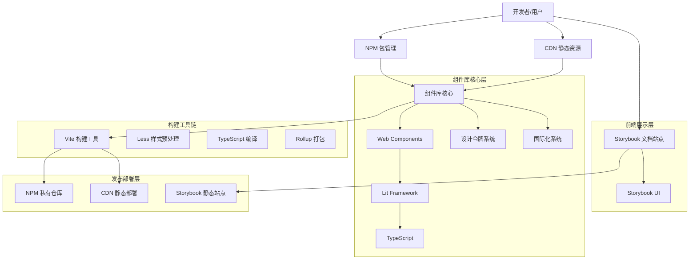

# Jackery Design System 项目实现进度分析报告（2025-11-18）

## 1. 本期交付摘要

* 完成汇总库构建：新增 `design:build:lib`，产出 `dist/index.js`、`dist/index.cjs`、`dist/index.d.ts`、`dist/index.css`。
* 完成单文件库构建：新增 `design:build:single`，产出 `dist/index.single`、`dist/index.single.cjs`、`dist/index.single.css`。
* 样式聚合：在 `src/index.ts:25` 引入 `@styles/index.less`，统一汇总到 `dist/index.css`。
* Storybook分离：类型生成与库构建显式排除 `**/.storybook/**` 与 `apps/**`；Storybook独立构建部署。
* 依赖对齐：根依赖补充 `vite-plugin-dts`、`lit`、`@open-wc/form-control`，保证库构建类型与运行依赖完整。
* 主题版本化：新增 `src/styles/themes/v1|v2` 目录，字体与 tokens 归档到版本目录；新增脚本 `design:build:themes` 产出 `dist/index.css`（v1）与 `dist/index-v2.css`（v2）。
* 运行时切换：新增 `src/styles/themes/switch.less`，产出 `dist/themes-switch.css`；在页面设置 `data-jds-theme-version="v2"` 切换变量与字体。
* 示例页验证：`apps/examples/pages/components/index.html` 增加主题验证区与吸顶交互，支持 `?theme=v1|v2` 与运行时切换按钮。

## 2. 构建产物与指标

* 多文件库：`index.js 126.34 kB (gzip 35.45 kB)`、`index.cjs 106.52 kB (gzip 32.11 kB)`。
* 单文件库：`index.single 226.92 kB (gzip 56.24 kB)`、`index.single.cjs 197.01 kB (gzip 52.76 kB)`。
* 样式：`index.css`（聚合全局样式，约 19.03 kB，gzip 3.34 kB）。
* 主题样式：`index-v2.css`（约 16.08 kB，gzip 2.88 kB），字体为版本专属，tokens 基于 `tokens.base.less` 自动生成。
* 属性覆盖：`themes-switch.css`（约 8.53 kB，gzip 1.60 kB），仅在运行时标识为 v2 时生效。

## 3. 进行中与下一步

* 检查 `style.css` 残留的构建产物并统一命名/清理（进行中）。
* 发布策略：定义 `esm/cjs/d.ts/css` 的CDN与NPM分发目录结构，完善消费指引（计划）。
* 文档：补充“按需 vs 汇总”选择建议与项目级示例（计划）。

## 4. 风险与缓解

* 单文件库体积偏大：建议在应用打包场景使用按需拆分库；CDN场景使用单文件库，并结合Gzip/Brotli与长缓存策略。
* Storybook混入风险：已在类型生成与库构建层面排除；CI校验添加目录白名单（建议）。

## 5. 参考与文件位置

* 入口引入样式：`src/index.ts:25`
* 构建脚本：`package.json:25-26`
* 构建配置：`vite.config.js:41-117, 120-196, 199-291`

***

## 6. 附：原架构说明（保留）

（以下保留历史架构说明，供对照与细化，在下个版本迁移到正式架构文档）

### 1.1 整体架构图

...（其余章节与原归档内容一致，已完整迁移）
