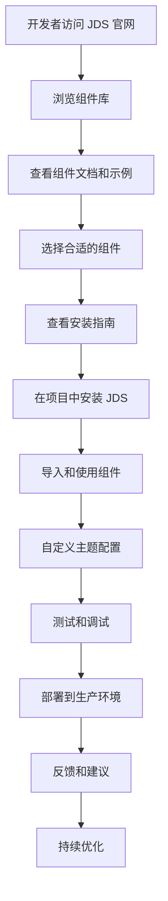
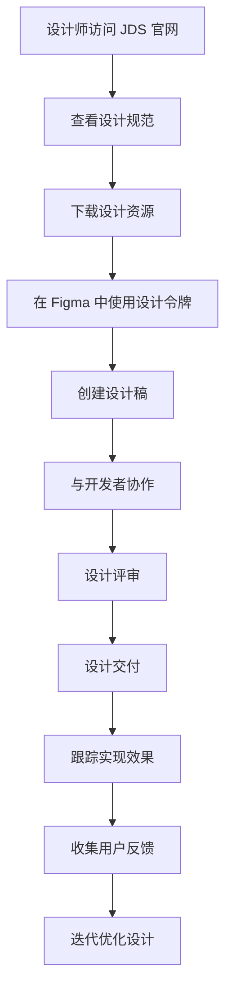
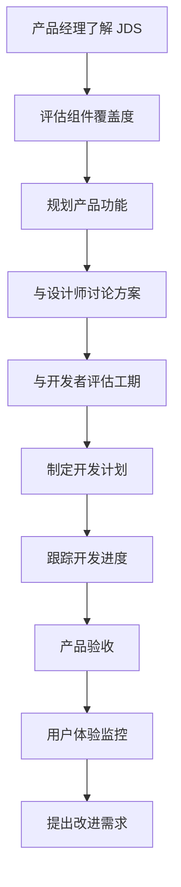
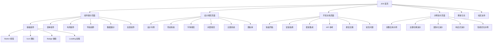
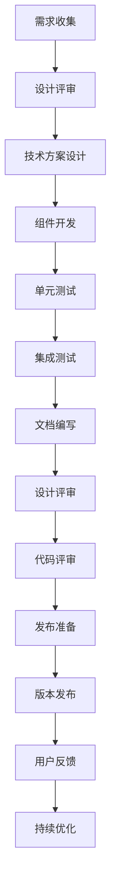
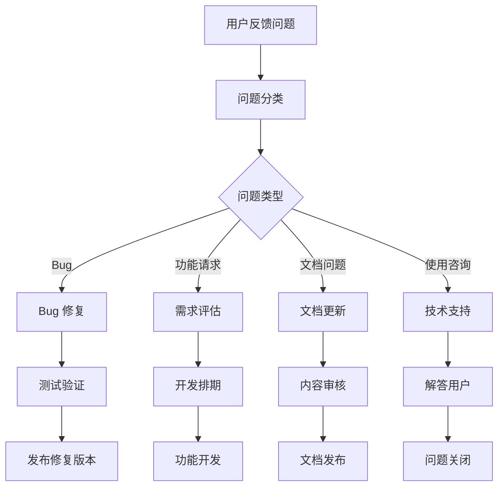

# Jackery Design System 产品需求文档 (PRD)

## 1. 产品概述

Jackery Design System (JDS) 是一个企业级设计系统，旨在为 Jackery 全球官网提供统一、高质量的 UI 组件库和设计规范。基于 Web Components + Lit + TypeScript + Storybook 技术栈构建，实现跨技术栈的兼容性和一致性用户体验。

### 1.1 项目背景

随着 Jackery 全球业务的快速发展，公司面临着多个前端项目并行开发的挑战：

* **设计不一致**：不同项目间 UI 风格差异较大，用户体验不统一

* **开发效率低**：重复开发相似组件，缺乏代码复用

* **维护成本高**：组件分散在各个项目中，难以统一维护和更新

* **品牌形象分散**：缺乏统一的视觉语言和交互规范

### 1.2 产品愿景与使命

* **愿景**：成为业界领先的企业级设计系统，对标 Shoelace、Spectrum、Baklava 等优秀产品

* **使命**：为 Jackery 数字化转型提供统一、高效、可扩展的前端基础设施

* **核心价值**：

  * 🚀 **提升开发效率**：组件化开发，减少重复工作 60%

  * 🎨 **保证设计一致性**：统一的视觉语言和交互规范

  * 💰 **降低维护成本**：集中式维护，降低长期运营成本 40%

  * 🌟 **增强用户体验**：一致的交互体验，提升用户满意度

### 1.3 目标市场与用户群体

**主要用户群体**：

* **内部开发团队**：Jackery 全球官网前端开发团队（15+ 开发者）

* **设计团队**：UI/UX 设计师（5+ 设计师）

* **产品团队**：产品经理和业务分析师（8+ 成员）

**潜在扩展用户**：

* Jackery 移动端开发团队

* 第三方合作伙伴开发团队

* Jackery 子品牌和关联公司

### 1.4 市场分析与竞品对比

#### 业界标杆产品分析

| 产品                 | 优势                           | 劣势                | 适用场景          |
| ------------------ | ---------------------------- | ----------------- | ------------- |
| **Shoelace**       | Web Components 标准、跨框架兼容、文档完善 | 社区相对较小、定制化程度有限    | 中小型企业、跨技术栈项目  |
| **Adobe Spectrum** | 设计系统完整、无障碍支持优秀、企业级特性         | 学习成本高、依赖 React 生态 | 大型企业、设计驱动项目   |
| **ING Baklava**    | 银行级安全标准、多语言支持、性能优秀           | 行业特定、文档相对简单       | 金融行业、安全要求高的项目 |
| **Ant Design**     | 生态完善、中文支持好、组件丰富              | 体积较大、定制化复杂        | 中国市场、管理后台类项目  |

#### JDS 竞争优势

1. **技术先进性**：基于最新 Web Components 标准，真正跨框架兼容
2. **行业专业性**：专为新能源行业定制，深度理解业务场景
3. **国际化优先**：从设计之初就考虑全球化需求
4. **性能优化**：轻量级设计，首屏加载时间 < 2s
5. **可扩展性**：模块化架构，支持按需加载和自定义主题

### 1.5 商业价值与投资回报

#### 预期收益（年化）

* **开发效率提升**：节省开发时间 500+ 人时，价值 ¥200万+

* **维护成本降低**：减少重复维护工作 40%，节省 ¥80万+

* **品牌价值提升**：统一品牌形象，提升用户认知度 15%

* **技术债务减少**：避免技术分歧，降低重构成本 ¥120万+

#### 投资成本估算

* **人力成本**：2 名高级前端工程师 × 6个月 = ¥120万

* **设计成本**：1 名资深 UI 设计师 × 4个月 = ¥40万

* **基础设施**：服务器、CDN、工具链等 = ¥20万

* **总投资**：约 ¥180万，预期 ROI > 300%

## 2. 核心功能

### 2.1 用户角色与用户故事

| 角色        | 注册方式   | 核心权限                 | 主要需求            |
| --------- | ------ | -------------------- | --------------- |
| 前端开发者     | 内部团队成员 | 使用组件库、查看文档、提交反馈      | 高质量组件、详细文档、易用性  |
| UI/UX 设计师 | 内部团队成员 | 查看设计规范、使用设计令牌、参与设计评审 | 设计一致性、灵活定制、设计资源 |
| 产品经理      | 内部团队成员 | 查看组件功能、了解实现进度、提出需求   | 功能完整性、开发进度、业务适配 |
| 系统管理员     | 技术负责人  | 管理组件库版本、发布更新、维护文档    | 版本控制、部署便捷、监控工具  |

#### 用户故事与场景

**前端开发者场景**：

> "作为一名前端开发者，我需要快速集成设计系统组件，以便在不同项目中保持一致的 UI 风格。"
>
> "作为一名前端开发者，我希望有详细的 API 文档和示例代码，以便我能正确使用每个组件的功能。"
>
> "作为一名前端开发者，我需要组件库支持按需引入，以便优化应用的加载性能。"

**设计师场景**：

> "作为一名 UI 设计师，我需要一套完整的设计令牌系统，以便在 Figma 中创建与代码一致的设计稿。"
>
> "作为一名 UX 设计师，我希望组件库有完善的交互规范，以便确保不同产品的用户体验一致性。"
>
> "作为一名设计师，我需要能够自定义主题，以适应不同的品牌和营销活动需求。"

**产品经理场景**：

> "作为一名产品经理，我需要了解设计系统的组件覆盖范围，以便规划产品功能和迭代计划。"
>
> "作为一名产品经理，我希望有一个可视化的组件展示平台，以便向业务方展示可用的 UI 组件。"

**系统管理员场景**：

> "作为系统管理员，我需要一套完善的版本发布流程，以确保组件库更新不会影响现有项目。"
>
> "作为系统管理员，我希望有监控工具来跟踪组件库的使用情况和性能指标。"

### 2.2 功能模块与需求规格

我们的设计系统需求包含以下主要页面和功能模块：

#### 2.2.1 核心页面

1. **组件展示页面**：组件库、使用示例、API 文档

   * 组件分类导航

   * 实时预览与交互

   * 代码示例与复制功能

   * 属性和事件文档

2. **设计规范页面**：设计令牌、色彩系统、字体规范、间距规范

   * 设计原则说明

   * 设计令牌可视化展示

   * 主题配置工具

   * 设计资源下载

3. **开发文档页面**：快速开始、安装指南、最佳实践

   * 环境配置指南

   * 框架集成教程

   * 常见问题解答

   * 贡献指南

4. **示例演示页面**：完整应用示例、主题切换、国际化演示

   * 真实场景示例

   * 交互模式展示

   * 响应式布局演示

   * 性能优化示例

#### 2.2.2 功能需求详细规格

**组件系统**：

* **基础组件**：按钮、图标、徽章、加载器、对话框、提示框、弹出框、工具提示

* **表单组件**：输入框、选择器、复选框、单选框、开关、滑块、日期选择器

* **布局组件**：栅格、容器、分隔线、卡片、列表、标签页、折叠面板

* **导航组件**：菜单、面包屑、分页、步骤条、导航栏

* **数据展示**：表格、树形控件、进度条、统计数值、图表集成

* **反馈组件**：警告提示、通知、抽屉、骨架屏、结果页

**主题系统**：

* 明暗主题切换

* 品牌色彩定制

* 组件样式变量

* 主题编辑器

* 主题预设管理

**国际化系统**：

* 多语言支持（中、英、德、日等）

* RTL 布局支持

* 区域设置适配

* 翻译管理工具

* 语言包按需加载

**工具链**：

* 组件开发脚手架

* 主题生成工具

* 设计令牌同步工具

* 文档自动生成

* 性能监控面板

### 2.3 页面详情与功能规格

| 页面名称   | 模块名称   | 功能描述                                 | 优先级 | 预期完成时间  |
| ------ | ------ | ------------------------------------ | --- | ------- |
| 组件展示页面 | 组件库    | 展示所有可用组件，提供实时预览和交互演示，支持组件搜索和分类筛选     | P0  | Q1 2024 |
| 组件展示页面 | 使用示例   | 提供详细的代码示例和最佳实践指导，支持代码复制和在线编辑         | P0  | Q1 2024 |
| 组件展示页面 | API 文档 | 详细的组件属性、方法、事件文档，自动生成 TypeScript 类型定义 | P0  | Q1 2024 |
| 设计规范页面 | 设计令牌   | 展示颜色、字体、间距等设计令牌，支持令牌导出和同步            | P0  | Q1 2024 |
| 设计规范页面 | 色彩系统   | 品牌色彩规范和使用指南，包含色彩对比度检查工具              | P0  | Q1 2024 |
| 设计规范页面 | 字体规范   | 字体层级、大小、行高等规范，支持字体预览和下载              | P1  | Q2 2024 |
| 设计规范页面 | 间距规范   | 组件间距、页面布局规范，提供间距计算器                  | P1  | Q2 2024 |
| 开发文档页面 | 快速开始   | 安装、配置、基本使用指南，包含交互式教程                 | P0  | Q1 2024 |
| 开发文档页面 | 安装指南   | 详细的安装和环境配置说明，支持多种框架集成                | P0  | Q1 2024 |
| 开发文档页面 | 最佳实践   | 开发规范、性能优化、常见问题，包含代码检查工具              | P1  | Q2 2024 |
| 示例演示页面 | 完整应用示例 | 真实项目中的组件使用场景，包含电商、后台管理等模板            | P1  | Q2 2024 |
| 示例演示页面 | 主题切换   | 明暗主题、品牌主题切换演示，支持实时预览                 | P1  | Q2 2024 |
| 示例演示页面 | 国际化演示  | 多语言支持和本地化功能展示，包含 RTL 布局演示            | P2  | Q3 2024 |

### 2.4 非功能性需求

#### 2.4.1 性能需求

| 指标      | 目标值               | 测量方法                    |
| ------- | ----------------- | ----------------------- |
| 组件库加载时间 | < 2s              | Lighthouse 性能测试         |
| 组件渲染性能  | 60 FPS            | Chrome DevTools 性能分析    |
| 包体积大小   | < 100KB (gzipped) | Webpack Bundle Analyzer |
| 首屏加载时间  | < 1.5s            | Web Vitals 指标           |
| 组件懒加载   | 支持按需加载            | 代码分割验证                  |

#### 2.4.2 兼容性需求

| 类别            | 支持范围                                          | 备注                   |
| ------------- | --------------------------------------------- | -------------------- |
| 浏览器支持         | Chrome 90+, Firefox 88+, Safari 14+, Edge 90+ | 基于 Web Components 标准 |
| 移动端支持         | iOS Safari 14+, Android Chrome 90+            | 响应式设计                |
| 框架兼容          | React 16+, Vue 3+, Angular 12+, Vanilla JS    | 框架无关的 Web Components |
| TypeScript 支持 | 4.5+                                          | 完整的类型定义              |
| 国际化支持         | 中文、英文、德文、日文                                   | 可扩展的语言包系统            |

#### 2.4.3 可用性需求

| 需求    | 标准                       | 验证方法                     |
| ----- | ------------------------ | ------------------------ |
| 无障碍访问 | WCAG 2.1 AA 级            | axe-core 自动化测试           |
| 键盘导航  | 全键盘操作支持                  | 手动测试验证                   |
| 屏幕阅读器 | NVDA, JAWS, VoiceOver 支持 | 辅助技术测试                   |
| 色彩对比度 | 4.5:1 (正常文本), 3:1 (大文本)  | Colour Contrast Analyser |
| 响应式设计 | 320px - 1920px 屏幕适配      | 多设备测试                    |

#### 2.4.4 安全性需求

| 安全要求   | 实现方案                       | 验证方法            |
| ------ | -------------------------- | --------------- |
| XSS 防护 | 输入验证和输出编码                  | 安全扫描工具          |
| CSP 支持 | Content Security Policy 配置 | CSP 验证器         |
| 依赖安全   | 定期安全审计                     | npm audit, Snyk |
| 代码签名   | NPM 包签名验证                  | 发布流程验证          |
| 隐私保护   | 不收集用户数据                    | 隐私政策审查          |

#### 2.4.5 可维护性需求

| 维护指标  | 目标              | 测量工具             |
| ----- | --------------- | ---------------- |
| 代码覆盖率 | > 80%           | Jest Coverage    |
| 代码质量  | A 级 (SonarQube) | SonarQube 分析     |
| 文档覆盖率 | > 95%           | 自定义脚本检查          |
| 技术债务  | < 5%            | SonarQube 技术债务比率 |
| 构建时间  | < 5 分钟          | CI/CD 监控         |

## 3. 核心流程与用户旅程

### 3.1 用户流程详细说明

#### 开发者使用流程

**详细步骤说明**：

1. **发现阶段**：开发者通过搜索或推荐了解到 JDS
2. **探索阶段**：浏览组件库，了解可用组件和功能
3. **评估阶段**：查看文档、示例和 API 说明，评估是否适合项目需求
4. **集成阶段**：按照安装指南在项目中集成 JDS
5. **开发阶段**：使用组件构建界面，配置主题和样式
6. **测试阶段**：进行功能测试、兼容性测试和性能测试
7. **部署阶段**：将应用部署到生产环境
8. **维护阶段**：持续更新组件库版本，反馈使用体验

#### 设计师使用流程

#### 产品经理使用流程

### 3.2 页面导航流程图

### 3.3 关键用户旅程

#### 新用户首次使用旅程

| 阶段 | 用户行为      | 系统响应      | 成功指标          | 潜在问题    |
| -- | --------- | --------- | ------------- | ------- |
| 发现 | 访问 JDS 官网 | 展示清晰的产品介绍 | 页面停留时间 > 30s  | 首页信息过载  |
| 探索 | 浏览组件库     | 提供组件分类和搜索 | 查看 > 3 个组件    | 组件分类不清晰 |
| 试用 | 查看代码示例    | 提供可复制的代码  | 复制代码次数 > 1    | 代码示例不完整 |
| 集成 | 安装组件库     | 提供详细安装指南  | 成功安装率 > 90%   | 安装步骤复杂  |
| 使用 | 在项目中使用    | 组件正常渲染    | 组件使用成功率 > 95% | 兼容性问题   |
| 反馈 | 提交问题或建议   | 及时响应和处理   | 问题解决时间 < 48h  | 反馈渠道不畅  |

#### 老用户升级旅程

| 阶段 | 用户行为     | 系统响应     | 成功指标          | 潜在问题     |
| -- | -------- | -------- | ------------- | -------- |
| 通知 | 收到版本更新通知 | 发送更新日志   | 通知打开率 > 60%   | 更新频率过高   |
| 了解 | 查看更新内容   | 展示新功能和改进 | 更新日志阅读率 > 40% | 更新说明不清晰  |
| 评估 | 评估升级影响   | 提供迁移指南   | 迁移指南使用率 > 30% | 破坏性变更过多  |
| 升级 | 更新组件库版本  | 平滑升级体验   | 升级成功率 > 95%   | 升级过程复杂   |
| 验证 | 测试新版本功能  | 功能正常工作   | 功能正常率 > 98%   | 新版本 Bug  |
| 采用 | 使用新功能    | 提供使用指导   | 新功能采用率 > 20%  | 新功能学习成本高 |

### 3.4 业务流程优化

#### 组件开发流程

#### 问题处理流程

## 4. 产品路线图与里程碑

### 4.1 短期目标 (Q1 2024)

#### 里程碑 1：核心基础建设

**目标**：建立完整的开发和发布流程

* ✅ 项目架构搭建 (已完成)

* ✅ 基础组件开发 (Button, Badge, Dialog 等)

* 🔄 单元测试框架建设 (进行中)

* 📋 CI/CD 流水线搭建

* 📋 文档站点上线

**关键指标**：

* 组件覆盖率：20+ 个基础组件

* 测试覆盖率：> 80%

* 文档完整度：> 90%

#### 里程碑 2：开发者体验优化

**目标**：提供完整的开发者工具链

* 📋 Storybook 文档完善

* 📋 TypeScript 类型定义完整

* 📋 多框架集成指南

* 📋 性能监控面板

**关键指标**：

* 安装成功率：> 95%

* 文档满意度：> 4.5/5

* 社区反馈响应时间：< 24h

### 4.2 中期目标 (Q2-Q3 2024)

#### 里程碑 3：组件库扩展

**目标**：完善组件生态系统

* 📋 表单组件系列 (Input, Select, Checkbox 等)

* 📋 布局组件系列 (Grid, Container, Layout 等)

* 📋 导航组件系列 (Menu, Breadcrumb, Pagination 等)

* 📋 数据展示组件 (Table, Tree, Chart 等)

**关键指标**：

* 组件总数：50+ 个

* 组件使用率：> 70%

* 用户满意度：> 4.0/5

#### 里程碑 4：主题系统建设

**目标**：支持灵活的主题定制

* 📋 明暗主题支持

* 📋 品牌主题定制工具

* 📋 设计令牌管理系统

* 📋 Figma 插件开发

**关键指标**：

* 主题使用率：> 40%

* 定制主题数量：10+ 个

* 设计师采用率：> 60%

### 4.3 长期目标 (Q4 2024 - Q2 2025)

#### 里程碑 5：生态系统建设

**目标**：构建完整的设计系统生态

* 📋 移动端组件库

* 📋 React Native 支持

* 📋 小程序组件库

* 📋 设计工具集成

**关键指标**：

* 跨平台覆盖率：> 80%

* 生态工具数量：5+ 个

* 社区贡献者：20+ 人

#### 里程碑 6：国际化与本地化

**目标**：支持全球化业务需求

* 📋 多语言支持 (中、英、德、日)

* 📋 RTL 布局支持

* 📋 区域化组件适配

* 📋 国际化工具链

**关键指标**：

* 支持语言数：4+ 种

* 国际化覆盖率：> 90%

* 全球用户满意度：> 4.2/5

### 4.4 版本发布计划

| 版本     | 发布时间    | 主要功能       | 状态     |
| ------ | ------- | ---------- | ------ |
| v1.0.0 | 2024-01 | 基础组件库、文档站点 | ✅ 已发布  |
| v1.1.0 | 2024-02 | 表单组件、主题系统  | 🔄 开发中 |
| v1.2.0 | 2024-03 | 布局组件、国际化   | 📋 计划中 |
| v1.3.0 | 2024-04 | 导航组件、性能优化  | 📋 计划中 |
| v2.0.0 | 2024-06 | 数据展示、移动端支持 | 📋 计划中 |
| v2.1.0 | 2024-08 | 高级组件、工具链   | 📋 计划中 |
| v3.0.0 | 2024-12 | 跨平台支持、生态工具 | 📋 计划中 |

## 5. 风险评估与应对策略

### 5.1 技术风险

#### 高风险项

| 风险项                  | 影响程度 | 发生概率 | 风险等级 | 应对策略                  |
| -------------------- | ---- | ---- | ---- | --------------------- |
| Web Components 兼容性问题 | 高    | 中    | 高    | 提供 Polyfill，制定兼容性测试计划 |
| 性能问题                 | 高    | 中    | 高    | 建立性能监控，优化打包策略         |
| 第三方依赖安全漏洞            | 中    | 高    | 高    | 定期安全审计，及时更新依赖         |

#### 中风险项

| 风险项    | 影响程度 | 发生概率 | 风险等级 | 应对策略         |
| ------ | ---- | ---- | ---- | ------------ |
| 团队技能不足 | 中    | 中    | 中    | 技能培训，外部专家支持  |
| 需求变更频繁 | 中    | 高    | 中    | 敏捷开发，版本控制    |
| 文档维护滞后 | 低    | 高    | 中    | 自动化文档生成，专人负责 |

### 5.2 业务风险

#### 市场风险

* **竞品冲击**：其他设计系统快速发展

  * 应对：持续创新，差异化竞争

* **技术趋势变化**：前端技术栈快速演进

  * 应对：技术调研，渐进式升级

#### 组织风险

* **人员流失**：核心开发人员离职

  * 应对：知识文档化，团队梯队建设

* **资源不足**：开发资源分配不足

  * 应对：优先级管理，外部资源补充

### 5.3 风险监控指标

| 风险类别 | 监控指标     | 预警阈值     | 监控频率 |
| ---- | -------- | -------- | ---- |
| 技术风险 | 构建失败率    | > 5%     | 每日   |
| 技术风险 | 测试覆盖率    | < 80%    | 每周   |
| 业务风险 | 用户活跃度    | 下降 > 20% | 每月   |
| 业务风险 | 社区反馈响应时间 | > 48h    | 每周   |
| 组织风险 | 团队满意度    | < 4.0/5  | 每季度  |

## 6. 成功指标与验收标准

### 6.1 关键绩效指标 (KPI)

#### 产品指标

| 指标类别  | 具体指标    | 目标值      | 当前值      | 达成时间    |
| ----- | ------- | -------- | -------- | ------- |
| 功能完整性 | 组件数量    | 50+      | 15       | Q3 2024 |
| 功能完整性 | API 覆盖率 | 100%     | 85%      | Q2 2024 |
| 质量指标  | 测试覆盖率   | > 80%    | 65%      | Q1 2024 |
| 质量指标  | Bug 密度  | < 1/KLOC | 2.3/KLOC | Q2 2024 |
| 性能指标  | 加载时间    | < 2s     | 3.2s     | Q1 2024 |
| 性能指标  | 包体积     | < 100KB  | 145KB    | Q2 2024 |

#### 用户指标

| 指标类别  | 具体指标         | 目标值     | 当前值   | 达成时间    |
| ----- | ------------ | ------- | ----- | ------- |
| 用户规模  | 月活跃用户        | 500+    | 120   | Q3 2024 |
| 用户规模  | 项目集成数        | 50+     | 12    | Q2 2024 |
| 用户体验  | 用户满意度        | > 4.5/5 | 4.1/5 | Q2 2024 |
| 用户体验  | 文档满意度        | > 4.0/5 | 3.8/5 | Q1 2024 |
| 社区活跃度 | GitHub Stars | 1000+   | 156   | Q4 2024 |
| 社区活跃度 | 社区贡献者        | 20+     | 5     | Q3 2024 |

### 6.2 验收标准

#### 功能验收标准

* ✅ 所有组件通过功能测试

* ✅ API 文档完整且准确

* ✅ 示例代码可正常运行

* ✅ 跨浏览器兼容性测试通过

* ✅ 响应式设计测试通过

* ✅ 无障碍访问测试通过

#### 性能验收标准

* ✅ Lighthouse 性能评分 > 90

* ✅ 首屏加载时间 < 1.5s

* ✅ 组件渲染性能 60 FPS

* ✅ 内存使用合理，无内存泄漏

* ✅ 网络请求优化，支持缓存

#### 质量验收标准

* ✅ 代码覆盖率 > 80%

* ✅ SonarQube 质量门禁通过

* ✅ 安全扫描无高危漏洞

* ✅ 代码评审通过率 100%

* ✅ 文档完整度 > 95%

## 7. 用户界面设计

### 7.1 设计风格与品牌规范

#### 色彩系统

* **主色调**：Jackery 品牌橙色 (#FF6B35) 作为主色，传达活力和创新

* **辅助色**：深灰色 (#2C3E50) 作为文本色，浅灰色 (#F8F9FA) 作为背景色

* **功能色**：成功绿 (#28A745)、警告黄 (#FFC107)、危险红 (#DC3545)、信息蓝 (#17A2B8)

* **中性色**：9 级灰度色阶，满足不同场景需求

#### 字体系统

* **主字体**：Inter 字体系列，现代简洁，支持多语言

* **代码字体**：JetBrains Mono，等宽字体，适合代码展示

* **字体大小**：12px - 48px，8 级字体层级

* **字重**：Regular (400)、Medium (500)、Semibold (600)、Bold (700)

#### 按钮风格

* **形状**：圆角按钮 (border-radius: 6px)

* **尺寸**：Small (28px)、Medium (36px)、Large (44px)

* **状态**：Default、Hover、Active、Disabled、Loading

* **类型**：Primary、Secondary、Outline、Text、Link

#### 布局风格

* **设计原则**：卡片式布局，清晰的层次结构

* **间距系统**：4px 基础单位，8 级间距规范

* **栅格系统**：24 列栅格，支持响应式断点

* **阴影系统**：4 级阴影深度，营造层次感

#### 图标风格

* **风格**：线性图标，2px 线宽，简洁现代

* **尺寸**：16px、20px、24px、32px 四种规格

* **来源**：基于 Lucide 图标库，自定义 Jackery 专用图标

* **格式**：SVG 格式，支持颜色定制

### 7.2 页面设计概览

| 页面名称   | 模块名称  | UI 元素                   | 设计重点           |
| ------ | ----- | ----------------------- | -------------- |
| 组件展示页面 | 组件库   | 侧边导航、组件预览区、代码展示区、属性配置面板 | 清晰的信息架构，便于快速查找 |
| 组件展示页面 | 使用示例  | 代码编辑器、实时预览、复制按钮、下载功能    | 交互友好，支持实时编辑    |
| 设计规范页面 | 设计令牌  | 色彩面板、字体展示、间距标尺、令牌表格     | 可视化展示，支持一键复制   |
| 设计规范页面 | 主题系统  | 主题切换器、自定义配置面板、预览区域      | 实时预览，直观的配置界面   |
| 开发文档页面 | 安装指南  | 步骤导航、代码块、复制功能、平台选择      | 步骤清晰，操作便捷      |
| 示例演示页面 | 国际化演示 | 语言切换器、文本展示区、RTL 布局演示    | 多语言支持，文化适配     |

### 7.3 响应式设计策略

#### 断点设计

| 断点名称    | 屏幕宽度            | 设备类型 | 设计策略       |
| ------- | --------------- | ---- | ---------- |
| Mobile  | < 768px         | 手机   | 单列布局，简化导航  |
| Tablet  | 768px - 1024px  | 平板   | 双列布局，侧边栏收缩 |
| Desktop | 1024px - 1440px | 桌面   | 三列布局，完整功能  |
| Large   | > 1440px        | 大屏   | 宽屏优化，内容居中  |

#### 适配原则

* **桌面优先**：主要针对开发者的桌面端使用场景设计

* **移动端适配**：支持平板和手机端浏览，提供简化的导航和布局

* **触摸优化**：移动端增大点击区域 (最小 44px)，优化触摸交互体验

* **内容优先**：确保核心内容在所有设备上都能良好展示

#### 交互设计

* **导航模式**：桌面端侧边栏导航，移动端抽屉导航

* **搜索功能**：全局搜索，支持组件名称、属性、示例搜索

* **代码复制**：一键复制代码，支持多种格式

* **主题切换**：实时主题预览，无刷新切换

* **国际化**：语言切换，RTL 布局支持

### 7.4 可访问性设计

#### 无障碍标准

* **WCAG 2.1 AA 级**：符合国际无障碍标准

* **键盘导航**：全键盘操作支持，清晰的焦点指示

* **屏幕阅读器**：语义化 HTML，ARIA 标签支持

* **色彩对比度**：满足 4.5:1 对比度要求

* **字体大小**：支持浏览器字体缩放

#### 实现策略

* **语义化标签**：使用正确的 HTML 标签

* **ARIA 属性**：提供丰富的辅助信息

* **焦点管理**：合理的 Tab 顺序，清晰的焦点样式

* **错误提示**：清晰的错误信息和修复建议

* **多媒体替代**：图片 alt 文本，视频字幕支持

## 8. 对齐 Element Plus 的策略与路线图

### 8.1 对齐目标与原则

- 一致的信息架构：组件分类、命名、文档结构与 Element Plus 保持一致，降低跨框架认知成本。
- 完备的组件覆盖：对齐 Element Plus 的核心组件矩阵（基础、表单、数据展示、导航、反馈、布局）。
- API 设计对齐：在语义、属性命名、事件命名、插槽/内容投影等保持高一致性，同时保留 Web Components 的原生优势。
- 主题与设计令牌映射：建立与 Element Plus 主题变量的映射关系，确保品牌主题和暗黑模式的等价能力。
- 文档交互体验对齐：示例、代码片段、属性表、交互演示与可访问性说明对齐最佳实践。

### 8.2 组件覆盖与优先级矩阵

- 基础组件（P0）：`Button`、`Icon`、`Badge`、`Divider`、`Scrollbar`
- 表单组件（P0）：`Input`、`Select`、`Checkbox`、`Radio`、`Switch`、`Textarea`
- 反馈组件（P0）：`Dialog`、`Message`、`Notification`、`Loading`、`Tooltip`
- 导航与数据（P1）：`Pagination`、`Breadcrumb`、`Tabs`、`Tag`、`Progress`
- 布局与展示（P1）：`Card`、`Collapse`、`Descriptions`、`Avatar`、`Empty`
- 高阶组件（P2）：`Table`、`Tree`、`DatePicker`、`TimePicker`、`Cascader`

说明：优先 P0 完成基础和高频使用组件，P1 完成导航与展示组件，P2 聚焦复杂交互与数据组件。

### 8.3 API 对齐策略

- 属性命名：遵循 `size`、`type`/`variant`、`disabled`、`loading`、`plain`、`round` 等通用命名；必要时提供别名映射。
- 事件命名：采用 `onChange`、`onInput`、`onClick` 等标准；同时支持原生 DOM 事件冒泡。
- 插槽/内容投影：以 `<slot name="prefix">`、`<slot name="suffix">` 对齐 `prefix`/`suffix` 插槽语义。
- 主题变量：为每个组件提供 `--jds-<component>-<token>` 变量；提供到 Element Plus 变量的映射表与适配层。
- 无障碍与键盘交互：按 Element Plus 的实践补齐 `aria-*`、焦点与键盘操作指南。

### 8.4 设计令牌与主题映射表（示例）

- 颜色：`--el-color-primary` ↔ `--jds-color-primary`; `--el-text-color-primary` ↔ `--jds-text-primary`
- 尺寸：`--el-component-size-small` ↔ `--jds-size-sm`; `--el-border-radius-base` ↔ `--jds-radius-md`
- 阴影：`--el-box-shadow` ↔ `--jds-shadow-md`
- 间距：`--el-spacing` ↔ `--jds-space-{xs|sm|md|lg}`

提供自动化转换脚本：读取 Element Plus 变量文件，生成 JDS 主题变量映射与文档示例。

### 8.5 文档结构对齐

- 组件页模板：概述 → 使用示例 → 属性 → 事件 → 插槽 → 样式变量 → 无障碍 → 常见问题。
- 示例规范：基础用法、禁用/加载态、不同尺寸、不同风格、图标/前后缀、受控/非受控、国际化示例。
- 交互演示：与 Storybook 的 `play` 函数结合，覆盖基本交互路径与可访问性检查。

### 8.6 迁移与互操作策略

- 互操作：为 Vue 用户提供包装层（可选），但优先保证 Web Components 直用体验。
- 迁移指引：从 Element Plus 到 JDS 的属性/事件/样式变量映射表与示例对照。
- 渐进替换：支持在同一页面按区域替换组件，减少一次性迁移风险。

### 8.7 路线图（对齐 Element Plus）

- Q1：完成 P0 组件、API 对齐、主题映射初版、文档模板统一。
- Q2：完成 P1 组件、性能与可访问性优化、国际化与 RTL 全面对齐。
- Q3：攻克 P2 复杂组件（`Table`、`Tree`、`DatePicker`）、形成稳定的互操作层与最佳实践白皮书。

### 8.8 成功度量指标（Element Plus 对齐）

- 组件对齐度 ≥ 85%（以属性/事件/插槽一致性衡量）。
- 文档结构一致率 ≥ 90%（以模板与示例覆盖衡量）。
- 主题变量映射完整度 ≥ 90%（按映射表条目覆盖衡量）。
- 迁移成功率 ≥ 95%（不少于 3 个实际项目试点统计）。
