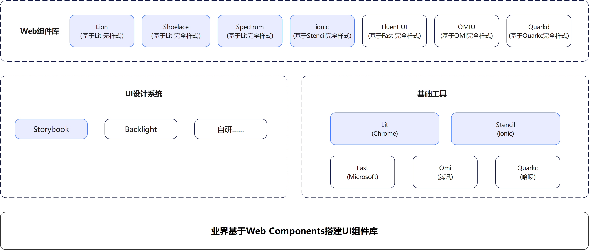

[](https://github.com/AIYAZONE/design-system/actions/workflows/ci.yml)

## 1. 简介

- **全称：** AIYAZONE Design System - AIYAZONE 设计系统
- **简写：** ZDS
- **介绍：** 面向多技术栈页面的 Web 基础库。以 Lit 自定义元素、设计令牌、图标和机器可读组件说明为核心，采用 Monorepo 管理源码、文档、示例与发布包。
- **当前边界：** Lit 是组件实现技术；发布后的自定义元素可被不同框架或原生 HTML 使用。AI 文档提供上下文，不限制模型输出；CI 检查仓库自己的页面样例，不替下游项目背书。
- **仓库：** [https://github.com/AIYAZONE/design-system](https://github.com/AIYAZONE/design-system)
- **文档站点：** [https://design.aiyazone.com](https://design.aiyazone.com)

## 1.1 项目定位

- **一句话：** ZDS 把设计令牌、Lit Web Components、图标和组件 API 文档放进同一套可版本化的前端基础设施。
- **对内：** 设计师和开发者维护源码；生成器产出主题样式、类型、组件清单和 API 文档；CI 检查仓库样例是否与这些来源一致。
- **对外：** 人和 AI 可以参考相同的组件与令牌资料。最终页面仍由工程检查、交互验证与设计评审负责。
- 边界：设计语言与通用组件的唯一来源；业务逻辑不进入本设计系统
- 下游依赖：业务站点、前端渲染层
- 演进路线：见 [docs/ROADMAP.md](./docs/ROADMAP.md)（已完成的工程化阶段与当前站点、AI 样例改进）

## 1.2 项目目录结构

```text
design-system/
├─ apps/                 示例与预览工程
│  ├─ examples/         组件演示与联调示例站
│  ├─ portal/           门户、架构页、AI 说明与实测样例
│  ├─ storybook/        Storybook 项目
│  ├─ styles/           示例站公共样式
│  └─ index.ts          示例入口聚合
├─ packages/            Monorepo 子包
│  ├─ core/             核心 Web Components 组件库
│  ├─ icons/            SVG 图标库与 Storybook
│  ├─ i18n/             国际化能力（window.i18n）
│  ├─ utils/            通用工具函数
│  └─ tokens/           DTCG 风格令牌源与生成物
├─ src/                 设计系统根入口与样式
│  ├─ styles/           全局样式与主题
│  │  ├─ themes/v1,v2,v3  主题样式与 Tokens
│  │  ├─ zone/          公共样式、重置、RTE
│  │  └─ animate/      动效示例
│  ├─ index.ts         根入口，导出并注册
│  └─ register.ts      组件注册
├─ docs/                令牌与文档（MD/MDX）
├─ public/              预览页与静态资源
├─ scripts/             构建辅助脚本
├─ .storybook/          Storybook 配置
├─ .changeset/          版本变更集
├─ package.json         根包配置
├─ pnpm-workspace.yaml  工作区声明
└─ README.md            项目说明
```

- apps/examples：用于组件联调与预览，入口示例见 [main.ts](./apps/examples/main.ts) 与页面 [pages](./apps/examples/pages)。
- packages/core：核心组件按 `components/<name>` 组织，每个组件包含 `index.ts`、`index.less`、`stories` 与 `__tests__`，如 [button](./packages/core/src/components/button)。
- src/styles：全局样式唯一来源，入口为 [index.less](./src/styles/index.less)，主题分为 [themes/v1](./src/styles/themes/v1)、[themes/v2](./src/styles/themes/v2) 与 [themes/v3](./src/styles/themes/v3)。
- docs：包含设计令牌与规范说明（MD/MDX），如 [tokens](./docs/tokens)。

## 2. 当前能力范围

- 以 Web Components 提供跨框架可消费的 UI 基础；具体框架兼容情况以接入测试为准。
- 支持 npm 包与 CDN 引入；生产页面应锁定明确版本。
- 通过主题 CSS 变量定制组件外观；可覆盖范围见各组件 API 文档。
- 保留 v1、v2、v3 主题资产；它们是主题版本，不代表完整的明暗主题方案。
- 组件测试包含部分无障碍断言；页面仍需自行评估语义、键盘操作和对比度。

## 3. 发布与部署

- 组件库：直接发布到 npm 公网仓库（作用域 `@aiyazone`），包名 `@aiyazone/design-system`；CDN 引用走 jsDelivr / unpkg（见 5.2）
- 文档站点：部署到 Vercel，绑定自定义域名 `design.aiyazone.com`

### 3.1 站点部署（Vercel）

整站产物统一组装到 `apps/portal/dist`：

| 路径 | 内容 | 来源 |
|------|------|------|
| `/` | 门户首页 | apps/portal |
| `/storybook/` | 组件文档 | apps/storybook |
| `/examples/` | 示例站 | apps/examples |
| `/icons/` | 图标文档 | packages/icons |

仓库根目录的 `vercel.json` 已配置完成（install → `pnpm install`，build → `pnpm --filter @aiyazone/portal run build:all`，输出 → `apps/portal/dist`）。

1. **Git 集成（推荐）**：Vercel 控制台 Import GitHub 仓库 `AIYAZONE/design-system`，Framework Preset 选 **Other**，其余保持默认（自动读取 vercel.json），master 分支推送即自动部署；develop 分支自动出 Preview 环境。
2. **CLI 本地部署**：

```bash
npm i -g vercel
vercel          # 预览环境
vercel --prod   # 生产环境
```

3. **自定义域名**：Vercel 项目 Settings → Domains 添加 `design.aiyazone.com`，按提示在 DNS 添加 CNAME 记录（`cname.vercel-dns.com`）。

## 4. 包结构

ZDS 采用 Monorepo 管理源码，对外只发布 `@aiyazone/design-system` 总包和 `@aiyazone/tokens`。core、icons、i18n、utils 是私有工作区模块，随总包交付；以下模块名用于仓库内开发。

### 📦 @aiyazone/core
- **用途**: 核心 Web Components 组件
- **包含**: 组件数量与 API 以 [zone-manifest.json](./packages/core/zone-manifest.json) 和 [docs/api](./docs/api) 为准。
- **对外使用**: `npm install @aiyazone/design-system lit`
- **样式策略**: 组件样式以内联方式注入（`index.less?inline`）；不再自动注入核心包的全局样式，项目需在入口显式引入设计系统样式（见下文）。

### 🎨 @aiyazone/icons
- **用途**: SVG 图标库；可用名称以门户 `/llms.txt` 与 SVG 源文件为准。
- **特性**: 支持按需导入、Tree-shaking、多种尺寸和颜色
- **对外使用**: 导入总包后使用 `<zone-icon name="arrow-right">`，图标由总包按需加载。

### 🌍 @aiyazone/i18n
- **用途**: 国际化功能
- **包含**: 核心 i18n 功能、装饰器、语言包
- **对外使用**: 从 `@aiyazone/design-system` 导入语言切换与翻译 API。

### 🔧 @aiyazone/utils
- **用途**: 通用工具函数
- **包含**: DOM 操作、事件处理、表单控制、通用工具
- **对外使用**: 工具实现随总包组件交付，不单独提供工具包安装入口。

### 🎛️ @aiyazone/tokens
- **用途**: DTCG 风格设计令牌源及 CSS / TypeScript 生成物
- **安装**: `npm install @aiyazone/tokens`

## AI 使用与验证边界

- `/llms.txt`、`/llms-full.txt` 和 `/ai-usage.html` 为人和 AI 提供组件、令牌和图标参考，不构成对生成结果的强制约束。
- 仓库内 `apps/portal/public/ai-demo.html` 由 `pnpm --filter @aiyazone/portal run check:ai-demo` 检查；检查器对照组件 HTML/JS API、图标 SVG 和令牌源码，覆盖范围见 [AI 使用指南](./docs/ai-usage.md)。
- 下游项目需要在自己的代码库中接入适合的 API、令牌、交互和无障碍检查。

## 5. 使用

### 5.1 依赖引用

以下 npm 契约对应待发布的 `0.4.0`，当前 registry 最新仍为 `0.3.2`。版本准备和本地验收不等同于正式发布。

1. 命令安装：

```cmd
npm i @aiyazone/design-system lit --save
```

在应用入口导入 JS 和一种主题：

```ts
import '@aiyazone/design-system';
import '@aiyazone/design-system/index-v3.css';
```

npm 的 ESM/CJS 共享应用安装的 Lit 3，不内嵌运行时。对外使用总包入口；`@aiyazone/core/button` 等子路径只供内部工作区开发与验证。令牌可单独安装 `@aiyazone/tokens`，无需组件包或 Lit。

Lit 为 ESM 依赖。直接在 Node 中 `require()` CJS 入口需要支持加载 ESM 的 Node（推荐 22.13+），并提供组件所需 DOM；Node 18 请使用 ESM 或能解析 Lit ESM 的打包器。本批安装验证使用 Node 24，CI 使用 Node 22。

### 5.2 CDN 引用（基于 npm 公网包）

新构建的浏览器入口为 `dist/cdn/index.js`（包子路径 `@aiyazone/design-system/cdn`）：自包含 Lit、组件、图标和翻译，不需要 import map 或额外 JS。主题继续单独加载；同一页面选择 npm 或 CDN 中的一种方式。

**发布状态（2026-11-18）**：新入口已通过本地 tarball 浏览器验证，尚未发布。下面的 `0.4.0` 是本次准备的版本；当前 registry 的 `0.3.2` 没有这个新入口。由于浏览器接入路径改变，总包按 0.x 的 minor 升版。正式发布后锁定确切版本，并让 JS 与 CSS 的版本一致：

```html
<link rel="stylesheet" crossorigin href="https://cdn.jsdelivr.net/npm/@aiyazone/design-system@0.4.0/dist/index-v3.css">
<script type="module" crossorigin src="https://cdn.jsdelivr.net/npm/@aiyazone/design-system@0.4.0/dist/cdn/index.js"></script>
```

unpkg 使用相同的包、版本及文件路径。新版 `dist/index.esm.js` 含 npm 裸导入，仅适合打包器使用，不能继续直接作为浏览器 script 引用。

**当前线上接入与回退**：门户首页和账户样例仍锁定已发布的 `0.3.2` 旧入口，待新版发布并核对 CDN 后一起更新。如果新版接入有问题，JS 与主题 CSS 一起退回这个组合并刷新页面：

```html
<link rel="stylesheet" crossorigin href="https://cdn.jsdelivr.net/npm/@aiyazone/design-system@0.3.2/dist/index-v3.css">
<script type="module" crossorigin src="https://cdn.jsdelivr.net/npm/@aiyazone/design-system@0.3.2/dist/index.esm.js"></script>
```

npm 项目回退时固定上一可用版本并重新安装、构建；不要在已加载的页面里再导入另一个版本。验证新产物：`pnpm build && pnpm design:build && pnpm packages:check && pnpm packages:check:lit && pnpm packages:test`；三尺寸浏览器复验方式见 [包验收记录](./output/packages-20261118/验收.md)。

### 5.3 样式使用规范（最新）

- **全局样式唯一来源**: npm 应用在入口显式引入包的一个主题 CSS；仓库内部开发使用 `src/styles/index.less`，统一加载字体、设计令牌、重置、公共样式与动效。
  - 示例：`apps/examples/main.ts:3` `import '../../src/styles/index.less';`
- **组件样式**: 组件内仅以 `index.less?inline` 注入结构样式，使用 `:root` 的 CSS 变量（由全局样式注入）进行主题化，无需在组件内再 `@import` 全局文件。
- **核心包不再自动注入全局样式**: `@aiyazone/core` 的入口不再引入 `packages/core/src/styles/index.css`，避免与 `src/styles` 的重复与冲突。
- **路径别名**: 推荐在 Vite 配置中添加 `@styles -> src/styles`，统一引用全局样式。

### 5.5 国际化使用指南（HTML 与脚手架通用）

- 引入一次即可自动初始化并挂载到 `window.i18n`：

```ts
import '@aiyazone/design-system';
// 现在可直接使用 window.i18n
window.i18n.t('common.ok');
```

- 声明式翻译（纯 HTML）：

```html
<span data-i18n-key="common.yes"></span>
<p data-i18n-key="common.welcome" data-i18n-params='{"name":"World"}'></p>
```

- 模板字符串形式（纯文本节点内）：

```html
<p title="${window.i18n.t('common.ok')}">common.ok:${window.i18n.t('common.ok')}</p>
```

  - 初次加载会替换为对应语言；切换语言后会自动重新扫描并更新。

- 切换语言：

```js
window.i18n.setCurrLanguage('ja');
```

说明：`@aiyazone/i18n` 在入口已自动执行 `initialize()` 与 `initI18nDom()`，无需手动初始化。

### 5.4 开发环境 Vite 别名

在根站点与示例站的 `vite.config` 中添加：

```js
// 根站点 vite.config.js
resolve: {
  alias: {
    '@': path.resolve(__dirname, 'src'),
    '@styles': path.resolve(__dirname, 'src/styles'),
    '@aiyazone/core': path.resolve(__dirname, 'packages/core/src'),
    '@aiyazone/icons': path.resolve(__dirname, 'packages/icons/src'),
    '@aiyazone/i18n': path.resolve(__dirname, 'packages/i18n/src'),
    '@aiyazone/utils': path.resolve(__dirname, 'packages/utils/src'),
  }
}
```

```js
// 示例站 apps/examples/vite.config.js
resolve: {
  alias: {
    '@': path.resolve(__dirname, '../../src'),
    '@styles': path.resolve(__dirname, '../../src/styles'),
    '@aiyazone/core': path.resolve(__dirname, '../../packages/core/src'),
    '@aiyazone/icons': path.resolve(__dirname, '../../packages/icons/src'),
    '@aiyazone/i18n': path.resolve(__dirname, '../../packages/i18n/src'),
    '@aiyazone/utils': path.resolve(__dirname, '../../packages/utils/src'),
  }
}
```

入口示例：

```ts
// 统一加载全局样式
import '@styles/index.less';
// 加载组件与图标
import '@aiyazone/core';
import '@aiyazone/icons';
```

## 6. 业界优秀实践

站在巨人的肩膀上看世界，业界优秀实践参考：



## 7. 构建与预览

- 构建库产物：`pnpm run design:build:lib`
- 构建自包含 CDN：`pnpm run design:build:cdn`（只清空 `dist/cdn`；`design:build:single` 为此命令的兼容别名）
- 完整发布构建：`pnpm run design:build`（npm → CDN → 主题，不相互覆盖）
- 构建主题样式：`pnpm run design:build:themes`
- 本地联调 watch（持续产出 dist）：
  - JS：`pnpm run design:watch:lib`
  - CSS（主题/基础样式）：`pnpm run design:watch:themes`
- 预览构建目录：`pnpm run site:preview -- --port 5175`
- 验证页：`dist/index.html`，支持 `?theme=v1|v2` 切换，示例地址 `http://localhost:5175/index.html?theme=v2`

### 打包格式
- `dist/index.esm.js`：npm ES Modules，供现代打包器解析外部 Lit
- `dist/index.cjs`：CommonJS，需支持 Lit ESM 依赖的 Node/打包器
- `dist/cdn/index.js`：自包含浏览器 ES Module，直接 CDN 引用
- 类型声明：`dist/zone.d.ts`

### 发布产物（NPM 包内文件）

- JS：`dist/index.esm.js`、`dist/index.cjs`、`dist/chunks/**`、`dist/cdn/index.js`
- CSS：`dist/index.css`、`dist/internal.css`、`dist/index-v2.css`、`dist/index-v3.css`
- 资产：`dist/fonts/**`、`dist/assets/**`
- 类型：`dist/zone.d.ts`、`dist/**/*.d.ts`
- 说明：不包含 `public/**`、Storybook 或站点预览文件。

### 内部按需引入组件
- 以下子路径供本仓库工作区开发；外部应用导入总包：
  - `import '@aiyazone/core/button'`
  - `import '@aiyazone/core/dialog'`
  - 其它：`badge`、`popover`、`spinner`、`toast`、`tooltip`
- 图标库副作用注册：`import '@aiyazone/icons'`，图标按需通过懒加载 chunk 引入

## 8. 发布到 npm 公网

仅发布总包和 tokens，两包保持独立语义版本。core/icons/i18n/utils 及共享工具配置为 `private:true`，Changesets 不给私有包升版或打标签。组件、图标、翻译与工具变化写总包 Changeset；令牌变化写 tokens Changeset，若影响总包生成的主题则同时写总包 Changeset。总包包含内部实现，不引用私有包的 registry 依赖。

发布准备：

```sh
pnpm run release:check
pnpm run changeset:status
pnpm run version-packages
pnpm run docs:gen
pnpm run build
pnpm run design:build
pnpm run packages:test
```

`packages:test` 只安装两份公开 tarball 和 Lit，检查 ESM/CJS、类型、样式与生产构建；`packages:test:internal` 保留六包的内部接口与混用检查。`publish:design-system` 仅构建，不执行发布。

正式发布另行授权。标准流程使用与总包版本一致的 `v*` 标签触发 `.github/workflows/release.yml`，先通过复用的 quality 检查，再以 npm Trusted Publishing 发布 tokens 和总包。发布步骤使用消费者验证过的同一份 tarball；Actions 保存提交、版本、文件清单、依赖及 SHA256 和两份 tarball。已存在的版本跳过。新版 registry 与 jsDelivr/unpkg 核查完成后，才更新门户的固定版本 CDN 引用。
