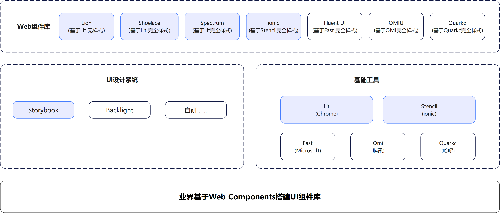

## 1. 简介

- **全称：** Jackery Design System - Jackery设计系统
- **简写：** JDS
- **介绍：** 作为全球官网中心前端设计系统，按照前端规范，基于Web Components + Vite + Lit + Storybook设计实现跨技术栈的Web端基础库。采用 Monorepo 架构，包含核心组件、图标库、国际化和工具函数四个独立包。
- **目标：** Shoelace/Spectrum/Baklava
- **仓库：** [http://192.168.30.241/global-website/jackery-design-system](http://192.168.30.241/global-website/jackery-design-system)
- **设计：**
  - [Figma - 基础UED - v1.0](https://www.figma.com/design/LI5xCizwANfYUQC0kub9B6/%E5%9F%BA%E7%A1%80UED%E8%A7%84%E8%8C%83)
  - [Figma - 基础UED - v2.1](https://www.figma.com/design/LI5xCizwANfYUQC0kub9B6/%E5%9F%BA%E7%A1%80UED%E8%A7%84%E8%8C%83?node-id=1108-1702&t=ptn5VD9j0Cx3DvgW-0)
  - [蓝湖 - 基础UED - v1.0](https://lanhuapp.com/web/#/item/project/stage?pid=a94d0246-a761-4bb0-947a-0616453550db&image_id=ab01c062-3104-4e5f-978a-b7298e8adf75)
  - [Figma - UED控件库 - v1.0](https://www.figma.com/design/xRSdg9dwrFbNMQz1zQVaaE/UED%E6%8E%A7%E4%BB%B6%E5%BA%93)

- **文档：** [前端知识库 - Jackery Design System](https://alidocs.dingtalk.com/i/nodes/o14dA3GK8g5nRwgwHoanD4XgV9ekBD76)

## 2. 目标

- 兼容所有框架
- CDN部署
- 可通过CSS完全自定义
- 包含深浅两个主题
- 无障碍优先

## 3. 部署

- 公司内网npm私仓：`https://nexus.hijackery.cn/repository/npm-private/`
- 名称： `@jackery/design-system`

## 4. 包结构

JDS 采用 Monorepo 架构，包含以下独立包：

### 📦 @jackery/core
- **用途**: 核心 Web Components 组件
- **包含**: Button, Badge, Dialog, Popover, Spinner, Toast, Tooltip
- **安装**: `npm install @jackery/core`
 - **样式策略**: 组件样式以内联方式注入（`index.less?inline`）；不再自动注入核心包的全局样式，项目需在入口显式引入设计系统样式（见下文）。

### 🎨 @jackery/icons
- **用途**: 图标库，提供 87+ 个 SVG 图标
- **特性**: 支持按需导入、Tree-shaking、多种尺寸和颜色
- **安装**: `npm install @jackery/icons`
- **使用**: `import { ArrowRight, AlertFill } from '@jackery/icons'`

### 🌍 @jackery/i18n
- **用途**: 国际化功能
- **包含**: 核心 i18n 功能、装饰器、语言包
- **安装**: `npm install @jackery/i18n`

### 🔧 @jackery/utils
- **用途**: 通用工具函数
- **包含**: DOM 操作、事件处理、表单控制、通用工具
- **安装**: `npm install @jackery/utils`

## 5. 使用

### 5.1 依赖引用

1. 系统目录`C:\Users\本机名\.npmrc` 或前端项目根目录新增 `.npmrc` 文件，内容如下：

  ```text
  # 默认使用npm公网仓库
  registry=https://registry.npmjs.com/

  # === @jackery前缀组件库，使用公司 npm 仓库 === #
  # PROD生产环境使用
  #@jackery:registry=https://nexus.hijackery.cn/repository/npm-private/

  # UAT验收环境使用
  #@jackery:registry=https://nexus.hijackery.cn/repository/npm-private-stage/

  # DEV开发环境使用
  @jackery:registry=https://nexus.hijackery.cn/repository/npm-private-dev/

  ```

2. 命令安装：

  ```cmd
  npm i @jackery/design-system --save
  ```

### 5.2 CDN引用

1. 最新版本：

  ```html
  <link rel="stylesheet" crossorigin href="https://f2e-cdn.jackery.com/@jackery/design-system/latest/dist/index.css">
  <script type="module" crossorigin src="https://f2e-cdn.jackery.com/@jackery/design-system/latest/dist/index.js"></script>
  ```

2. 特定版本：

  ```html
  <link rel="stylesheet" crossorigin href="https://f2e-cdn.jackery.com/@jackery/design-system/0.0.1/dist/index.css">
  <script type="module" crossorigin src="https://f2e-cdn.jackery.com/@jackery/design-system/0.0.1/dist/index.js"></script>
  ```

### 5.3 样式使用规范（最新）

- **全局样式唯一来源**: 在项目入口显式引入 `src/styles/index.less`，统一加载字体、设计令牌、重置、公共样式与动效。
  - 示例：`apps/examples/main.ts:3` `import '../../src/styles/index.less';`
- **组件样式**: 组件内仅以 `index.less?inline` 注入结构样式，使用 `:root` 的 CSS 变量（由全局样式注入）进行主题化，无需在组件内再 `@import` 全局文件。
- **核心包不再自动注入全局样式**: `@jackery/core` 的入口不再引入 `packages/core/src/styles/index.css`，避免与 `src/styles` 的重复与冲突。
- **路径别名**: 推荐在 Vite 配置中添加 `@styles -> src/styles`，统一引用全局样式。

### 5.4 开发环境 Vite 别名

在根站点与示例站的 `vite.config` 中添加：

```js
// 根站点 vite.config.js
resolve: {
  alias: {
    '@': path.resolve(__dirname, 'src'),
    '@styles': path.resolve(__dirname, 'src/styles'),
    '@jackery/core': path.resolve(__dirname, 'packages/core/src'),
    '@jackery/icons': path.resolve(__dirname, 'packages/icons/src'),
    '@jackery/i18n': path.resolve(__dirname, 'packages/i18n/src'),
    '@jackery/utils': path.resolve(__dirname, 'packages/utils/src'),
  }
}
```

```js
// 示例站 apps/examples/vite.config.js
resolve: {
  alias: {
    '@': path.resolve(__dirname, '../../src'),
    '@styles': path.resolve(__dirname, '../../src/styles'),
    '@jackery/core': path.resolve(__dirname, '../../packages/core/src'),
    '@jackery/icons': path.resolve(__dirname, '../../packages/icons/src'),
    '@jackery/i18n': path.resolve(__dirname, '../../packages/i18n/src'),
    '@jackery/utils': path.resolve(__dirname, '../../packages/utils/src'),
  }
}
```

入口示例：

```ts
// 统一加载全局样式
import '@styles/index.less';
// 加载组件与图标
import '@jackery/core';
import '@jackery/icons';
```

## 6. 业界优秀实践

站在巨人的肩膀上看世界，业界优秀实践参考：


