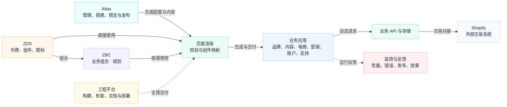

# ZDS 工程与产品演进路线

> **定位**：ZDS 维护可版本化的设计令牌、Lit Web Components、图标与机器可读组件说明。AI 文档提供上下文，不限制模型输出；仓库 CI 检查本仓库的样例，不替下游项目背书。
>
> **当前阶段**：ZDS-01～04 完成，0.4.1 / tokens 0.1.1 发布与门户生产三尺寸复验通过；当前推进批次 3 的 ZDS-05/06：无障碍问题修复与独立消费者浏览器 CI
>
> **最后更新**：2026-11-18

---

## 使用说明（如何维护这份文档）

1. 每完成一个任务，把对应 `[ ]` 改成 `[x]`；
2. 阶段全部完成后，更新顶部「当前阶段」和总览表的「状态 / 完成日期」；
3. 有新决策时更新「决策登记」表；阶段有调整时在「变更记录」补一行。
4. 查看进度：直接看总览表 + 顶部状态条即可。

---

## 后续迭代清单（2026-11-17）

本清单是当前 ZDS 仓库的后续工作入口，承接 [架构评估与实施结果](./architecture-review-20261117.md)。本仓库没有 Atlas Backlog/SOP；Atlas 的平台任务应在其实际项目中维护。用户于 2026-11-18 授权按本路线继续实施，当前从 ZDS-01 开始。真实发布及清单中标注的策略、平台设置仍按其授权条件执行。不做人日估算，按可验收结果划分批次。

已完成基线：全站深色 UI、架构展示、十个组件子路径与类型/样式、六包消费者验证、重复注册与多语言初始化修复、CommonJS 动态图标、发布复用 CI、单次门户组装、指南模板与稳定文档生成。验收：294 项组件测试、79 项 Storybook 渲染测试、六包 79 个文件声明、严格类型与生产样式、独立浏览器及三尺寸门户检查通过。

| 编号 | 优先级 / 批次 | 任务与目标 | 来源 | 状态 | 依赖 | 验收条件 | 责任 |
| --- | --- | --- | --- | --- | --- | --- | --- |
| ZDS-01 | P1 / 批次 2 | 分开 npm 与 CDN 产物：npm 共享 Lit，CDN 使用明确的自包含入口 | 架构评估 P1 | 2026-11-18 完成；npm 与 jsDelivr/unpkg 固定版本三尺寸实测通过 | 现有包契约与消费者基线 | npm 总包、基础包、混用两种顺序均可用；检查实际构建确认 Lit 未重复打入 npm 包；固定版本 CDN 的按钮、图标、主题、多语言可用；接入说明和回退路径同步 | AI 实施，用户验收 |
| ZDS-02 | P1 / 批次 2 | 仅公开总包和 tokens，四基础包保持内部模块，补 Changesets 和发布产物记录 | 架构评估 P2；用户确认两包策略 | 2026-11-18 完成；0.4.1 / 0.1.1 公开安装、产物哈希与 CDN 核查通过 | ZDS-01；策略已确认 | 两公开包不依赖私有包，可独立安装；版本、提交、包清单及 hash 可追溯；发布前消费者检查通过；正式发布后核查 registry/CDN | AI 实施，用户已授权发布 |
| ZDS-03 | P1 / 批次 2 | 在 PR 上验证远端 CI，并核对分支保护要求的检查名称 | 本批 CI 变更与既有 Rulesets 记录 | 2026-11-18 远端验收完成；PR #9 CI 通过并已合并 | 创建进入受保护分支的 PR；可查看远端设置 | 同一提交的构建、包安装、类型、lint、测试、文档和 Storybook 检查通过；保护规则要求与实际检查名一致；release 必须依赖 quality。包验证作为 quality 步骤，检查名保持稳定；修改平台设置另行授权 | AI 核查，仓库管理员配置 |
| ZDS-04 | P2 / 提前实施 | 沿用线上彩色全景，补齐渲染、API、存储及外部系统关系，收敛架构范围 | 用户 2026-11-17 最新反馈：认可 design.aiyazone.com 原图，要求补缺而非扩大平台设计 | 2026-11-18 用户验收完成；960c404 已提交推送 | 以线上全景为视觉和覆盖范围基线；Atlas 资料只作事实核对 | 默认直接展示七条彩色能力带；每带 3–4 个能力组，业务入口最多 6 个；补充的运行支撑和外部交易边界在图上可找到；三条主链路可读；取消五视图与自动展开长详情；每组详情最多四项；三尺寸、键盘、旧链接、构建与适用检查通过 | AI 整理与实施，用户验收 |
| ZDS-05 | P2 / 批次 3 | 定位并修复 Storybook 已有无障碍提示，为代表性组件建立稳定断言 | 本批渲染测试日志 | 2026-11-18 修复完成；最终全量及远端 CI 验收中 | 记录实际违规及触发 story | 对已复现问题修复并补有效回归；不放宽已有检查；重点验证标签、焦点、键盘和对比度，更新限制说明；79 个渲染测试与组件测试继续通过 | AI 实施，用户验收 |
| ZDS-06 | P2 / 批次 3 | 把独立安装项目的真实浏览器检查接入 CI | 本批消费者浏览器验收 | 2026-11-18 公开消费者三尺寸通过；内部回归及远端 CI 验收中 | ZDS-01 与 ZDS-03 | 使用 tarball 安装且无源码别名；按钮、动态图标、主题、语言与代表性弹窗/下拉操作可复现；失败输出日志和截图；服务与临时目录可清理 | AI 实施，用户验收 |
| ZDS-07 | P3 / 批次 4 | 选一个实际内容页面，验证“数据 → 校验 → 组件映射 → 页面” | 架构评估 P3 | 待业务场景确认 | 批次 2/3；页面目标、内容样例、业务负责人 | 内容版本、允许组件与属性、未知组件回退、旧版本处理和错误定位明确；页面能演示且能回退原有实现；平台发布、监控责任清晰 | 用户确认场景，AI 实施 |
| ZDS-08 | P3 / 批次 4 后 | 达到真实复用条件后再做 ZBC 业务组合组件 | 现有 ZBC 准入规则 | 待复用证据 | 同一稳定模式在至少三个真实场景使用 | 组合已有基础组件与样式；业务请求和状态边界明确；记录三处复用证据、API 和兼容验证 | 业务负责人提供证据，AI 实施 |
| ZDS-09 | P4 / 远期池 | 按业务测量结果决定 SSR、Edge、多区域缓存和性能监控 | 原多站点规划 | 冻结 | 实际站点的 SEO/首屏/运行指标与部署责任人 | 先有基线和具体问题，再选技术；定义收益指标、成本、告警与回滚；在业务项目维护，不以基础组件仓库代替运行平台 | 业务团队负责 |

### 建议批次顺序

1. **批次 2：接入与发布可靠**，取 ZDS-01～03。先解决 npm/CDN 依赖，再确定包发布方式，最后用远端同一提交验证质量与保护规则。
2. **批次 3：架构资料和消费者验证一致**，取 ZDS-04～06。统一架构数据，处理实际无障碍问题，并自动验证发布包在浏览器中的行为。
3. **批次 4：真实内容页面试点**，先取 ZDS-07；有三处复用证据才取 ZDS-08。试点结果支持平台需求后，再讨论 Atlas 的建设范围。
4. **远期池**，ZDS-09 保持冻结，等待业务证据。

每批完成需同时满足：功能可演示、相关检查通过、文档与包契约同步。验证结果应附具体提交与日志；本地通过、远端通过、正式发布分别记录。

### ZDS-01 实施与验收（2026-11-18）

沿用已有包边界：总包继续包含 ZDS 组件代码，npm 的 ESM/CJS 均外部引用 Lit 及其子路径；基础包使用同一 Lit。CDN 在 `dist/cdn/index.js` 内包含运行时和动态图标，通过 `@aiyazone/design-system/cdn` 明确导出；主题 CSS 保持现有独立入口。CDN 与 npm 分别在独立页面使用。

1. 先在实际产物和 tarball 消费者中复现重复 Lit，检查按钮、图标、多语言组件与消费者 `LitElement` 的实例关系。
2. 调整 npm 构建的外部依赖，新增 CDN 构建且避免清空 npm 产物；完整构建同时生成两种入口及主题、类型。
3. 验证基础包、总包、混用两种顺序的 ESM/CJS、严格类型与实际生产构建；检查构建模块确认 npm 不含 Lit 源码。
4. 用已打包的固定版本产物验证 CDN 按钮、动态图标、主题和语言切换，回写接入说明与旧版回退方法。registry/CDN 上线检查需在正式发布后完成，不能用本地结果代替。

本地结果见 [包验收记录](../output/packages-20261118/验收.md)：

- [x] 总包和图标包的重复 Lit 已由实际消费者失败断言复现并修复。
- [x] 五个 npm 包的构建模块检查均内嵌 0 个 Lit 模块；492 个 npm JS 文件无 Lit 运行时；CDN 自包含 16 个 Lit 模块，无其他 JS 导入。
- [x] 六包 tarball、81 个文件声明、八种 ESM/CJS 导入、两种严格类型解析及四页面生产构建通过；消费者构建只有一份 Lit ReactiveElement。
- [x] 基础包、总包、两种混用顺序、固定版本 CDN 路径，五方式 × 三尺寸共 15 组浏览器验证通过：按钮点击、动态图标、主题颜色覆盖、英语切日语与单份 Lit。
- [x] 类型、lint、294 项组件/配套测试、令牌、AI 样例及79项 Storybook 渲染通过。接入说明与机器可读文档已同步，生成稳定性检查通过；已有 Storybook 无障碍提示保留为 ZDS-05。
- [x] 新入口 0.4.1 正式发布，registry 安装、npm 生产页面与 jsDelivr/unpkg 在线三尺寸核查通过；首页和账户样例已使用 0.4.1 的 JS/CSS 组合并通过本地交互验证。结果见 [正式发布验收](../output/release-20261118/验收.md)。

### ZDS-02 两包发布策略（2026-11-18）

当前 release 工作流只发布总包和 tokens。正式发布后，公开 registry 的总包 latest 为 `0.4.1`，tokens 为 `0.1.1`；core/icons/i18n/utils 保持私有工作区模块，不承诺可公开安装。发布准备时总包 latest 为 `0.3.2`，四基础包查询返回 404。

用户明确确认：“只发布总包和 tokens”。对外只承诺总包组件接入及独立令牌接入；core/icons/i18n/utils 保持私有工作区模块，保留内部子路径和六包 tarball 验证。共享 ESLint/TypeScript 配置也设为私有，避免 Changesets 误发。用户随后已授权正式发布。

两公开包独立采用语义版本，不设置固定或联动版本组。组件、图标、多语言与工具变化记入总包 Changeset；令牌变化记入 tokens，若影响总包生成的主题则也记入总包。Changesets 必须识别根目录总包，私有包不升版、不打标签。本次总包 minor 到 `0.4.0`（CDN 接入路径变化），tokens patch 到 `0.1.1`。

实施与验收：

1. 将内部包设为私有，限制 Changesets 与发布脚本的范围，校验公开包没有私有运行依赖或工作区路径。
2. 补总包 Changeset 并准备两包版本、变更日志与锁文件，生成版本一致的 API/AI 文档。
3. 默认消费者只安装总包和 tokens，检查真实 ESM/CJS、严格类型、主题与生产构建；六包混用通过内部专用命令继续验证。
4. 发布工作流复用 quality，保存提交、版本、文件清单、依赖、tarball hash，发布消费者验证过的同一份 tarball。
5. 记录本地验证结果；正式发布后的 registry/CDN 核查继续保留待办，门户当前 CDN 引用保持已发布版本。

- [x] 用户确认两包策略。
- [x] 包配置、Changesets 版本准备、两包消费者与内部接口验证完成。
- [x] 产物记录、接入文档和发布流程同步并完成适用质量检查。
- [x] 正式 npm 发布与 registry/CDN 在线核查完成：总包 0.4.1 / tokens 0.1.1 可安装，两包与成功 Actions tarball 的文件、依赖、SHA256 及 registry SHA512 一致；npm 与两个 CDN 三尺寸验证通过。原 v0.4.0 标签保留。

本地结果见 [两包发布验收](../output/packages-20261118/两包发布验收.md)：公开两包安装、tokens 单独安装、六包内部回归、两种严格类型解析、实际生产构建、三尺寸 npm/CDN 六组浏览器检查、294 项测试及文档生成稳定性通过。发布范围的四种错误配置均被拒绝；下一次版本计划隔离验证只包含两公开包。正式执行见 [发布与在线验收](../output/release-20261118/验收.md)：补齐 tokens 的仓库元数据后，首次 v0.4.1 发布完成 tokens；再修正 npm 12 的本地 tarball 路径，run 44262755187 通过原标签重试完成总包发布。发布扫描完成后核实公开可安装，避免把 202 受理当作安装成功。

### ZDS-03 CI 名称兼容与远端核查（2026-11-18）

本轮新增包检查时，quality 的显示名曾改为 `Build · Type · Test · Tokens · Docs · Packages`，与 2026-11-15 记录的 required check 不一致。现恢复稳定名称 `Build · Type · Test · Tokens · Docs`；发布范围、包导出、Lit 产物与 tarball 安装检查继续在同一任务内执行。无需为了新增步骤修改平台规则。Release 的 publish 仍通过 `needs: quality` 依赖复用的 `ci.yml`。

- [x] 本地检查名与已有规则记录一致，贡献指南说明新增步骤不更名。
- [x] 两份 workflow 的 YAML 解析、包检查步骤与 Release 依赖核验通过，补丁格式检查通过。
- [x] 已登录 GitHub 并读取 master/develop 实际生效的 Rulesets、传统分支保护及 required checks。
- [x] 用户授权提交推送本轮 ZDS-01～03 改动；代码提交 `dcb81f2` 已推送。
- [x] 已创建进入 master 的 [PR #9](https://github.com/AIYAZONE/design-system/pull/9)；远端 CI 已启动。
- [x] 对该 PR 的同一提交核对全部 CI 步骤、检查名称及合并要求，记录提交 SHA 和 Actions 链接。

GitHub CLI 2.104.0 已完成登录。远端 master（Ruleset `27304465`）和 develop（`27304522`）均启用保护：必须通过 PR 合入、要求分支更新、禁止强推与删除，required check 精确为 `Build · Type · Test · Tokens · Docs`，来源 GitHub Actions（integration `15368`）。传统分支保护接口返回 404，保护由 Rulesets 生效；未修改平台规则。

本轮代码提交 `dcb81f2` 已推送至 `origin/feat/home-revamp`，并合并 `origin/master` 的现有合并提交以满足分支更新要求。以下远端验收需以 PR 最终 HEAD 为准；本地包验收报告中的提交状态是验收当时的历史快照。用户随后授权合并、打标签与正式发布；PR #9 已合并，`v0.4.0` 固定在合并提交 `af6a7e6e3bcffe0d282b42b722d872966a123c0a`。

远端验收提交为 `ed9b7bb93d79cb1079062e2e0ccf94ae17c63022`，[Actions run 44258038554](https://github.com/AIYAZONE/design-system/actions/runs/44258038554) 已成功完成（1 分 50 秒）。包构建、公开包 tarball 安装、类型、lint、组件测试、令牌、文档、AI 样例和 79 个 Storybook 渲染检查全部通过。实际 CheckRun 名称与 Rulesets 完全一致，app ID 为 `15368`；`gh pr checks --required` 通过，PR 状态为 `MERGEABLE / CLEAN`，Vercel 预览部署成功。

Chromatic 已发布 [build 12](https://www.chromatic.com/build?appId=6af6e62dac96b03b34e741db&number=12)，包含 10 个组件、79 个 stories；当前使用 `--exit-once-uploaded`，CI 成功表示上传完成，不能代替视觉差异测试与基线审批。已有 Storybook 无障碍提示由 ZDS-05 承接。此验收记录提交后再次检查最终 PR HEAD；后续运行链接保留在 PR Checks 与交付结果中，避免为写入自身 SHA 反复生成提交。

### ZDS-05/06 批次 3 实施计划（2026-11-18）

用户已授权按本路线继续。范围为真实无障碍问题和发布包浏览器质量检查；实施与证据直接回写本清单。

方案采用现有 Storybook 渲染检查与独立 tarball 消费者。另建浏览器示例项目会重复安装及构建逻辑；仅测试源码别名不能验证实际交付的包。复用 `scripts/check-packed-consumer.mjs` 生成的隔离消费者，增加浏览器步骤与失败证据，CI 的 required check 名称保持不变。

1. **复现与失败断言**：按 `.storybook/preview.ts` 和现有 addon 的扫描范围，在 Chromium 扫描 79 个 stories，保存规则 ID、节点、原因与对比度数据。针对真实问题先增加失败断言，保留修复前证据；不因提示数量改为关闭规则。
2. **无障碍修复**：根据报告修改实际组件、主题来源或 story 内容。收紧 button、badge、dialog 中仅断言「结果是数组」的测试；用真实浏览器补名称、键盘操作、弹窗初始焦点、Tab 循环、关闭后的焦点恢复与对比度检查。jsdom 无布局能力的限制在文档明确。
3. **消费者浏览器流程**：扩展 `scripts/check-packed-consumer.mjs`，由独立生产页面演示按钮、图标、主题覆盖、英语切日语、弹窗及下拉。浏览器执行代码放独立模块，使用 Storybook 已安装的 `playwright-core`，验证真实生产构建且无源码别名。
4. **失败与清理**：浏览器失败记录场景、屏幕尺寸、页面错误和截图；临时 HTTP 服务使用空闲端口，并在 `finally` 关闭浏览器与服务。消费者目录默认清理，已有人工诊断需要显式保留。成功及失败退出码均应可由 CI 识别。
5. **CI 与回归**：在 `.github/workflows/ci.yml` 的 quality 内安装 Chromium、运行消费者浏览器检查，失败时上传诊断产物；保持 `Build · Type · Test · Tokens · Docs`。完整测试、类型、lint、令牌、文档和 79 项 Storybook 渲染检查通过后，按同一提交核对远端 CI。
6. **交付**：1440 / 768 / 390 三尺寸检查；记录失败复现、修复效果、自动清理及远端运行链接。组件契约变更同步 API/AI 文档，涉及公开包行为时补 Changeset，由版本准备流程决定下次包版本。

执行检查：

- [x] 79 个 stories 的 Chromium 原始违规报告与针对性失败断言。
- [x] 已复现问题修复，名称、焦点、键盘及实际对比度验证通过。
- [x] 独立生产消费者三尺寸检查与错误、截图输出可复现。
- [x] 服务及临时目录清理验证通过，CI 接入并保留稳定 required check。
- [ ] 完整本地回归、文档同步及同一提交的远端 CI 通过。

首次报告中 56/79 stories 有违规，包含对比度、按钮名称、可见文字与名称不一致。修复 loading 名称、键盘轮廓、弹窗关闭按钮／插槽焦点／焦点恢复、标题层级、下拉树标签及滚动焦点入口；生产页面另复现打开过渡阻止初始聚焦并修复。主题语义色从 tokens 真源调整，基线同步；公开包各补 minor Changeset，当前公开版本仍为 0.4.1 / 0.1.1。本批结果与原始证据见 [无障碍与消费者验收](../output/a11y-consumer-20261118/验收.md)。Chromium 检查等待动画结束，保留 `incomplete`；Chromatic 上传不代替视觉审批。

### ZDS-04 最新方案：沿用彩色全景，补齐关键关系

方案日期：2026-11-17。状态：用户于 2026-11-18 回复“OK 实施”，完成改版与本地技术验收后回复“非常棒哈 先提交推送代码”；用户验收完成，提交 `960c404` 已推送至 `origin/feat/home-revamp`。该节替代此前实施级全栈蓝图作为页面修改依据；历史验收记录保留。结果见 [彩色全景验收](../output/architecture-20261118/验收.md)。

实施步骤（2026-11-18）：

1. 建立七带、能力组与三链路的小规模展示数据，保留旧完整模型供资料页查阅。
2. 改版主图、关键关系、短详情和手机布局；兼容旧模块链接。
3. 检查数据引用、构建、键盘与三尺寸浏览器行为，保存截图与验收结果。
4. 更新本清单及架构评估记录，交付本地可查看页面。

#### 用户目标与基线

用户认可 `https://design.aiyazone.com/` 的全景覆盖面、配色和图形组织，要求补齐缺失部分。此次目标是帮助读者看懂“有哪些能力、各自做什么、如何协作”。

线上图已通过浏览器读取和截图核对：浅色图面、七条彩色横向能力带、左侧层名、右侧能力组。颜色顺序为业务蓝、Atlas 青、业务组合紫、设计系统橙、工程平台黄、运行绿色、观测粉。沿用这个视觉结构。

此前两个方向均需纠正：43 个模块和 217 项子能力超出阅读目标；仅保留内容发布链路又会丢失用户认可的工程、设计与监控全景。新版保持原图的覆盖面，并降低节点颗粒度。

#### 方案选择

| 方案 | 结果 | 取舍 |
| --- | --- | --- |
| 原图补齐与纠错（推荐） | 保留七条能力带和配色，将缺失关系补进相应能力组 | 改动集中，读者沿用熟悉的结构；适合当前诉求 |
| 重新整理为更少层级 | 将设计、工程、运行等重新合并 | 图更短，但改变用户认可的分类，暂不采用 |
| 保留现有完整模型并继续折叠 | 保留五视图、模块与全部详情 | 展开后仍然庞杂，不能解决范围失控，停止沿此方向推进 |

#### 七条能力带

能力带表示分类，不表示请求必须依次穿过七层；每条主要展示 3–4 个能力组，业务入口允许最多 6 个。能力组中的子项以简短标签呈现，不分别变成服务节点。

| 能力带 / 配色 | 图上主要内容 | 本轮调整 |
| --- | --- | --- |
| 业务应用 / 蓝 | 品牌与内容、电商店面、营销活动、账户与会员、帮助与支持 | 补电商入口；多站点、多语言、多区域作为配置标签；运营入口由 Atlas 表达，避免重复 |
| 内容平台 Atlas / 青 | 站点与素材管理、内容建模、可视化搭建、预览与发布 | 补站点配置与素材；说明 Atlas 产出页面配置和发布内容，渲染执行由运行能力承接 |
| 业务组合 ZBC / 紫 | 营销展示、表单组合、数据展示 | 更名为“业务组合组件”；保留规划标记，避免被理解为会员、交易等后端领域 |
| 设计系统 ZDS / 橙 | 设计令牌与主题、基础组件、视觉资产、国际化与工具 | 沿用主要内容，名称统一；明确页面可以直接使用 ZDS，组合组件按复用需要使用 |
| 工程平台 / 黄 | 代码与版本管理、构建与质量检查、预览与部署、文档与 AI 接入 | 补源码生成文档、组件包供应用使用的关系；工具名放二级说明 |
| 运行与数据支撑 / 绿 | 页面渲染、业务 API、数据库与文件存储、站点交付 | 在原运行带中补 Runtime/Schema 映射、API 与存储；CDN、SSR/静态生成、回退为组内说明 |
| 监控与反馈 / 粉 | 页面性能、前后端错误、发布运行状态、业务效果 | 补 API 和发布状态反馈；保留业务效果范围，不展开分析平台 |

外部边界只增加一个虚线区域：“Shopify 等业务系统”，主要明确电商对接 Shopify，交易由外部系统负责。CRM/ERP 等在有明确接入需求后补充，不逐个画为本次平台模块。

下面只示意主协作关系，包含按需使用的规划组合；实际页面继续采用线上图的七条横向能力带。两个绿色节点在页面中合并到同一条“运行与数据支撑”带，外部系统位于图侧。

#### 必须补齐的关系

1. **内容怎样变成页面**：Atlas 的页面配置与内容 → Runtime 校验和组件映射 → 站点页面。Schema 和 Registry 的术语在详情中解释，主图优先中文。
2. **组件怎样被使用**：ZDS → 业务组合或直接进入页面；基础组件不依赖 Atlas。不能画成所有页面必须经过尚在规划的 ZBC。
3. **动态数据从哪里来**：页面 → 业务 API → 平台数据库或 Shopify；素材与发布产物由文件存储支撑，CDN 分发公共资源。
4. **工程怎样支撑交付**：源码 → 检查与构建 → 组件包/应用产物 → 部署；组件文档和 AI 说明是开发接入资料。
5. **运行怎样形成反馈**：性能、接口错误和发布状态 → 监控 → 对应维护团队的改进；业务效果保留为高层能力。

这五项在图上归并为三条可高亮主链路：“内容发布”“组件与代码交付”“访问与反馈”。默认只画关键箭头，最多 8 条；选择主链路时只突出相关节点和箭头。图旁保留一句“箭头表达主要协作，能力带不是严格执行顺序”。

#### 页面与信息预算

- `/architecture.html` 默认直接呈现彩色全景；标题、简短说明、图例之后就是图，不再先展示三段摘要后要求展开。
- 主体为“一张全景 + 三条主链路”，取消现有五视图导航、六场景筛选及成组的详情面板。
- 每个能力组最多展示名称和一句职责，组内标签最多 3 项；工程平台可保留原图的四组小面板。
- 点击能力组打开一处简短详情，最多四项：负责什么、主要包含什么、与谁协作、当前状态。每项最多两句，禁止展开契约字段、数据生命周期、故障策略与证据目录。
- 核心能力在主图可读，详情只补解释；查看详情不应成为理解架构的前置条件。
- 颜色表达能力分类；状态另用文字表达“已有实现 / 部分实现 / 规划”。详情说明核查范围；源码存在不表述为生产已部署。
- 原图成熟度百分比、等级评分、升级年限不进入新主页面；仓库清单和历史记录仅在资料入口中访问。
- 多区域仅保留为站点交付维度，本轮不制定集团区域拓扑、homeRegion、灾备或容量目标。
- 旧 `?view=deployment#module-domain-sites` 等链接映射到对应简化能力组，不触发旧的大型部署视图。无法映射时回到全景。
- 桌面保持横向能力带；手机改为同色的纵向分组，文字保持可读，主链路用顺序文字补充。

#### 范围控制与验收

本轮新增内容限定为上面列出的缺失关系及必要纠错。会员、营销和客服保留业务入口，不向下展开新的身份、权益、工单、活动规则服务。队列、Outbox、端口分层、区域数据库、详细契约、SLA 和容量设计不纳入本次页面方案。

后续改动集中在门户架构页面、全景渲染、样式和相应数据；重新建立小规模展示数据，旧完整模型仅保留为历史资料，不继续驱动新主图。Atlas 源码与文档继续只作事实参考。

- [x] 浏览器核对线上全景的实际布局、内容与颜色。
- [x] 明确原图补齐方案、七条能力带、缺失关系和信息预算。
- [x] 在现有 ZDS-04 中原位更新范围，避免新增另一份独立方案。
- [x] 用户评审该方案后实施门户改版。
- [x] 校验显示内容、引用与全部 43 个旧模块链接映射；门户 TypeScript/Vite、仓库 lint、整站组装及补丁格式检查通过。
- [x] 在开发预览与最终生产产物的 1440、768、390 三种宽度验证图面、全部能力组的键盘详情、主链路刷新恢复与旧链接。
- [x] 主图直接呈现 Atlas、ZDS、ZBC、渲染、API、存储、Shopify、工程交付与监控，内容到页面路径可从关键关系读取。
- [x] 用户体验验收：2026-11-18 用户回复“非常棒哈 先提交推送代码”，认可改版并授权提交推送。

## 历史阶段与当前已完成范围

| 阶段 | 内容 | 工期 | 状态 | 完成日期 |
|------|------|------|------|----------|
| 0 | 小清理（token 泄露修复 + 产物卫生） | 0.5 天 | 🟢 已完成 | 2026-11-13 |
| 1 | Tokens 真源化（DTCG JSON → 生成物） | 2–3 天 | 🟢 已完成 | 2026-11-13 |
| 2 | AI 可消费文档（CEM + API 规格 + llms.txt） | 3–4 天 | 🟢 已完成 | 2026-11-13 |
| 4 | ZBC 薄层规范（与阶段 2 并行） | 1 天 | 🟢 已完成 | 2026-11-13 |
| 3 | CI 质量门禁（构建、类型、测试、令牌、文档、Storybook） | 2–3 天 | 🟢 已完成 | 2026-11-15 |
| 5 | 依赖大版本升级（Vite/Vitest/Storybook） | 2–3 天 | 🟢 已完成 | 2026-11-13 |
| 6 | 定位收敛、站点呈现与 AI 样例验证 | 持续 | 🟢 已完成 | 2026-11-16 |
| 7 | 全站深色 UI、完整架构展示、包契约与混用修复、发布检查配置 | 按验收结果 | 本地验收完成，待 PR 远端验证 | 2026-11-17 |

依赖关系：`0 → 1 →（2 ∥ 4）→ 3 → 5`。合计约 10–14 人天。

---

## 阶段 0：小清理（0.5 天）

**目标**：消除安全隐患与维护负担，为阶段 1 扫清障碍。

- [x] `apps/storybook/package.json` 中硬编码的 Chromatic token 移至环境变量（chromatic CLI 自动读取 `CHROMATIC_PROJECT_TOKEN`），新增 `.env.example` 与 `.gitignore` 忽略 ⚠️ **该 token 历史提交中曾明文出现，需到 Chromatic 后台轮换**
- [x] ~~归档删除 v1/v2 主题~~ → **调整为保留**：核查发现 `apps/examples` 主题切换演示仍引用 v1/v2（`apps/examples/main.ts`），不删除；阶段 1 仅收敛 zone 主线 + v3
- [x] 确认构建产物（dist / storybook-static）未被 git 跟踪，`.gitignore` 已覆盖并补充 `.env*` 忽略
- [x] 全仓敏感词复扫 0 命中；build 5/5、test 7/7 全绿

**验收**：`pnpm run build && pnpm run test` 全绿；v1/v2 删除后文档站与组件样式无回归（肉眼过一遍 stories）。

---

## 阶段 1：Tokens 真源化（2–3 天）

**目标**：设计令牌从「手写 LESS」变为「机器可读 JSON 单真源 + 自动生成」，AI 与人消费同一份数据。

- [x] 新建 `packages/tokens`，定义 `tokens.json`（DTCG 风格）：基础色板 / 语义色 / 尺寸刻度 / 字号 / 圆角 / 字重 / 层级 / 字体组合 / 响应式参数
- [x] 编写生成器 `pnpm tokens:build`（零依赖 Node），产出：
  - [x] `src/styles/zone/generated-tokens.less` —— tokens.base.less 变量段（mixin 保留手写）
  - [x] `src/styles/themes/v3/generated-tokens.less` —— 主题覆盖 + 语义变量 + 字体组合（原 205 行手写收敛为 12 行骨架）
  - [x] `packages/tokens/dist/tokens.css` —— 静态全量令牌表（149 变量，CDN/npm 直用）
  - [x] `packages/tokens/dist/tokens.ts` —— typed `as const`，TS 侧消费
- [x] 新旧并行比对：`scripts/verify.mjs` 用 lessc 编译 v3/v1/v2 三主题，基线 vs 生成版 **diff = 0**（1144/1079/1143 行完全一致）
- [x] `pnpm tokens:check`：生成物与提交不一致 → 失败
- [x] lint 规则 `pnpm tokens:lint`：组件 less 禁止**新增**裸 hex（存量 47 处冻结于 `hex-allowlist.json`，增量即失败）
- [x] `docs/tokens/*.mdx` 色板 / 间距表改为从 JSON 自动渲染（`packages/tokens/scripts/build-docs-mdx.mjs`：colors / size-and-spacing / radius / z-index 四份文档的表格段由 tokens.json 生成，`pnpm docs:gen` 一并产出，`docs:check` 纳入 diff 校验；顺带修正了手写表格与 JSON 的漂移——尺寸 42/44/50/68/94 五档此前缺失）

**验收**：`tokens:check` 通过；变量名零变更（下游无感知）；文档站 tokens 页与 JSON 一致。

**风险**：mixin 重排可能引入细微样式回归 → 依赖 diff=0 校验 + 阶段 3 视觉回归双保险（建议先跑一次 Chromatic 基线再动手）。

---

## 阶段 2：AI 可消费文档（3–4 天）

**目标**：组件的 API 与用法成为 AI 可直接读取的结构化数据；站点对 AI 暴露标准入口。

- [x] 接入 `@custom-elements-manifest/analyzer`，生成 `packages/core/custom-elements.json`；因装饰器来自本地模块，另建源码增强解析（`build-ai-docs.mjs`：@property/@state/事件/插槽/类型别名展开/@summary/@cssproperty）→ 产出规范化清单 `packages/core/zone-manifest.json`
- [x] ~~Storybook 接 CEM~~ → **调整**：组件 API 规格由 `docs/api/*.md` 承载（生成器输出），Storybook autodocs 维持现状（避免双真源）
- [x] 文档生成器 `pnpm docs:gen`：CEM + 源码增强 + tokens → `docs/api/zone-*.md`（快速使用 / 属性表 / 事件 / 插槽 / 可覆盖 CSS 变量 / 约束）+ `docs/api/README.md` 索引
- [x] 站点 AI 入口（`apps/portal/public/`，构建时随 dist 发布）：
  - [x] `/llms.txt` —— 组件索引 + 使用建议 + 令牌摘要 + 安装方式
  - [x] `/llms-full.txt` —— llms 索引 + 10 组件全量规格 + AI 使用规范 拼接
  - [x] `/ai-usage.html` —— AI 生成页面指南（当前由 `apps/portal/templates/ai-usage.html` 生成；`docs/ai-usage.md` 保留完整技术说明并进入 llms-full.txt）
- [x] 同步校验 `pnpm docs:check`：CEM/清单/文档/llms 产物与源码不一致即失败（阶段 3 接入 CI）

**验收**：新增组件后一条 `pnpm docs:gen` 自动更新清单与 API 文档；AI 可读取这些资料作为上下文，生成结果仍需检查。

---

## 阶段 4：ZBC 薄层规范（1 天，与阶段 2 并行）

**目标**：业务组件层「规划中、保持最薄」，能由 AI 按 ZBC 规范现生成的就不预制。

- [x] 撰写《ZBC 准入与 AI 页面生成 Playbook》（`docs/markdown/zbc-playbook.md`）：
  - [x] 准入规则：同一模式出现 **≥3 处复用**才沉淀为 ZBC
  - [x] API 形状约定：受控/非受控、事件命名（`zone-biz-*` custom event）、样式钩子只暴露 CSS 变量
  - [x] 组合优先：ZBC 必须由基础组件 + token 组合而成，禁止重写原语
  - [x] AI 页面生成提示词起点 + 人工检查建议（与 `/ai-usage.html` 同源，`docs/ai-usage.md`）
- [x] portal 全景图 Domain 层明确标为「规划中」，不再将 Atlas 过渡供给描述为已实现；真实复用后再建设组合层

**验收**：规范文档发布到文档站；占位芯片文案与规范一致。

---

## 阶段 3：CI 质量门禁（2–3 天）

**目标**：所有变更机器把关，AI 参与度越高门禁越重要。

- [x] 新建 `.github/workflows/ci.yml`，push/PR 必过关卡：
  `install → build → type-check → test（单测 + a11y 断言）→ tokens:check → tokens:lint → docs:check → storybook 构建 → Chromatic（条件）`
- [x] a11y：**调整实现方式**——a11y 断言已内置于 vitest（button/checkbox/dialog/dropdown 各有 `.a11y.test.ts`，axe-core 断言），随 test 关卡执行；Storybook test-runner 已随 SB9 接入（见下条）
- [x] Storybook test-runner（SB9 后的既定后续，CI 第 7 关）：`pnpm --filter @aiyazone/storybook run test:storybook`——静态构建 + `--index-json` + playwright-core Chromium，79 stories 渲染冒烟全过；CI 在 storybook 构建 后执行
- [x] 视觉回归：Chromatic（决策 #2）作为条件步骤——仓库配置 `CHROMATIC_PROJECT_TOKEN` Secret 后自动生效，未配置时跳过不阻塞；`--exit-once-uploaded` 允许基线待审时通过。**core 基线已建立**（build 1：10 组件 79 stories 上传成功）；icons 项目**不接 Chromatic**（决策 #5），以 vitest 资产守卫测试兜底（SVG 完整性/唯一性/数量，118 项）
- [x] 组件 DoD 写入 `CONTRIBUTING.md`：story + 单测（含 a11y 用例）+ 视觉基线 + API 文档生成，缺一不可合并
- [x] 分支保护：已由仓库管理员通过 GitHub Rulesets 为 master/develop 配置——Require a pull request before merging + Require status checks（`Build · Type · Test · Tokens · Docs`）+ Require branches to be up to date before merging

**验收**：一个故意引入样式回归的 PR 被 CI 拦截；绿灯合入流程跑通一次。

---

## 阶段 5：依赖大版本升级（2–3 天，门禁就绪后才做）

**目标**：在有视觉回归兜底的前提下消化技术债。

- [x] 前置条件：阶段 3 完成（CI + 视觉基线可用）
- [x] 逐包升级、逐个合入（一次一个 PR）：`vitest 1 → 3`（294 测试全绿）→ `vite 5 → 7`（vite-plugin-dts 5、vite-plugin-static-copy 3.3；移除弃用 baseUrl/esModuleInterop；storybook 应用 vite 同批升至 7，SB 9.1 builder 原生支持）→ `storybook 8 → 9`（9.1.21；addons 精简为 docs/a11y/chromatic，essentials/interactions/actions/viewport/blocks 等并入核心；`@storybook/blocks → @storybook/addon-docs/blocks`、`manager-api/theming → storybook/*`；索引 79 stories + 22 文档页完整）
- [x] 每次升级观察：测试全绿 + 视觉 diff 为零（组件实现与样式未动，仅工具链升级）+ 文档站正常（portal build:all 通过）

**验收**：三个大版本升级合入后，六关 CI 持续绿。

---

## 阶段 6：定位收敛、站点呈现与 AI 样例验证

**目标**：将项目定位落到已交付的源码、产物和检查上；让门户更清楚地呈现真实组件与架构边界；用可复现检查代替“AI 一定合规”的文案承诺。

- [x] README 与 AI 入口改为事实型描述：Lit 是实现技术；AI 文档是上下文；下游项目需要自行验证
- [x] 首页改为组件实物演示、源码到产物的说明、接入入口；架构页区分当前实现与未来事项
- [x] 建立站点视觉 tokens，并统一首页、架构页、共享导航、页脚与 AI 指南页的呈现
- [x] 增加 `check:ai-demo`：对照组件清单、图标文件与令牌生成物检查静态页面样例，并加入 CI
- [x] 修复样例中的无效组件属性；修复 tokens CSS 导出中白色别名被写成 `undefined` 的生成器缺陷
- [x] 在指南中记录静态规则覆盖范围与无法替代的人工、运行时和下游检查

**验收**：`check:ai-demo` 通过；令牌产物与源码同步；门户构建成功；主要视口检查无明显溢出。

**边界**：仓库样例的静态检查不是模型约束，也不代表任意生成代码、运行时交互或下游页面已合规。

---

## 决策登记

| # | 决策项 | 推荐 | 状态 | 结论 |
|---|--------|------|------|------|
| 1 | Token 格式：W3C DTCG JSON 单真源 vs 保留 LESS 只做导出 | DTCG 单真源 | ✅ 已确认 2026-11-13 | DTCG 单真源 |
| 2 | 视觉回归：A. Chromatic（省事，免费 5000 快照/月）vs B. Playwright + pixelmatch（零成本自维护） | A | ✅ 已确认 2026-11-13 | A. Chromatic |
| 3 | llms.txt 是否随站点公开 | 公开 | ✅ 已确认 2026-11-13 | 公开 |
| 4 | 是否新建独立 `@aiyazone/tokens` npm 包 | 是（业务线/CDN 直用） | ✅ 已确认 2026-11-13 | 新建独立包 |
| 5 | icons 是否接 Chromatic / 站点形态 | 不接 Chromatic；/icons/ 站点由 icons Storybook 改为**自建静态图标库页**（搜索/分类/复制图标名），质量用 vitest 资产守卫兜底 | ✅ 已确认 2026-11-13 | 自建图标库页，icons Storybook 下线 |
| 6 | ZDS npm 公开发布范围 | 两包，按实际需求保持简单 | ✅ 已确认 2026-11-18 | 仅 design-system / tokens；core/icons/i18n/utils 为内部私有模块；用户随后已授权真实发布 |

---

## 变更记录

| 日期 | 变更 |
|------|------|
| 2026-11-18 | ZDS-01～03 发布收官：总包 0.4.1 / tokens 0.1.1 公开可安装，成功 Release run 44262755187；两包 tarball 与 registry 字节哈希一致，npm/jsDelivr/unpkg 三尺寸共九组浏览器验证通过。首页与账户样例更新自包含 CDN 入口并通过本地验证；最终 PR 合并后复验生产。保留原 v0.4.0、v0.4.1 标签，后续 ZDS-05/06 独立开展 |
| 2026-11-18 | PR #9 已合并且原 v0.4.0 标签保持不变；tokens Trusted Publisher 过期及发布模式修复后 OIDC 交换成功，随后因包缺少 repository.url 被 npm provenance 拒绝（run 44260976758）。补齐 tokens 仓库元数据及发布前回归检查，准备总包 0.4.1 / tokens 0.1.1 的新标签发布 |
| 2026-11-18 | ZDS-03 本地 CI 检查名恢复为既有 required check，包验证步骤保留；Release 依赖 quality 核验通过。GitHub CLI 已安装但未登录，实际 Rulesets/PR 查询待登录，本轮远端验收待提交推送 |
| 2026-11-18 | 用户确认“只发布总包和 tokens”，ZDS-02 两包策略及本地验收完成：总包 0.4.0 / tokens 0.1.1，私有基础包不升版；发布范围、两包独立安装、内部回归、产物记录、文档和 Release 同步。正式 npm 发布另行授权 |
| 2026-11-18 | 按用户要求继续路线：ZDS-01 完成 npm 共享 Lit 与 CDN 独立入口、本地 tarball 与三尺寸浏览器验收、接入及回退文档同步；新入口未发布。ZDS-02 核查公开 registry 并整理六包/两包发布选项，待用户确认；ZDS-04 用户验收及提交推送记录补齐（960c404） |
| 2026-11-17 | 用户认可线上原图的配色和全景组织，纠正本地架构范围膨胀。ZDS-04 原位更新为“原图补齐与纠错”：保留七条彩色能力带，补渲染、API、存储与外部系统关系，限制能力组和详情，取消五视图。最新方案已整理，页面尚未修改 |
| 2026-11-17 | 用户批准全栈蓝图，ZDS-04 提前完成：应用、领域、数据适配到基础设施七层及治理，五视图与统一数据；纠正 Atlas 已有实现、数据库与发布语义；生产与开发三尺寸验收通过，部署/可靠性目标仍待独立验证 |
| 2026-11-17 | 根据“太复杂”反馈，架构入口收成业务应用、平台能力、技术底座三段总览；七层与五视图、仓库实现和历史按需展开，旧链接自动展开定位；开发与生产三尺寸、键盘和构建复验通过 |
| 2026-11-17 | 用户追加“信息超多、只展示必要信息”，把仓库实现、检查配置、平台边界、优化进度与完整功能清单从默认页拆到独立页 `architecture-reference.html`（导航归入“架构”），默认页仅保留 header 与三段总览并给出入口链接；三尺寸复验无横向溢出，截图见 output/architecture-simple-20261117 |
| 2026-11-17 | 用户反馈“架构图看不懂、全是专业术语”，对详情与三段总览做可读性改写：视图名改为「谁调用谁 / 数据存在哪 / 跑在哪里 / 做到哪一步」，关系类型与控件加白话括注，`details` 内与各视图、模块详情顶部加浅色导读，模块详情重排为「导读 → 状态 → 细节」；只改渲染层措辞，架构数据与结论未变 |
| 2026-11-17 | 全站深色科技 UI 与完整架构展示完成；修复包产物、混用注册、多语言、动态图标、文档生成与整站组装，发布接入同一提交 CI；本地验收通过。新增 ZDS-01～09 后续清单，按接入发布、架构与验证、实际内容页面试点、远期运行能力分批 |
| 2026-11-13 | 初版：确立「AI 约束层」定位，规划阶段 0–5 与依赖顺序 |
| 2026-11-13 | 4 项决策按推荐确认；阶段 0 完成（Chromatic token 移出；v1/v2 主题因 examples 引用调整为保留） |
| 2026-11-13 | 阶段 1 基本完成：tokens.json 真源 + 生成器 + 三主题 diff=0 验证 + tokens:check/lint；余 mdx 联动并入阶段 2 |
| 2026-11-13 | 阶段 2 / 4 完成：CEM + 源码增强清单、docs/api 规格、llms.txt / llms-full.txt / ai-usage.html、ZBC Playbook；Storybook CEM 项调整为 docs/api 承载 |
| 2026-11-13 | 阶段 3 完成：ci.yml 七步流水线（a11y 内置于 vitest；Chromatic 条件步骤，Secret 未配置时跳过）；组件 DoD 沉淀 CONTRIBUTING.md；余分支保护需管理员配置 |
| 2026-11-13 | 文档消费方式修正为总包 @aiyazone/design-system；core Chromatic 基线建立（79 stories）；icons 决策 #5（不接 Chromatic，vitest 资产守卫 118 项）；icons 包硬编码 token 移除；.env 解除跟踪并本地化 |
| 2026-11-13 | icons Storybook 下线：/icons/ 改为自建静态图标库页（搜索/分类/尺寸切换/复制图标名），build:all 少一个 Storybook 构建步；图标名清单（113 个）进入 llms.txt 与 llms-full.txt，AI 可直接取用合法图标名；icons 包 storybook 全家桶依赖移除（24 个） |
| 2026-11-16 | **npm 首发**：@aiyazone/design-system@0.3.1 与 @aiyazone/tokens@0.1.0 上线 registry（经暂存发布 + 2FA 批准，npm 2026-08 新规）；发布配置修正（prepublishOnly 去递归发布、publishConfig public 统一、tokens exports）；release.yml 就绪（tag 触发 + OIDC trusted publishing + 版本校验） |
| 2026-11-16 | **自动发版全链路打通**：Trusted Publisher 双包配置生效，v0.3.2 实弹验证 OIDC 发布（仓库零 npm token）；npm 首发版本文档统一为总包（PR #2/#3）；0.0.0-stage 占位符清理；Chromatic token 轮换 + GitHub Secret 接入；stage 分支删除，分支保护生效（PR 流程） |
| 2026-11-16 | **AI 实测闭环（阶段 2 验收）**：按线上 llms.txt/llms-full.txt 生成「账户设置」样例页 /ai-demo.html（CDN 直用 npm 包，初版人工清单通过）。阶段 6 的 API 与运行时检查随后发现 `loading-icon` 不受支持且下拉应赋值 `options` 而非 `data`，均已修正；另修复令牌 CSS 的白色别名输出 `undefined`。AI 资料不再描述为执行约束 |
| 2026-11-16 | **门户视觉与结构收敛**：首页改为事实型文案（版本标签 + 数据事实）+「查/抄/喂 AI/了解」分组入口矩阵 + 浅色安装块 + 一行事实条，删除口号/光晕/深色终端块/大卡；架构页取消双 Tab 改纵向（全景图为主体 → AI 生成流水线 → Non-goals），删除与全景图重复的分层/门禁/发布段；修复品牌名误替换（AIYAZDS → AIYAZONE）；导航「文档」更名「组件」 |
| 2026-11-17 | **门户编辑风重构 + 排版与圆角收敛**：首页改为封面式（事实文案 + LIVE SPECIMEN 真实组件演示 + 交付路径三步 + AI 检查深色块 + 安装区），架构页改为「系统边界按代码说」三节（现状 / 质量闭环 / 明确的未来项）；新增编辑风设计令牌 tokens.css（mono 眉标 + hairline + 编号章节）；修正中文排版（节标题 34-56px → 22-28px、Hero ≤44px、行高 1.18、字距 -0.01em）与圆角语言（2-4px → 8/12/16px，与 logo rx=8 统一），修复 specimen 卡与主按钮直角残留；CI 增 AI 样例页检查关（check-ai-demo）；tokens 导出 CSS 解析基础色别名（changeset patch）；README 定位改写 |
| 2026-11-16 | **首页双轨叙事重构 + 架构页独立（方案 B）**：首页重写为「一套零件，两种写法」（给人用 / 给 AI 用双栏 + 两种引入方式 + 七关门禁徽章 + 紧凑入口行）；/architecture.html 为双视图页：「架构总览」（AI 生成流水线 · 四层单向依赖 · 七道门禁表 · 发布链路 · Non-goals）+「治理全景图」（原工程与运行治理全景图完整保留，含业务分层/C4/KPI/成熟度/升级路线，支持 ?view=panorama 直达）；命名统一 ZONE → ZDS；导航新增「架构」；portal 改多入口构建（index + architecture） |
| 2026-11-13 | 阶段 1 余项清零：docs/tokens 四份 mdx 的色板/尺寸/圆角/层级表格段改为 tokens.json 自动渲染（build-docs-mdx.mjs，docs:gen/docs:check 链路接入），顺带修正手写表格漂移（尺寸 5 档缺失）；并补入此前缺失的框架色 frame 组。阶段 5 开始：vitest 1 → 3 |
| 2026-11-13 | 阶段 5 完成：vitest 1→3（294 测试全绿）→ vite 5→7（vite-plugin-dts 5 / static-copy 3.3，弃用 tsconfig 选项清理）→ storybook 8→9（9.1.21，addons 精简，blocks/manager-api/theming 导入迁移，索引 79 stories + 22 docs 完整）。全部按单步提交合入，各步全门禁通过。计划内工作全部完成，仅余分支保护需管理员配置 |
| 2026-11-13 | 收官后既定后续落地：Storybook test-runner 接入（test-runner 0.23.0 兼容 SB9；静态构建冒烟 79/79 stories 全过；CI 增为第 7 关，位于 storybook 构建与 Chromatic 之间）。本机备忘：公司网络证书链拦截 playwright 浏览器下载，已用本地 chromium-1234 修订版符号链接为 1254 绕过（CI 无此问题） |
| 2026-11-15 | 分支保护配置完成（最后一项人工操作清零）：管理员通过 GitHub Rulesets 为 master/develop 配置 required pull request + required status check（`Build · Type · Test · Tokens · Docs`）+ up to date 约束。阶段 0–5 计划内工作全部收官 |
| 2026-11-16 | **阶段 6 完成**：README、llms 与 AI 指南改为准确表达；门户首页以实际 Lit 组件演示，架构页按当前实现与未来事项分层；新增 `check:ai-demo` 对照组件 HTML/JS API、图标、令牌与表单标签检查，并接入 CI；统一门户与 AI 指南页的纸白/石墨/橙色视觉和窄屏导航 |
