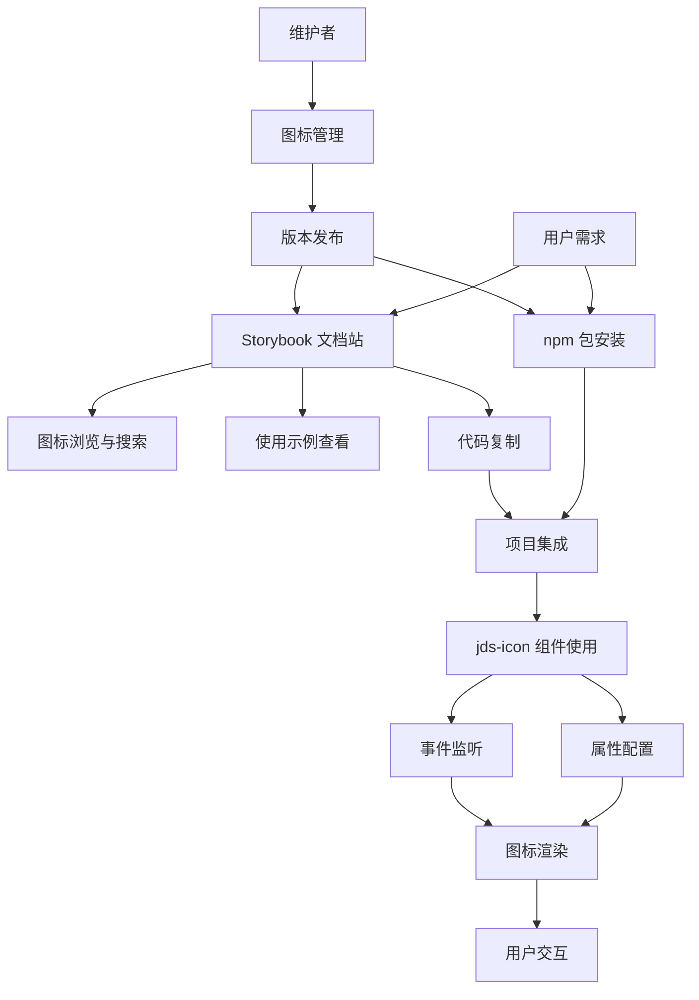

# Jackery Icons 产品需求文档

## 1. 产品概览

### 1.1 项目背景
Jackery Icons 是一个基于 Lit 框架的 Web Component 图标库，提供高质量的 SVG 图标组件，支持按需加载、悬停态切换和事件派发等现代化功能。该产品旨在为 Jackery 前端团队提供统一、高效的图标解决方案，提升开发效率和用户体验一致性。

### 1.2 市场价值
- **统一品牌形象**：确保 Jackery 全产品线的视觉一致性，强化品牌识别度
- **开发效率提升**：减少重复图标开发工作，预计可节省 40% 的 UI 开发时间
- **维护成本降低**：集中化图标管理，降低多项目间的维护复杂度
- **技术标准化**：建立企业级图标使用规范，提升代码质量和可维护性

### 1.3 目标用户
- **主要用户**：Jackery 前端开发团队（15+ 开发者）
- **次要用户**：UI/UX 设计师（5+ 设计师）
- **管理用户**：技术负责人和项目经理

## 2. 市场分析

### 2.1 竞品分析
| 竞品 | 优势 | 劣势 | 市场占有率 |
|------|------|------|------------|
| Ant Design Icons | 生态完善，文档详细 | 体积较大，定制性差 | 35% |
| React Icons | 图标丰富，tree-shaking 好 | 缺乏统一设计语言 | 28% |
| Heroicons | 设计精美，体积小 | 图标数量有限 | 15% |
| Material Icons | Google 支持，更新频繁 | 风格固定，不适合品牌化 | 22% |

### 2.2 技术趋势
- **Web Components 标准化**：浏览器原生支持度达到 95%+
- **SVG 优先**：相比字体图标，SVG 具有更好的可访问性和清晰度
- **按需加载**：现代构建工具对 tree-shaking 的支持日趋完善
- **设计系统化**：企业级应用越来越重视统一的设计语言

## 3. 核心功能

### 3.1 用户角色
| 角色 | 使用方式 | 核心权限 | 使用场景 |
|------|----------|----------|----------|
| 前端开发者 | npm 安装或 CDN 引入 | 可使用所有图标组件、查看文档、集成到项目 | 日常开发、组件集成 |
| UI/UX 设计师 | Storybook 预览 | 可浏览图标库、查看使用示例、提供设计反馈 | 设计评审、视觉规范制定 |
| 项目维护者 | 源码仓库访问 | 可添加新图标、更新组件、发布版本 | 版本管理、功能扩展 |
| 产品经理 | 文档查看 | 可查看使用统计、功能规划 | 需求管理、产品规划 |

### 3.2 功能模块详述

#### 3.2.1 核心功能模块
1. **图标组件系统**
   - Web Component 架构的 `<jds-icon>` 组件
   - 支持 name、hover-name、size、color 等属性配置
   - 事件系统：jds-load、jds-error 事件派发
   - 悬停态双图层切换机制

2. **图标资源管理**
   - 分类管理：系统图标、社媒图标、家电图标、会员系统图标
   - SVG 文件组织和版本控制
   - 按需加载和缓存机制
   - 多格式支持：line、fill、color 变体

3. **开发者工具链**
   - Storybook 交互式文档
   - TypeScript 类型定义
   - 搜索和过滤功能
   - 代码示例和最佳实践

4. **构建与分发系统**
   - Vite 构建系统，支持 ES 和 UMD 格式
   - npm 包管理和版本发布
   - CDN 分发支持
   - 自动化测试和部署

#### 3.2.2 高级功能模块
1. **性能优化**
   - Tree-shaking 支持
   - SVG 压缩和优化
   - 懒加载机制
   - 缓存策略

2. **可访问性支持**
   - ARIA 标签支持
   - 键盘导航
   - 屏幕阅读器兼容
   - 高对比度模式

3. **扩展性功能**
   - 自定义图标集成
   - 主题切换支持
   - 多框架适配
   - 插件系统

### 3.3 页面详情
| 页面名称 | 模块名称 | 功能描述 | 优先级 |
|----------|----------|----------|--------|
| **Storybook 主页** | 图标展示 | 展示所有可用图标，支持分类浏览、搜索过滤、网格/列表切换 | P0 |
| **图标详情页** | 单个图标预览 | 显示图标的不同状态、使用代码示例、属性配置面板 | P0 |
| **文档页面** | 使用指南 | 提供安装说明、API 文档、最佳实践、集成示例 | P0 |
| **组件 API** | 属性配置 | 展示所有可配置属性、事件和方法的详细说明 | P1 |
| **设计规范** | 设计指南 | 图标设计原则、使用规范、品牌指导 | P1 |
| **更新日志** | 版本历史 | 版本更新记录、新增功能、破坏性变更说明 | P2 |

## 4. 用户故事

### 4.1 开发者用户故事
**作为前端开发者，我希望能够：**
- 快速集成图标组件到现有项目中，无需复杂配置
- 通过简单的属性配置实现图标的不同状态和样式
- 获得完整的 TypeScript 类型支持和智能提示
- 监听图标加载状态，处理加载失败的情况
- 在不同框架中使用相同的图标组件

**验收标准：**
- 安装后 5 分钟内完成首个图标集成
- TypeScript 项目中获得 100% 类型覆盖
- 支持 React、Vue、Angular 等主流框架
- 提供完整的错误处理机制

### 4.2 设计师用户故事
**作为 UI/UX 设计师，我希望能够：**
- 在可视化界面中浏览所有可用图标
- 快速搜索和筛选符合需求的图标
- 查看图标在不同状态下的表现效果
- 获取图标的使用代码，方便与开发者协作
- 提供新图标需求和设计反馈

**验收标准：**
- Storybook 界面直观易用，支持关键词搜索
- 图标预览支持不同尺寸和颜色
- 一键复制使用代码功能
- 支持设计反馈和需求提交

### 4.3 维护者用户故事
**作为项目维护者，我希望能够：**
- 高效地添加和管理新图标
- 自动化构建和发布流程
- 监控图标库的使用情况和性能
- 维护向后兼容性和版本管理
- 处理社区反馈和贡献

**验收标准：**
- 新图标添加流程标准化，支持批量操作
- CI/CD 自动化部署，零停机发布
- 提供使用统计和性能监控
- 语义化版本管理，清晰的变更日志

## 5. 核心流程

### 5.1 开发者使用流程
```
开发者需求确认 → npm 安装图标库 → 查看 Storybook 文档 → 选择合适图标 → 
复制使用代码 → 项目中集成组件 → 配置属性和事件 → 测试和调试 → 部署上线
```

### 5.2 设计师协作流程
```
设计需求分析 → Storybook 图标浏览 → 图标选择和标注 → 与开发者沟通 → 
设计评审确认 → 新图标需求提交 → 设计稿交付 → 开发实现验收
```

### 5.3 维护发布流程
```
需求收集 → 图标设计/优化 → 代码实现 → 单元测试 → 文档更新 → 
版本构建 → 自动化测试 → 发布到 npm → 更新 CDN → 通知用户
```



## 6. 性能指标和质量要求

### 6.1 性能指标
| 指标类型 | 目标值 | 测量方法 | 优先级 |
|----------|--------|----------|--------|
| **包体积** | 核心库 < 50KB (gzipped) | webpack-bundle-analyzer | P0 |
| **首次加载时间** | < 100ms | Performance API | P0 |
| **图标渲染时间** | < 16ms (60fps) | Chrome DevTools | P0 |
| **内存占用** | < 10MB (1000个图标) | Memory Profiler | P1 |
| **缓存命中率** | > 90% | 自定义统计 | P1 |
| **搜索响应时间** | < 50ms | 用户输入延迟测量 | P1 |

### 6.2 质量要求
| 质量维度 | 标准 | 验证方式 | 责任人 |
|----------|------|----------|--------|
| **代码覆盖率** | > 85% | Jest + Coverage | 开发团队 |
| **类型安全** | 100% TypeScript 覆盖 | tsc --noEmit | 开发团队 |
| **可访问性** | WCAG 2.1 AA 级别 | axe-core 测试 | QA 团队 |
| **浏览器兼容性** | 支持 Chrome 80+, Firefox 75+, Safari 13+ | BrowserStack 测试 | QA 团队 |
| **文档完整性** | 100% API 文档覆盖 | 人工审查 | 技术写作 |

### 6.3 用户体验指标
- **学习成本**：新用户 15 分钟内完成首次集成
- **错误率**：用户操作错误率 < 5%
- **满意度**：用户满意度评分 > 4.5/5.0
- **采用率**：团队内部采用率 > 80%

## 7. 用户界面设计

### 7.1 设计原则
- **一致性**：遵循 Jackery 品牌设计语言
- **简洁性**：界面简洁明了，突出核心功能
- **易用性**：降低学习成本，提升操作效率
- **可访问性**：支持无障碍访问，兼容辅助技术

### 7.2 设计风格
- **主色调**：Jackery 品牌橙色 (#FF6B35) 作为主色，深灰色 (#2C3E50) 作为辅助色
- **次要色彩**：浅灰色 (#F8F9FA) 背景，中灰色 (#6C757D) 文本
- **按钮样式**：圆角矩形按钮 (border-radius: 6px)，支持悬停态和点击反馈
- **字体系统**：
  - 标题：PingFang SC, -apple-system, BlinkMacSystemFont, 'Segoe UI'
  - 正文：系统默认字体栈
  - 代码：Monaco, Consolas, 'Courier New', monospace
- **布局风格**：卡片式布局，12 列网格系统，响应式设计
- **图标规范**：32x32 像素画布，线性和填充两种风格，支持单色和彩色版本

### 7.3 页面设计概览
| 页面名称 | 模块名称 | UI 元素 | 交互设计 |
|----------|----------|---------|----------|
| **Storybook 主页** | 图标网格 | 搜索框、分类筛选器、网格/列表切换、图标卡片 | 实时搜索、拖拽排序、键盘导航 |
| **图标详情页** | 属性面板 | 图标预览区、属性控制面板、代码示例区、复制按钮 | 实时预览、一键复制、属性联动 |
| **文档页面** | 内容区域 | 导航侧边栏、Markdown 渲染区、代码高亮、锚点链接 | 平滑滚动、代码折叠、搜索高亮 |
| **设计规范** | 指南展示 | 设计原则、使用示例、规范说明、下载资源 | 示例切换、资源下载、规范对比 |

### 7.4 响应式设计
- **桌面端** (≥1200px)：完整功能展示，多列布局
- **平板端** (768px-1199px)：适配触摸操作，调整列数
- **移动端** (<768px)：单列布局，优化触摸交互
- **交互优化**：支持触摸手势、键盘快捷键、语音控制

## 8. 项目里程碑和交付计划

### 8.1 第一阶段：基础功能完善 (4 周)
**目标**：完成核心功能开发和基础文档

**主要交付物**：
- ✅ 完成 `<jds-icon>` 组件核心功能
- ✅ 实现系统图标和社媒图标分类
- ✅ 搭建 Storybook 文档系统
- ✅ 配置构建和发布流程
- 🔄 完善 TypeScript 类型定义
- 🔄 添加单元测试覆盖

**验收标准**：
- 核心组件功能完整，通过所有测试用例
- Storybook 文档可正常访问和使用
- npm 包可正常安装和使用

### 8.2 第二阶段：性能优化和体验提升 (3 周)
**目标**：优化性能，提升用户体验

**主要交付物**：
- 实现 tree-shaking 支持
- 添加 SVG 压缩和优化
- 完善错误处理和事件系统
- 优化搜索和过滤功能
- 添加可访问性支持

**验收标准**：
- 包体积减少 30%，加载性能提升
- 通过 WCAG 2.1 AA 级别测试
- 用户体验评分 > 4.0/5.0

### 8.3 第三阶段：生态扩展和工具完善 (4 周)
**目标**：扩展生态系统，完善开发工具

**主要交付物**：
- 添加家电图标和会员系统图标
- 开发图标管理工具
- 集成 CI/CD 自动化流程
- 完善文档和使用指南
- 添加使用统计和监控

**验收标准**：
- 图标库包含 200+ 高质量图标
- 自动化流程覆盖构建、测试、发布
- 文档完整性达到 95%

### 8.4 第四阶段：企业级功能和平台化 (6 周)
**目标**：实现企业级功能，支持平台化扩展

**主要交付物**：
- 多框架适配 (React、Vue、Angular)
- 自定义图标集成功能
- 主题切换和品牌定制
- 图标使用分析平台
- 社区贡献和反馈系统

**验收标准**：
- 支持 3+ 主流前端框架
- 提供完整的定制化解决方案
- 建立可持续的社区生态

## 9. 风险评估和应对策略

### 9.1 技术风险
| 风险项 | 影响程度 | 发生概率 | 应对策略 |
|--------|----------|----------|----------|
| 浏览器兼容性问题 | 高 | 中 | 充分测试，提供 polyfill |
| 性能瓶颈 | 中 | 中 | 性能监控，持续优化 |
| 依赖库更新冲突 | 中 | 高 | 版本锁定，定期更新 |
| 构建系统故障 | 高 | 低 | 备用构建方案，监控告警 |

### 9.2 业务风险
| 风险项 | 影响程度 | 发生概率 | 应对策略 |
|--------|----------|----------|----------|
| 用户采用率低 | 高 | 中 | 用户培训，激励机制 |
| 设计规范变更 | 中 | 中 | 版本管理，向后兼容 |
| 竞品冲击 | 中 | 低 | 差异化定位，持续创新 |
| 团队资源不足 | 高 | 中 | 优先级管理，外部支持 |

## 10. 成功指标

### 10.1 业务指标
- **采用率**：团队内部采用率达到 80%
- **使用频次**：月活跃图标使用量 > 10,000 次
- **满意度**：用户满意度评分 > 4.5/5.0
- **效率提升**：UI 开发效率提升 40%

### 10.2 技术指标
- **性能**：首次加载时间 < 100ms
- **质量**：代码覆盖率 > 85%
- **稳定性**：月故障率 < 0.1%
- **兼容性**：支持 95% 目标浏览器

### 10.3 生态指标
- **文档完整性**：API 文档覆盖率 100%
- **社区活跃度**：月活跃贡献者 > 5 人
- **版本稳定性**：主版本发布周期 3-6 个月
- **扩展性**：支持 3+ 前端框架集成

---

*本文档将根据项目进展和用户反馈持续更新，确保产品需求与实际开发保持一致。*