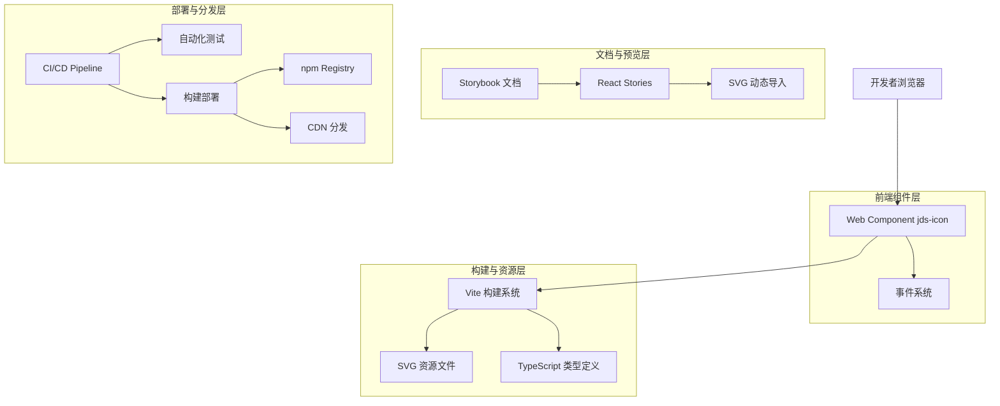
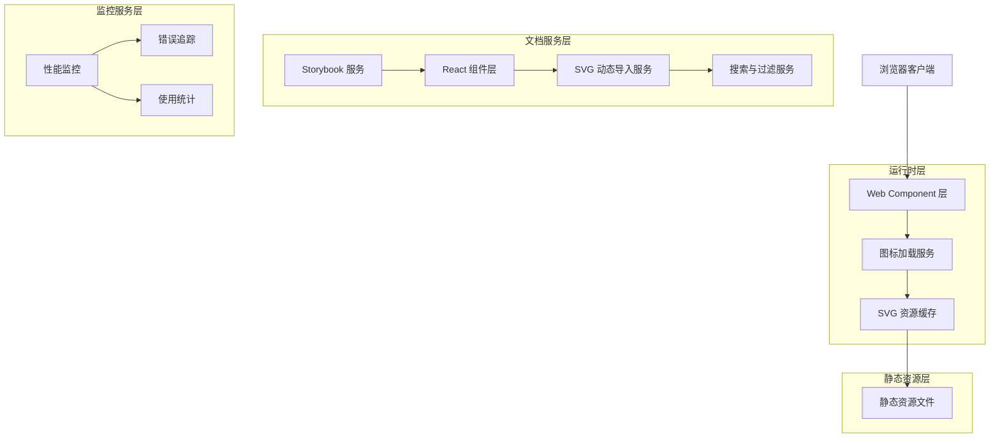
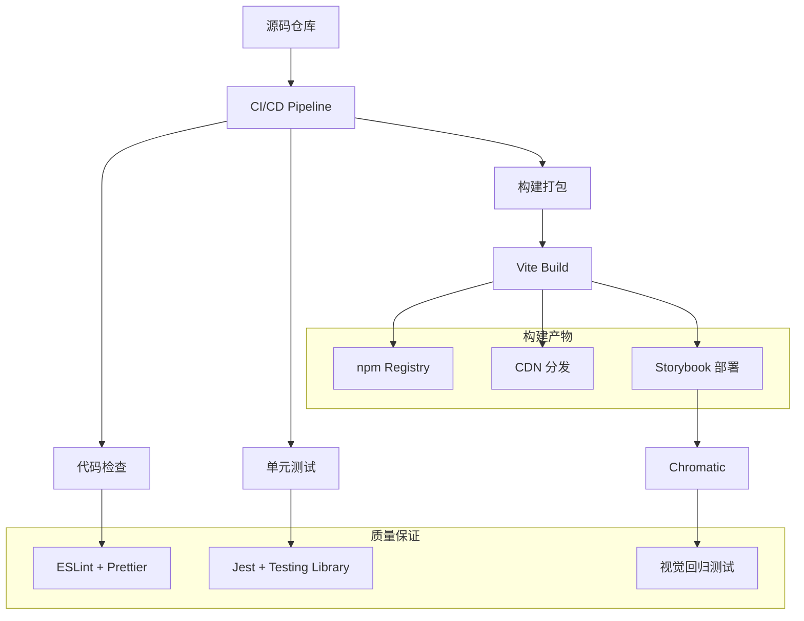
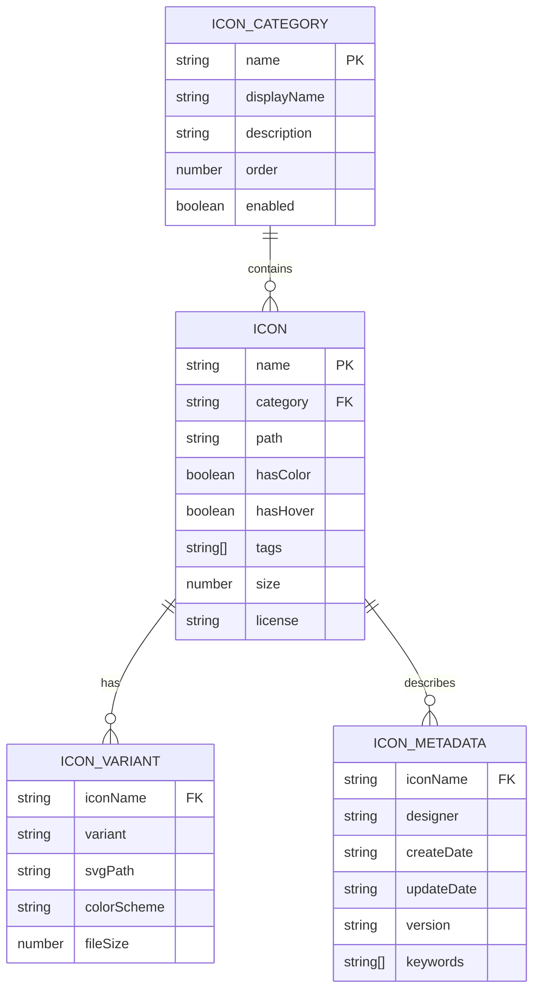
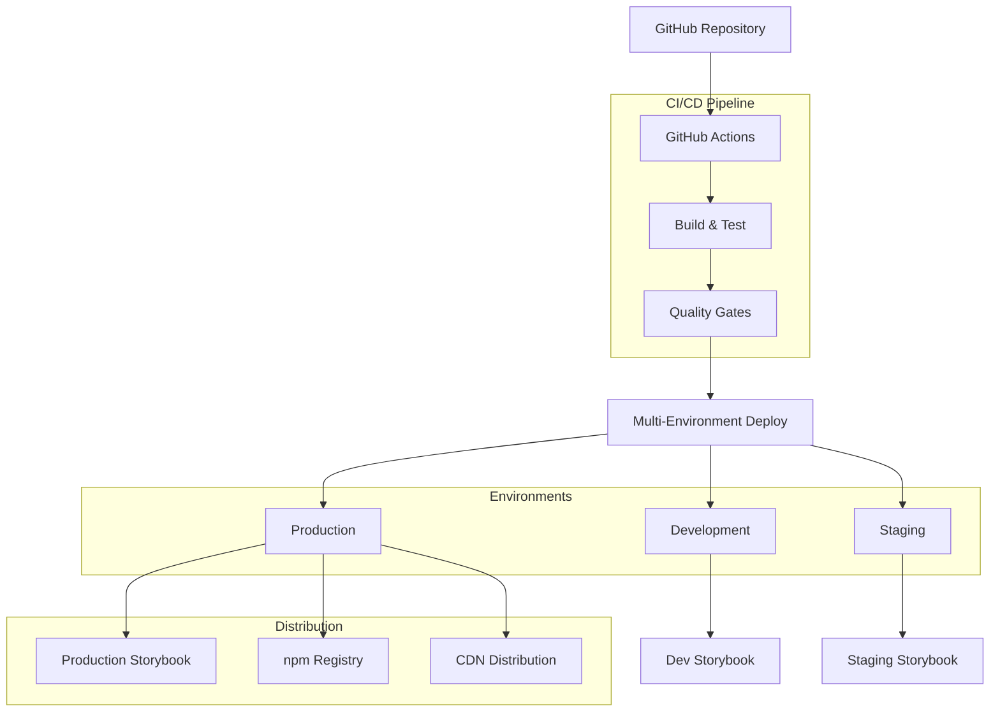

# Jackery Icons 技术架构文档

## 1. 架构设计

### 1.1 整体架构图



### 1.2 技术架构分层

#### 1.2.1 表现层 (Presentation Layer)

* **Web Component**: 基于 Lit 框架的 `<jds-icon>` 组件

* **Storybook UI**: React 组件构建的文档界面

* **响应式设计**: 支持桌面端、平板端、移动端

#### 1.2.2 业务逻辑层 (Business Logic Layer)

* **图标加载器**: 动态 SVG 加载和缓存机制

* **事件管理**: 自定义事件派发和监听

* **搜索引擎**: FlexSearch 实现的全文搜索

* **状态管理**: 图标状态和用户交互状态

#### 1.2.3 数据访问层 (Data Access Layer)

* **SVG 资源**: 静态 SVG 文件存储和访问

* **类型定义**: TypeScript 类型映射和验证

* **配置管理**: 构建配置和环境变量

#### 1.2.4 基础设施层 (Infrastructure Layer)

* **构建系统**: Vite 构建工具链

* **测试框架**: Jest + Testing Library

* **部署平台**: Chromatic + npm Registry

* **监控系统**: 性能监控和错误追踪

## 2. 技术选型分析

### 2.1 核心技术栈

* **前端框架**: Lit\@3 + TypeScript + Vite\@5

* **构建工具**: vite-plugin-dts + vite-plugin-static-copy + vite-plugin-compression

* **文档系统**: Storybook\@8 + React\@18

* **搜索功能**: flexsearch + debounce

* **测试工具**: Jest + @testing-library/dom

* **部署工具**: Chromatic (可视化回归测试)

### 2.2 技术选型对比

#### 2.2.1 组件框架选择

| 框架         | 优势          | 劣势                   | 选择原因              |
| ---------- | ----------- | -------------------- | ----------------- |
| **Lit** ✅  | 轻量级、标准化、跨框架 | 生态相对较小               | 符合 Web 标准，跨框架兼容性好 |
| React      | 生态丰富、开发体验好  | 体积较大、框架绑定            | 不适合跨框架图标库         |
| Vue        | 学习成本低、性能好   | 框架绑定、TypeScript 支持一般 | 限制使用场景            |
| Vanilla JS | 无依赖、体积小     | 开发效率低、维护困难           | 开发成本过高            |

#### 2.2.2 构建工具选择

| 工具         | 优势                   | 劣势           | 选择原因                |
| ---------- | -------------------- | ------------ | ------------------- |
| **Vite** ✅ | 快速构建、ES Module 原生支持  | 相对较新、插件生态发展中 | 现代化构建体验，性能优秀        |
| Webpack    | 生态成熟、配置灵活            | 配置复杂、构建速度慢   | 过于复杂，不适合库项目         |
| Rollup     | 专为库设计、Tree-shaking 好 | 配置复杂、开发体验一般  | Vite 基于 Rollup，体验更好 |
| Parcel     | 零配置、简单易用             | 定制性差、插件生态小   | 不适合复杂构建需求           |

### 2.3 架构设计原则

#### 2.3.1 设计原则

* **单一职责**: 每个模块只负责一个特定功能

* **开放封闭**: 对扩展开放，对修改封闭

* **依赖倒置**: 依赖抽象而非具体实现

* **接口隔离**: 使用小而专一的接口

* **最少知识**: 模块间耦合度最小化

#### 2.3.2 性能原则

* **按需加载**: 只加载使用的图标资源

* **缓存优先**: 多级缓存策略提升性能

* **懒加载**: 延迟加载非关键资源

* **压缩优化**: SVG 和代码压缩最小化体积

## 3. 路由定义

### 3.1 Storybook 路由结构

| 路由                                          | 用途                       | 组件                         | 权限 |
| ------------------------------------------- | ------------------------ | -------------------------- | -- |
| `/storybook`                                | Storybook 主页，展示所有图标组件和文档 | App.tsx                    | 公开 |
| `/storybook/?path=/story/icons--system`     | 系统图标分类页面                 | SystemIcons.stories.tsx    | 公开 |
| `/storybook/?path=/story/icons--social`     | 社交媒体图标分类页面               | SocialIcons.stories.tsx    | 公开 |
| `/storybook/?path=/story/icons--appliance`  | 家电图标分类页面                 | ApplianceIcons.stories.tsx | 公开 |
| `/storybook/?path=/story/icons--member`     | 会员系统图标分类页面               | MemberIcons.stories.tsx    | 公开 |
| `/storybook/?path=/docs/introduction--docs` | 使用文档和 API 说明             | Introduction.mdx           | 公开 |
| `/storybook/?path=/docs/design-guide--docs` | 设计规范和最佳实践                | DesignGuide.mdx            | 公开 |
| `/storybook/?path=/docs/changelog--docs`    | 版本更新日志                   | Changelog.mdx              | 公开 |

### 3.2 组件内部路由

```typescript
// 图标动态加载路由
const ICON_ROUTES = {
  system: '/icons/system/{name}.svg',
  social: '/icons/social-media/{name}.svg',
  appliance: '/icons/appliance/{name}.svg',
  member: '/icons/member/{name}.svg'
} as const;
```

## 4. API 定义

### 4.1 核心组件 API

#### 4.1.1 jds-icon Web Component

**属性配置 (Properties)**

| 参数名称       | 参数类型              | 默认值            | 是否必需  | 描述                    |
| ---------- | ----------------- | -------------- | ----- | --------------------- |
| name       | string            | -              | true  | 图标名称，使用 kebab-case 命名 |
| hover-name | string            | -              | false | 悬停时显示的图标名称            |
| size       | string            | 'inherit'      | false | 图标尺寸，支持 CSS 单位        |
| color      | string            | 'currentColor' | false | 图标颜色，支持 CSS 颜色值       |
| loading    | 'lazy' \| 'eager' | 'lazy'         | false | 加载策略                  |
| aria-label | string            | -              | false | 无障碍标签                 |
| title      | string            | -              | false | 图标标题，用于 tooltip       |

**事件定义 (Events)**

| 事件名称      | 事件类型        | 触发时机      | 事件载荷                                                    |
| --------- | ----------- | --------- | ------------------------------------------------------- |
| jds-load  | CustomEvent | 图标加载成功时触发 | `{ name: string, category: string, timestamp: number }` |
| jds-error | CustomEvent | 图标加载失败时触发 | `{ name: string, error: Error, timestamp: number }`     |
| jds-hover | CustomEvent | 鼠标悬停时触发   | `{ name: string, hoverName?: string }`                  |
| jds-click | CustomEvent | 点击图标时触发   | `{ name: string, event: MouseEvent }`                   |

**方法定义 (Methods)**

| 方法名称          | 参数 | 返回值              | 描述       |
| ------------- | -- | ---------------- | -------- |
| reload()      | -  | Promise\<void>   | 重新加载图标   |
| preload()     | -  | Promise\<void>   | 预加载图标资源  |
| getIconData() | -  | IconData \| null | 获取当前图标数据 |

**CSS 自定义属性**

| 属性名称                   | 默认值          | 描述     |
| ---------------------- | ------------ | ------ |
| --jds-icon-size        | inherit      | 图标尺寸   |
| --jds-icon-color       | currentColor | 图标颜色   |
| --jds-icon-transition  | 0.2s ease    | 过渡动画   |
| --jds-icon-hover-scale | 1.1          | 悬停缩放比例 |

**使用示例**

```html
<!-- 基础用法 -->
<jds-icon name="home-line"></jds-icon>

<!-- 悬停切换 -->
<jds-icon name="heart-line" hover-name="heart-fill"></jds-icon>

<!-- 自定义样式 -->
<jds-icon 
  name="star-fill" 
  size="24px" 
  color="#FF6B35"
  aria-label="收藏"
  title="点击收藏">
</jds-icon>

<!-- 事件监听 -->
<script>
const icon = document.querySelector('jds-icon');
icon.addEventListener('jds-load', (e) => {
  console.log('图标加载成功:', e.detail);
});
icon.addEventListener('jds-error', (e) => {
  console.error('图标加载失败:', e.detail);
});
</script>
```

### 4.2 构建配置 API

#### 4.2.1 Vite 配置

```typescript
// vite.config.ts
export default defineConfig({
  // 基础配置
  base: './',
  mode: 'production',
  
  // 路径解析
  resolve: {
    alias: [
      { find: '@', replacement: resolve(__dirname, 'src') },
      { find: '@icons', replacement: resolve(__dirname, 'src/icons') }
    ]
  },
  
  // 构建配置
  build: {
    lib: {
      entry: 'src/index.ts',
      name: 'JackeryIcons',
      fileName: (format) => `index.${format}.js`,
      formats: ['es', 'umd']
    },
    rollupOptions: {
      external: ['lit'],
      output: {
        globals: {
          lit: 'Lit'
        }
      }
    },
    sourcemap: true,
    minify: 'terser',
    terserOptions: {
      compress: {
        drop_console: true,
        drop_debugger: true
      }
    }
  },
  
  // 插件配置
  plugins: [
    // TypeScript 声明文件生成
    dts({
      insertTypesEntry: true,
      rollupTypes: true
    }),
    
    // 静态资源复制
    staticCopy({
      targets: [
        { src: 'src/icons', dest: '.' },
        { src: 'README.md', dest: '.' }
      ]
    }),
    
    // Gzip 压缩
    viteCompression({
      algorithm: 'gzip',
      ext: '.gz'
    })
  ]
});
```

#### 4.2.2 TypeScript 配置

```json
{
  "compilerOptions": {
    "target": "ES2020",
    "module": "ESNext",
    "lib": ["ES2020", "DOM", "DOM.Iterable"],
    "declaration": true,
    "declarationMap": true,
    "outDir": "./dist",
    "rootDir": "./src",
    "strict": true,
    "noUnusedLocals": true,
    "noUnusedParameters": true,
    "noImplicitReturns": true,
    "noFallthroughCasesInSwitch": true,
    "moduleResolution": "node",
    "allowSyntheticDefaultImports": true,
    "esModuleInterop": true,
    "experimentalDecorators": true,
    "emitDecoratorMetadata": true,
    "skipLibCheck": true,
    "forceConsistentCasingInFileNames": true
  },
  "include": ["src/**/*"],
  "exclude": ["node_modules", "dist", "**/*.test.ts"]
}
```

### 4.3 Storybook 配置 API

#### 4.3.1 主配置文件

```typescript
// .storybook/main.ts
export default {
  stories: ['../src/**/*.stories.@(js|jsx|ts|tsx|mdx)'],
  addons: [
    '@storybook/addon-essentials',
    '@storybook/addon-docs',
    '@storybook/addon-controls',
    '@storybook/addon-actions',
    '@storybook/addon-viewport',
    '@storybook/addon-a11y'
  ],
  framework: {
    name: '@storybook/react-vite',
    options: {}
  },
  features: {
    buildStoriesJson: true
  },
  viteFinal: async (config) => {
    config.resolve.alias = {
      ...config.resolve.alias,
      '@': path.resolve(__dirname, '../src')
    };
    return config;
  }
};
```

## 5. 服务架构图

### 5.1 运行时架构



### 5.2 构建部署架构



## 6. 数据模型

### 6.1 数据模型定义



### 6.2 数据定义语言

#### 6.2.1 图标分类定义

```typescript
// src/types/categories.ts
export const ICON_CATEGORIES = {
  system: {
    name: 'system',
    displayName: '系统图标',
    description: '通用系统界面图标',
    order: 1,
    enabled: true
  },
  social: {
    name: 'social', 
    displayName: '社交媒体',
    description: '社交平台和媒体图标',
    order: 2,
    enabled: true
  },
  appliance: {
    name: 'appliance',
    displayName: '家电产品', 
    description: 'Jackery 产品相关图标',
    order: 3,
    enabled: false // 开发中
  },
  member: {
    name: 'member',
    displayName: '会员系统',
    description: '会员等级和权益图标',
    order: 4,
    enabled: false // 规划中
  }
} as const;

export type IconCategory = keyof typeof ICON_CATEGORIES;
```

#### 6.2.2 图标类型定义

```typescript
// src/types/icons.ts
export interface IconDefinition {
  name: string;
  category: IconCategory;
  path: string;
  hasColorVariant: boolean;
  hasHoverState: boolean;
  tags: string[];
  size: number; // 文件大小 (bytes)
  license: 'MIT' | 'Apache-2.0' | 'Custom';
  variants?: {
    line?: string;
    fill?: string;
    color?: string;
  };
  metadata?: {
    designer: string;
    createDate: string;
    updateDate: string;
    version: string;
    keywords: string[];
  };
}

// 系统图标列表
export const SYSTEM_ICONS: IconDefinition[] = [
  {
    name: 'home-line',
    category: 'system',
    path: '/icons/system/home-line.svg',
    hasColorVariant: false,
    hasHoverState: true,
    tags: ['home', 'house', '首页', '主页'],
    size: 1024,
    license: 'MIT',
    variants: {
      line: 'home-line',
      fill: 'home-fill'
    },
    metadata: {
      designer: 'Jackery Design Team',
      createDate: '2024-01-15',
      updateDate: '2024-01-20',
      version: '1.0.0',
      keywords: ['navigation', 'ui', 'interface']
    }
  }
  // ... 更多图标定义
];
```

#### 6.2.3 缓存管理

```typescript
// src/utils/cache.ts
interface IconCache {
  [key: string]: {
    svg: string;
    timestamp: number;
    category: string;
    size: number;
    hits: number;
  };
}

interface CacheConfig {
  maxSize: number;
  maxAge: number; // 毫秒
  strategy: 'LRU' | 'LFU' | 'FIFO';
}

class IconCacheManager {
  private cache: IconCache = {};
  private config: CacheConfig = {
    maxSize: 100,
    maxAge: 30 * 60 * 1000, // 30分钟
    strategy: 'LRU'
  };

  getCachedIcon(name: string): string | null {
    const cached = this.cache[name];
    if (!cached) return null;
    
    // 检查过期
    if (Date.now() - cached.timestamp > this.config.maxAge) {
      delete this.cache[name];
      return null;
    }
    
    // 更新访问统计
    cached.hits++;
    cached.timestamp = Date.now();
    
    return cached.svg;
  }

  setCachedIcon(name: string, svg: string, category: string): void {
    // 缓存清理策略
    if (Object.keys(this.cache).length >= this.config.maxSize) {
      this.evictCache();
    }
    
    this.cache[name] = {
      svg,
      timestamp: Date.now(),
      category,
      size: svg.length,
      hits: 1
    };
  }

  private evictCache(): void {
    const entries = Object.entries(this.cache);
    
    switch (this.config.strategy) {
      case 'LRU':
        // 移除最近最少使用的
        entries.sort((a, b) => a[1].timestamp - b[1].timestamp);
        break;
      case 'LFU':
        // 移除使用频率最低的
        entries.sort((a, b) => a[1].hits - b[1].hits);
        break;
      case 'FIFO':
        // 移除最早添加的
        entries.sort((a, b) => a[1].timestamp - b[1].timestamp);
        break;
    }
    
    // 移除最旧的 25% 缓存
    const removeCount = Math.floor(entries.length * 0.25);
    for (let i = 0; i < removeCount; i++) {
      delete this.cache[entries[i][0]];
    }
  }

  getCacheStats() {
    const entries = Object.values(this.cache);
    return {
      size: entries.length,
      totalSize: entries.reduce((sum, item) => sum + item.size, 0),
      totalHits: entries.reduce((sum, item) => sum + item.hits, 0),
      categories: [...new Set(entries.map(item => item.category))]
    };
  }
}

export const iconCache = new IconCacheManager();
```

#### 6.2.4 搜索索引

```typescript
// src/utils/search.ts
import FlexSearch from 'flexsearch';

interface SearchIndex {
  id: string;
  name: string;
  category: string;
  tags: string;
  keywords: string;
}

class IconSearchEngine {
  private index: FlexSearch.Index;
  private documents: Map<string, IconDefinition> = new Map();

  constructor() {
    this.index = new FlexSearch.Index({
      tokenize: 'forward',
      resolution: 9,
      depth: 3,
      cache: true
    });
  }

  addIcon(icon: IconDefinition): void {
    const searchData: SearchIndex = {
      id: icon.name,
      name: icon.name,
      category: icon.category,
      tags: icon.tags.join(' '),
      keywords: icon.metadata?.keywords.join(' ') || ''
    };

    this.index.add(icon.name, [
      searchData.name,
      searchData.category,
      searchData.tags,
      searchData.keywords
    ].join(' '));

    this.documents.set(icon.name, icon);
  }

  search(query: string, limit: number = 20): IconDefinition[] {
    const results = this.index.search(query, { limit });
    return results
      .map(id => this.documents.get(id as string))
      .filter(Boolean) as IconDefinition[];
  }

  searchByCategory(category: IconCategory, query?: string): IconDefinition[] {
    const categoryIcons = Array.from(this.documents.values())
      .filter(icon => icon.category === category);

    if (!query) return categoryIcons;

    return categoryIcons.filter(icon =>
      icon.name.includes(query) ||
      icon.tags.some(tag => tag.includes(query))
    );
  }
}

export const searchEngine = new IconSearchEngine();
```

## 7. 安全性和性能考虑

### 7.1 安全性措施

#### 7.1.1 内容安全策略 (CSP)

```typescript
// 安全的 SVG 内容验证
export function sanitizeSVG(svgContent: string): string {
  // 移除潜在的恶意脚本
  const cleanSVG = svgContent
    .replace(/<script\b[^<]*(?:(?!<\/script>)<[^<]*)*<\/script>/gi, '')
    .replace(/on\w+="[^"]*"/gi, '')
    .replace(/javascript:/gi, '');
  
  return cleanSVG;
}

// SVG 内容类型验证
export function validateSVGContent(content: string): boolean {
  const svgRegex = /^<svg[^>]*>.*<\/svg>$/s;
  return svgRegex.test(content.trim());
}
```

#### 7.1.2 输入验证

```typescript
// 图标名称验证
export function validateIconName(name: string): boolean {
  const nameRegex = /^[a-z0-9]+(-[a-z0-9]+)*$/;
  return nameRegex.test(name) && name.length <= 50;
}

// 属性值验证
export function validateIconProps(props: Partial<IconProps>): boolean {
  if (props.size && !/^\d+(px|em|rem|%)?$/.test(props.size)) {
    return false;
  }
  
  if (props.color && !/^(#[0-9a-f]{3,8}|rgb|hsl|currentColor|\w+)$/i.test(props.color)) {
    return false;
  }
  
  return true;
}
```

### 7.2 性能优化策略

#### 7.2.1 资源优化

```typescript
// SVG 优化配置
export const SVG_OPTIMIZATION_CONFIG = {
  plugins: [
    'removeDoctype',
    'removeXMLProcInst',
    'removeComments',
    'removeMetadata',
    'removeTitle',
    'removeDesc',
    'removeUselessDefs',
    'removeEditorsNSData',
    'removeEmptyAttrs',
    'removeHiddenElems',
    'removeEmptyText',
    'removeEmptyContainers',
    'removeViewBox',
    'cleanupEnableBackground',
    'convertStyleToAttrs',
    'convertColors',
    'convertPathData',
    'convertTransform',
    'removeUnknownsAndDefaults',
    'removeNonInheritableGroupAttrs',
    'removeUselessStrokeAndFill',
    'removeUnusedNS',
    'cleanupIDs',
    'cleanupNumericValues',
    'moveElemsAttrsToGroup',
    'moveGroupAttrsToElems',
    'collapseGroups',
    'removeRasterImages',
    'mergePaths',
    'convertShapeToPath',
    'sortAttrs',
    'removeDimensions'
  ]
};
```

#### 7.2.2 加载性能优化

```typescript
// 预加载策略
class IconPreloader {
  private preloadQueue: Set<string> = new Set();
  private preloadedIcons: Set<string> = new Set();

  async preloadIcon(name: string): Promise<void> {
    if (this.preloadedIcons.has(name) || this.preloadQueue.has(name)) {
      return;
    }

    this.preloadQueue.add(name);
    
    try {
      const iconData = await this.loadIconData(name);
      iconCache.setCachedIcon(name, iconData.svg, iconData.category);
      this.preloadedIcons.add(name);
    } catch (error) {
      console.warn(`Failed to preload icon: ${name}`, error);
    } finally {
      this.preloadQueue.delete(name);
    }
  }

  async preloadCategory(category: IconCategory): Promise<void> {
    const categoryIcons = this.getIconsByCategory(category);
    const preloadPromises = categoryIcons.map(icon => this.preloadIcon(icon.name));
    
    await Promise.allSettled(preloadPromises);
  }

  private async loadIconData(name: string): Promise<{ svg: string; category: string }> {
    // 实现图标数据加载逻辑
    const response = await fetch(`/icons/${name}.svg`);
    const svg = await response.text();
    return { svg, category: this.getCategoryByIconName(name) };
  }
}

export const iconPreloader = new IconPreloader();
```

## 8. 部署架构和环境配置

### 8.1 部署架构图



### 8.2 环境配置

#### 8.2.1 开发环境

```typescript
// .env.development
VITE_APP_ENV=development
VITE_API_BASE_URL=http://localhost:3000
VITE_STORYBOOK_URL=http://localhost:6006
VITE_ENABLE_DEBUG=true
VITE_ENABLE_PERFORMANCE_MONITORING=false
```

#### 8.2.2 生产环境

```typescript
// .env.production
VITE_APP_ENV=production
VITE_API_BASE_URL=https://api.jackery.com
VITE_STORYBOOK_URL=https://icons.jackery.com
VITE_ENABLE_DEBUG=false
VITE_ENABLE_PERFORMANCE_MONITORING=true
VITE_CDN_BASE_URL=https://cdn.jackery.com/icons
```

### 8.3 CI/CD 配置

#### 8.3.1 GitHub Actions 工作流

```yaml
# .github/workflows/ci-cd.yml
name: CI/CD Pipeline

on:
  push:
    branches: [main, develop]
  pull_request:
    branches: [main]

jobs:
  test:
    runs-on: ubuntu-latest
    steps:
      - uses: actions/checkout@v3
      - uses: actions/setup-node@v3
        with:
          node-version: '18'
          cache: 'npm'
      
      - name: Install dependencies
        run: npm ci
      
      - name: Run linting
        run: npm run lint
      
      - name: Run type checking
        run: npm run type-check
      
      - name: Run tests
        run: npm run test:coverage
      
      - name: Upload coverage
        uses: codecov/codecov-action@v3

  build:
    needs: test
    runs-on: ubuntu-latest
    steps:
      - uses: actions/checkout@v3
      - uses: actions/setup-node@v3
        with:
          node-version: '18'
          cache: 'npm'
      
      - name: Install dependencies
        run: npm ci
      
      - name: Build library
        run: npm run build
      
      - name: Build Storybook
        run: npm run build-storybook
      
      - name: Upload build artifacts
        uses: actions/upload-artifact@v3
        with:
          name: build-files
          path: |
            dist/
            storybook-static/

  deploy:
    needs: build
    runs-on: ubuntu-latest
    if: github.ref == 'refs/heads/main'
    steps:
      - name: Deploy to npm
        run: npm publish
        env:
          NODE_AUTH_TOKEN: ${{ secrets.NPM_TOKEN }}
      
      - name: Deploy Storybook
        uses: chromaui/action@v1
        with:
          token: ${{ secrets.GITHUB_TOKEN }}
          projectToken: ${{ secrets.CHROMATIC_PROJECT_TOKEN }}
```

## 9. 监控和日志策略

### 9.1 性能监控

#### 9.1.1 Web Vitals 监控

```typescript
// src/utils/performance.ts
import { getCLS, getFID, getFCP, getLCP, getTTFB } from 'web-vitals';

interface PerformanceMetrics {
  CLS: number;
  FID: number;
  FCP: number;
  LCP: number;
  TTFB: number;
}

class PerformanceMonitor {
  private metrics: Partial<PerformanceMetrics> = {};

  init(): void {
    getCLS((metric) => this.recordMetric('CLS', metric.value));
    getFID((metric) => this.recordMetric('FID', metric.value));
    getFCP((metric) => this.recordMetric('FCP', metric.value));
    getLCP((metric) => this.recordMetric('LCP', metric.value));
    getTTFB((metric) => this.recordMetric('TTFB', metric.value));
  }

  private recordMetric(name: keyof PerformanceMetrics, value: number): void {
    this.metrics[name] = value;
    
    // 发送到监控服务
    this.sendToAnalytics(name, value);
  }

  private sendToAnalytics(metric: string, value: number): void {
    if (typeof gtag !== 'undefined') {
      gtag('event', 'web_vitals', {
        event_category: 'Performance',
        event_label: metric,
        value: Math.round(value)
      });
    }
  }
}

export const performanceMonitor = new PerformanceMonitor();
```

#### 9.1.2 图标加载性能监控

```typescript
// src/utils/icon-performance.ts
interface IconLoadMetrics {
  name: string;
  category: string;
  loadTime: number;
  cacheHit: boolean;
  fileSize: number;
  timestamp: number;
}

class IconPerformanceTracker {
  private metrics: IconLoadMetrics[] = [];

  trackIconLoad(
    name: string,
    category: string,
    startTime: number,
    cacheHit: boolean,
    fileSize: number
  ): void {
    const loadTime = performance.now() - startTime;
    
    const metric: IconLoadMetrics = {
      name,
      category,
      loadTime,
      cacheHit,
      fileSize,
      timestamp: Date.now()
    };

    this.metrics.push(metric);
    
    // 定期清理旧数据
    if (this.metrics.length > 1000) {
      this.metrics = this.metrics.slice(-500);
    }

    // 发送性能数据
    this.reportMetrics(metric);
  }

  getPerformanceStats() {
    const totalLoads = this.metrics.length;
    const cacheHits = this.metrics.filter(m => m.cacheHit).length;
    const avgLoadTime = this.metrics.reduce((sum, m) => sum + m.loadTime, 0) / totalLoads;
    
    return {
      totalLoads,
      cacheHitRate: cacheHits / totalLoads,
      averageLoadTime: avgLoadTime,
      slowestIcons: this.metrics
        .sort((a, b) => b.loadTime - a.loadTime)
        .slice(0, 10)
    };
  }

  private reportMetrics(metric: IconLoadMetrics): void {
    // 发送到分析服务
    if (window.gtag) {
      window.gtag('event', 'icon_load', {
        event_category: 'Icon Performance',
        event_label: metric.name,
        value: Math.round(metric.loadTime),
        custom_map: {
          cache_hit: metric.cacheHit,
          file_size: metric.fileSize
        }
      });
    }
  }
}

export const iconPerformanceTracker = new IconPerformanceTracker();
```

### 9.2 错误监控和日志

#### 9.2.1 错误追踪

```typescript
// src/utils/error-tracking.ts
interface ErrorReport {
  message: string;
  stack?: string;
  iconName?: string;
  category?: string;
  userAgent: string;
  timestamp: number;
  url: string;
}

class ErrorTracker {
  private errorQueue: ErrorReport[] = [];

  init(): void {
    window.addEventListener('error', this.handleGlobalError.bind(this));
    window.addEventListener('unhandledrejection', this.handleUnhandledRejection.bind(this));
  }

  trackIconError(error: Error, iconName?: string, category?: string): void {
    const errorReport: ErrorReport = {
      message: error.message,
      stack: error.stack,
      iconName,
      category,
      userAgent: navigator.userAgent,
      timestamp: Date.now(),
      url: window.location.href
    };

    this.errorQueue.push(errorReport);
    this.reportError(errorReport);
  }

  private handleGlobalError(event: ErrorEvent): void {
    this.trackIconError(new Error(event.message));
  }

  private handleUnhandledRejection(event: PromiseRejectionEvent): void {
    this.trackIconError(new Error(String(event.reason)));
  }

  private reportError(error: ErrorReport): void {
    // 发送到错误监控服务 (如 Sentry)
    if (window.Sentry) {
      window.Sentry.captureException(new Error(error.message), {
        tags: {
          component: 'jds-icon',
          iconName: error.iconName,
          category: error.category
        },
        extra: error
      });
    }

    // 发送到 Google Analytics
    if (window.gtag) {
      window.gtag('event', 'exception', {
        description: error.message,
        fatal: false
      });
    }
  }
}

export const errorTracker = new ErrorTracker();
```

***

*本技术架构文档将随着项目发展持续更新，确保架构设计与实际实现保持一致。*
